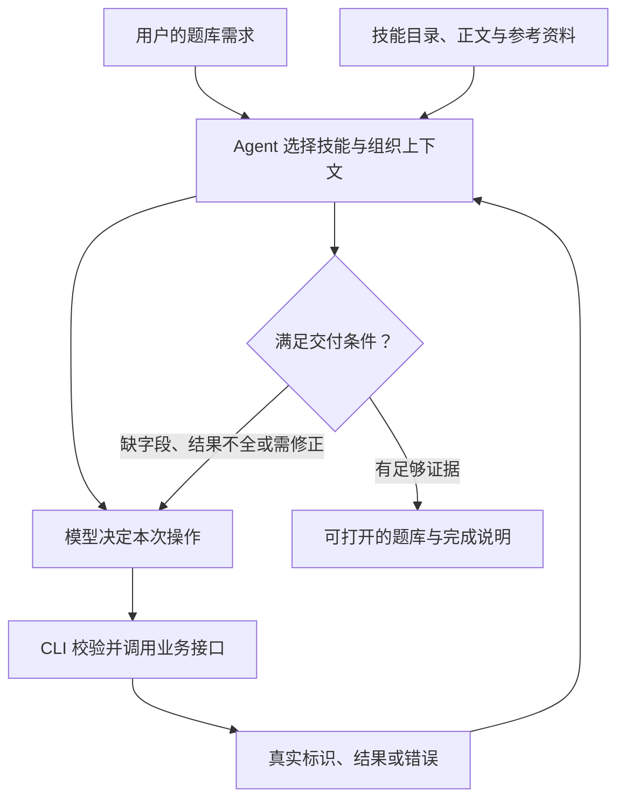

# 用“搭一个数学题库”看懂 Skill、CLI 和模型怎样配合

这是根据公开机制编写的说明性案例，**没有运行飞书，也不是豆包的真实轨迹**。任务是：“给我建一个数学题库，区分知识点、难度和审核状态，方便查看待审核题目。”用户提出目标，Agent（智能体）组织上下文和决定动作，Skill（技能包）提供领域做法，CLI（命令行工具）执行业务操作，飞书服务保存业务对象。

## 四个角色分别承担什么

| 角色 | 在这个例子里做什么 | 可以学到什么 |
| --- | --- | --- |
| 模型与宿主 Agent | 理解用户要题库，选择技能，生成操作，读结果继续推进 | 需要研究调用前消息和调用后的循环 |
| lark-base 技能 | 解释表格资源、目标定位、字段类型、记录与视图的操作规则 | 技能写具体决策依据与步骤依赖 |
| lark-cli 命令行工具 | 校验参数和身份，调用飞书接口，返回结构化结果 | 工具接口承担可执行契约 |
| 飞书业务服务 | 创建或修改真实表、字段、记录与视图 | 成功最终要体现为可访问的业务成果 |

上述分工来自[官方 CLI 说明](https://github.com/larksuite/cli/blob/017b19a793ad71794a02887ede04757f3d82e10d/README.zh.md)和[官方 Base 技能](https://github.com/larksuite/cli/blob/017b19a793ad71794a02887ede04757f3d82e10d/skills/lark-base/SKILL.md)。宿主 Agent 怎样注入技能，需要另查该宿主的实现；CLI 仓库本身不能证明豆包内部怎样调用模型。

图中验收判断是这个示例采用的宿主工作流，不表示 CLI 内置了一个叫“满足交付条件”的模型节点。

## 第一步：把需求变成有限的业务设计

本例可先建一张题目表，包含题干、答案、知识点、难度和审核状态；用“待审核”视图筛选相应题目。此处是为解释机制选的最小方案，并不是飞书强制模板。若用户还要记录每次审核、每个学生的作答，才进一步讨论独立事件表与关联关系。

这里最值得研究的不是“模型能不能列五个字段”，而是它根据什么判断应建几张表、哪些内容是静态值、哪些应由公式持续计算、哪些能力本轮不需要。用户提供的[第三方 Base 搭建指引](https://github.com/ahang1598/doubao-workbuddy-qwenwork-skills/blob/1c9239cc90585f57d9e06d32deffc017bbff5802/doubao/skills/lark-base/references/lark-base-solution-design.md)给出了业务建模和验收方法，可作为相邻来源研究；它与官方技能不是同一版本，不能混装后称为官方配置。

## 第二步：让模型读到当前这一步需要的资料

从机制上看，第一次选择技能时只需知道“有哪些技能、各自适用于什么任务”。选中 Base 后再读取正文；需要创建字段或设置视图时，再读相应参考文件。模型同时需要看到当前实际可用的执行工具、项目约束，以及用户已经给出的业务条件。

下面用一个抽象消息表解释上下文的变化。它是为教学重新编写的示意，字段并不对应豆包或任意特定厂商的真实 API 请求。

| 时刻 | 新加入模型的内容 | 尚不需要全部加入的内容 |
| --- | --- | --- |
| 选择能力 | 用户任务、宿主工作约定、可用工具、技能名称与用途 | 所有技能的完整正文 |
| 设计与准备创建 | Base 正文、字段或视图相关参考、当前身份与授权结果 | 邮件、会议等无关业务说明 |
| 创建后继续 | 工具返回的真实表格和字段标识、成功或失败明细 | 与下一步无关的全部历史返回 |
| 验收与交付 | 必要的字段、视图或记录读取结果，以及最终入口 | 没有被使用的参考章节 |

要看真实实现，可以对照 [Eino 的技能工具](https://github.com/cloudwego/eino/blob/0a5ca53b9d3bf7b661dccc863465ec568a421eea/adk/middlewares/skill/skill.go)：目录用于选择，正文通过工具返回进入上下文。这个机制可帮助理解示意表，但不能据此断言飞书的所有宿主都用 Eino。

## 第三步：工具返回的真实对象支撑后续操作

官方技能规定先定位真实业务对象；创建或查询得到的标识用于后续请求。`base_token` 是目标多维表格标识，`table_id` 是其中某张表的标识，`field_id` 是字段标识，`record_id` 是记录标识。这些值来自工具或已确认的用户上下文，不能由模型猜一个看起来像真的字符串。

如果用户给的是已有表格链接，应先解析它，确认对象类型，再决定读取或修改什么。若同名候选不唯一，应基于现有证据消歧。写入、筛选和关联需要字段类型时，补查字段结构，再构造合法参数。这些顺序来自[官方 Base 技能](https://github.com/larksuite/cli/blob/017b19a793ad71794a02887ede04757f3d82e10d/skills/lark-base/SKILL.md)，本例把它们映射到题库场景。

## 第四步：处理结果时区分成功、部分成功和等待

工具返回不只是自然语言“完成了”。飞书[错误与结果契约](https://github.com/larksuite/cli/blob/017b19a793ad71794a02887ede04757f3d82e10d/errs/ERROR_CONTRACT.md)规定用 `ok`（成功标记）或进程退出码判断状态；`error.type` 表示错误类别，`error.hint` 提供恢复建议。批量操作可能部分成功，需要查看逐项结果，而不是整批重做。

官方 Base 技能还说明一些写入异步生效：写入已成功但立即查询暂时不可见，不一定表示失败。需要最终状态证据时，应在相关变更完成后统一验收，考虑读取延迟；不要误判后重复创建。这个细节说明，业务 Skill 可以把服务的真实时序特性教给模型。

## 第五步：定义用户拿到什么，才算交付

本例的最小交付条件是：存在可打开的题库；字段与约定一致；待审核视图筛选正确；若用户提供了题目，实际记录已写入；明确哪些内容仍为空或待用户补充。示例数据只有在合适且清楚标记时才应加入，不能把编造题目冒充用户原始资料。

“题库建好”不自动意味着题目数学上正确。题目质量需要独立解题或审核证据；本例的验收只覆盖题库结构与业务操作。把平台操作成功和内容正确拆开，可以避免用一个笼统的完成标记掩盖两种不同问题。

读完这个案例，继续看[方法对照表](method-map.md)或[字节与飞书详细拆解](../cases/bytedance-lark.md)。真正可以学走的是目标定位、分层读取、工具结果传递、时序与错误处理、交付定义这条完整链。
