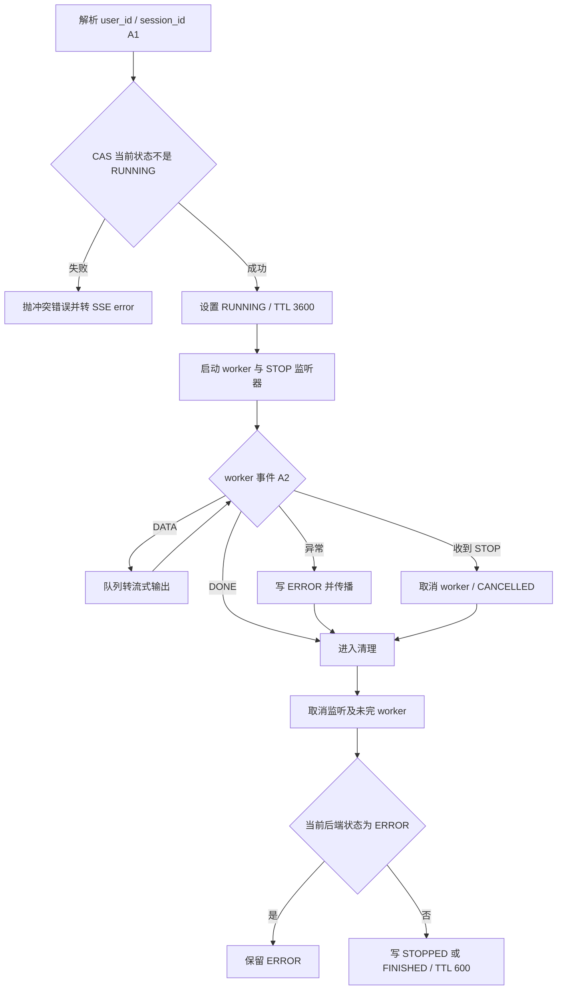
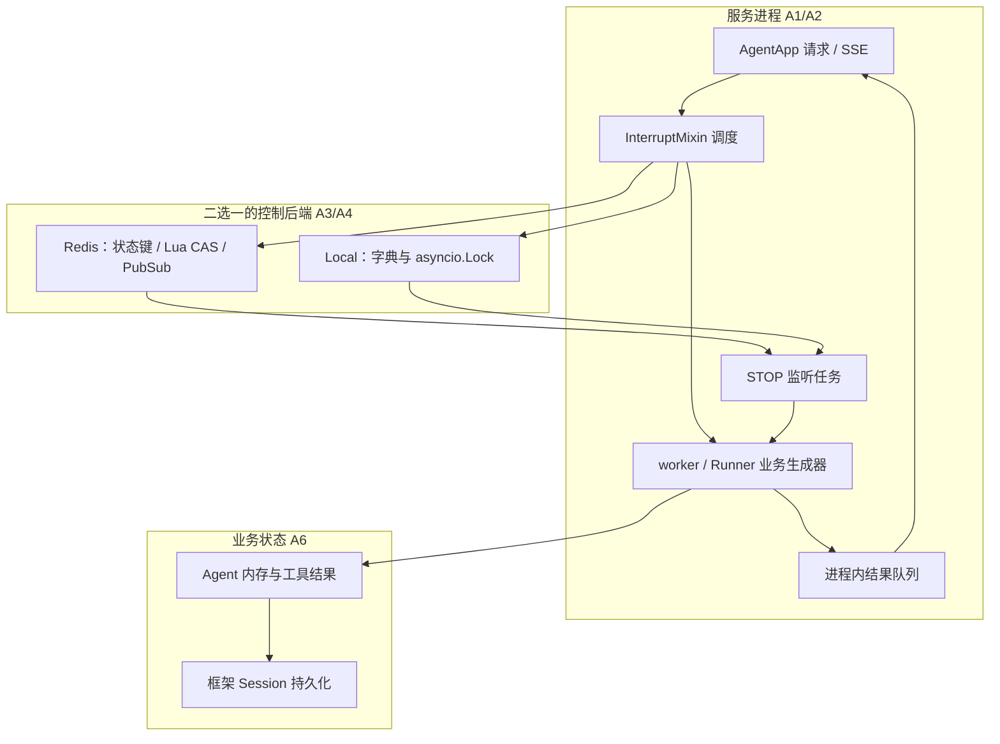

# 技术方案：AgentScope Runtime 的启动互斥、中断与状态边界

研究 ID：ASR-INTERRUPT-20261103。日期：2026-11-03。状态：为 P1-01 迁移核查提前阅读的旧实现子链，未验收 P3。固定来源：agentscope-ai/agentscope-runtime @ 22072fd7075ce0c6f43cb39509d6a14b0e60ddb5，Apache-2.0。源码静态阅读，未启动 Python 上游服务、Redis、模型或测试；不将旧实现套到 AgentScope 2.0。

## 问题与适用条件

一个用户的长任务正在生成回复，第二个请求同时到达；用户还可能要求停止。服务需要阻止同一会话重复启动，把停止信号送到实际运行的 worker，并向调用者流式返回结果。这里研究调度控制子链；模型推理、工具权限、业务成功验收和会话保存不能由这一层替代。

维护者的 v1.1.0 说明把 Runtime 自定义 Session/Memory 服务迁到 Agent 框架原生持久化；因此“运行状态存 Redis”不等于“Agent 上下文也在这个 Redis 中”。迁移公告称核心能力集成至 2.0，这是官方声明，本卡没有验证等价性。

## 原文与证据

[来源清单](../evidence/2026-11-03/source-manifest.json)记录下列完整文件的快照、哈希与阅读范围。基路径为本仓 snapshots/agentscope-ai/agentscope-runtime/22072fd7075ce0c6f43cb39509d6a14b0e60ddb5/files/。

| ID | 文件与已读范围 | 可支持的事实 | 未验证 |
| --- | --- | --- | --- |
| A1 | [agent_app.py](../../snapshots/agentscope-ai/agentscope-runtime/22072fd7075ce0c6f43cb39509d6a14b0e60ddb5/files/src/agentscope_runtime/engine/app/agent_app.py)：后端选择、四个流分发函数 | 自定义后端优先，其次 Redis URL，否则本地；请求解析成 AgentRequest 后调用 run_and_stream | HTTP 中间件、鉴权、Runner 与模型全链未读 |
| A2 | [interrupt_mixin.py](../../snapshots/agentscope-ai/agentscope-runtime/22072fd7075ce0c6f43cb39509d6a14b0e60ddb5/files/src/agentscope_runtime/engine/deployers/utils/service_utils/interrupt/interrupt_mixin.py)：全文 | 启动 CAS、worker/监听器、消息队列、停止信号及最终状态 | 真实取消、进程崩溃和消息丢失未测 |
| A3 | [base_backend.py](../../snapshots/agentscope-ai/agentscope-runtime/22072fd7075ce0c6f43cb39509d6a14b0e60ddb5/files/src/agentscope_runtime/engine/deployers/utils/service_utils/interrupt/base_backend.py)、[local_backend.py](../../snapshots/agentscope-ai/agentscope-runtime/22072fd7075ce0c6f43cb39509d6a14b0e60ddb5/files/src/agentscope_runtime/engine/deployers/utils/service_utils/interrupt/local_backend.py)：全文 | asyncio.Lock 保护内存字典的读改写，惰性 TTL 过期；队列发布订阅 | 锁不跨进程；不据注释宣称跨线程保证 |
| A4 | [redis_backend.py](../../snapshots/agentscope-ai/agentscope-runtime/22072fd7075ce0c6f43cb39509d6a14b0e60ddb5/files/src/agentscope_runtime/engine/deployers/utils/service_utils/interrupt/redis_backend.py)：全文 | Lua 将 get/compare/set EX 组合执行；Pub/Sub 传控制消息 | Redis 服务配置、持久性与故障恢复未测 |
| A5 | [test_interrupt_mixin.py](../../snapshots/agentscope-ai/agentscope-runtime/22072fd7075ce0c6f43cb39509d6a14b0e60ddb5/files/tests/unit/test_interrupt_mixin.py)：全文静态读 | Mock 后端覆盖正常、冲突、停止、异常、广播、清理分支 | 不验证实际 Redis 原子性、TTL 长任务、订阅时序 |
| A6 | [CHANGELOG v1.1.0](../../snapshots/agentscope-ai/agentscope-runtime/22072fd7075ce0c6f43cb39509d6a14b0e60ddb5/files/cookbook/en/CHANGELOG.md)：仅该版本章节 | 官方迁移解释、JSONSession 与取消后 finally 保存的教学示例 | 示例不是全局强制持久化机制 |

## 输入、输出与组件职责

AgentApp 接受 request 字典，构造 AgentRequest，取 user_id 与 session_id，交给 run_and_stream；业务生成器是 _common_stream_generator，后者调用 _runner.stream_query 并把每个 chunk 转成 SSE 的 data 行。读取到的是流适配层，不是模型提示词装配器。

任务标识由字符串 `user_id:session_id` 拼接；后端状态键是 `state:{task_id}`，控制频道是 `chan:{task_id}`。教学值 user_id=u、session_id=s 产生 state:u:s 和 chan:u:s。输入 ID 的鉴权、冒号约束与租户隔离需继续查 schema/入口，不能仅凭拼接自述“unique”就认定碰撞不可能。

运行状态包括 IDLE、RUNNING、STOPPED、FINISHED、ERROR。控制信号枚举还列 PAUSE、RESUME，但已读监听器只处理 STOP，不能因此声称暂停与恢复已实现。worker 的 DATA、DONE、CANCELLED、ERROR 是进程内队列消息，和用户看到的文档/任务是否正确不是同一个状态维度。

## 流程图

以下还原 A1—A4 的正常和已捕获异常路径；后端操作自身抛错等情况并不保证走完整清理。

## 架构图

控制后端归属调度标记和消息；业务层归属模型上下文与恢复数据。图中的 Session 箭头源于官方迁移示例的应用逻辑，不表示 InterruptMixin 自动保存。用户工具调用、权限和副作用都发生在未完整展开的 Runner/Agent 层。

## 状态、上下文与执行契约

入口以 negate=True 做 CAS：只要当前状态不是 RUNNING 就设为 RUNNING，TTL 3600 秒。因此无状态、FINISHED、STOPPED、ERROR 都可再启动。CAS 成功后 worker 再写一次 RUNNING；内存后端用 time.time 与惰性失效，Redis 用 SET EX。两种后端共享接口，但运行环境不同：本地实例的锁不能阻止另一进程的实例同时执行；Redis 方案要求各进程访问相同状态空间。

监听器收到 STOP 后调用 worker.cancel。stop_chat 仅发布 STOP，不等待 STOPPED，不确认所有副作用结束。监听任务在 worker 创建后异步启动，代码没有订阅就绪握手；若发布早于订阅，存在丢信号窗口的推断，需可控时序验证。枚举有 PAUSE/RESUME 不意味着有重启旧调用栈的实现。

正常生成完后传 DONE；取消设置 is_interrupted 并传 CANCELLED；普通 Exception 写 ERROR 并传 ERROR。finally 关闭生成器、取消监听和未完 worker，然后读取后端状态；若不是 ERROR，写 STOPPED 或 FINISHED，TTL 600 秒。这个“先 get 后 set”不是带 owner/代次的 CAS。已读代码也没见持续续租。

A6 示例在 query 内创建 Agent、加载 JSONSession、流式运行；捕获 CancelledError 后调用 agent.interrupt 并重新抛出，最后在 finally 保存。它说明恢复需要应用显式接线；加载失败发生在示例 try 之前，不能把“finally 保存”扩大成任意初始化失败也有快照。模型 system prompt、工具和持久化策略由应用构造，不由中断后端提供。

本轮没有读完业务工具实现和部署鉴权。STOP 不撤销已提交的邮件、文件写或外部交易；FINISHED 也只说明生成路径正常结束，不是外部业务验证器。此处没有可证实的 exactly-once（恰好执行一次）保证。

## 验收、反例与上游测试边界

| 检查场景 | 当前能支持的判断 | 下一步需要的证据 |
| --- | --- | --- |
| 同 key 在有效 RUNNING 状态中重复启动 | CAS 失败并抛 RuntimeError；AgentApp 流包装捕获后输出 error | 两实例同 Redis 的实际并发记录 |
| 任务运行超过最后一次 RUNNING 写入后 3600 秒 | 状态可能过期，而旧 worker 仍存活 | 虚拟时钟/缩短 TTL 的受控实验 |
| 过期后第二任务启动，旧任务先结束 | 旧任务可能读到新 RUNNING 后写 FINISHED，影响新任务标记 | 带事件时间线的故障注入 |
| stop_chat 调用返回 | 只能说明发布调用完成，不能证明业务已停 | STOPPED 确认、worker 完成及副作用清单 |
| 流中出现 error 数据 | 不能只以连接建立或流正常关闭认定业务成功 | 客户端解析结果与业务验收规则 |
| 单元测试 test_concurrency_conflict 通过 | 测试直接把 Mock CAS 返回值设为 false | 不证明真实后端竞态、锁期限或进程隔离 |

后两种 TTL 情况是从固定源码构造的反例条件，并非已复现事故。具体序列：t0 任务 A 获得 RUNNING；t0+3601 标记已过期但 A 未结束；B 对同 key CAS 成功；A 清理时看到 B 的 RUNNING，写成 FINISHED。若没有外部更短超时、续租或其他约束，这会削弱启动互斥。应核查上层是否提供这些约束，不能仅凭本卡断言所有部署都有实际缺陷。

## 横向比较与替代设计

同一个“旧状态下重复执行”问题，比较 [Lark 文档更新](lark-update-conflict-contract.md)的版本字段、Runtime 两种后端，以及本仓建议：

| 实现 | 保护对象 | 原子边界 | 代价/限制 |
| --- | --- | --- | --- |
| Lark docs +update | 远端文档 revision | 服务端解释；客户端只传值 | 服务端条件语义未证，不保护宿主重复任务 |
| Runtime Local | 本地任务状态 | 同实例 asyncio.Lock 内读改写 | 无 Redis 依赖，不能跨进程 |
| Runtime Redis | 共享任务状态 | Lua 内 get/compare/set | 需要 Redis；任务 TTL 与业务执行时间必须协调 |
| 本仓建议：租约加执行代次 | 运行所有权及旧 worker 写回 | 获取、续租、释放均核对 owner/generation | 复杂度增加；仍需外部工具幂等或结果核对 |

建议方案不是上游功能。仅增加心跳也不够：旧 worker 失联后恢复可能继续产生副作用，还需受保护资源识别过时代次或提供幂等键。这里没有测得吞吐或可靠性收益。

## 学习练习

未运行。用独立内存模型和可推进的假时钟重演 t0、t0+3601、B 启动、A 结束四步，打印每步 key、owner、state。先按当前“只存状态”契约观察旧 A 能写回，再添加 generation 检查，预期旧 A 的释放被拒绝。该实验只验证教学模型，不计上游实跑或复现。

后续若运行真实受控实验，使用本地 Redis、无模型、只 yield 假数据的生成器；检查重复启动、订阅前 STOP、生成器异常与消费者提前断流。禁止调用真实外部业务工具。还需审阅上游测试和运行依赖再决定执行方式。

## 接续事项

优先为 P1-01 完成 AgentScope 2.0 的模块映射与版本备份影响核查。旧代码发现的 TTL、订阅时序、key 约束与 generation 问题作为迁移核查清单，不直接宣布新实现仍有相同问题。P3 后续再追完整 Runner→模型→工具→Session 链及业务验证器。
