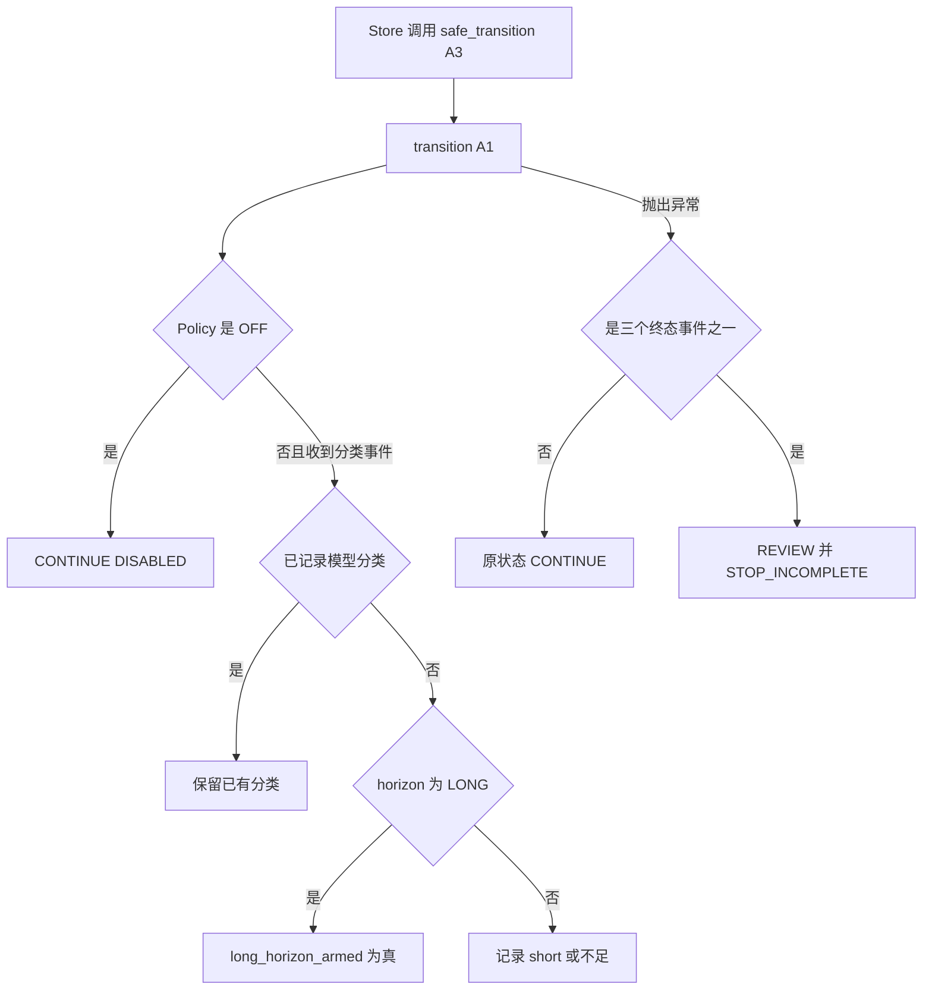
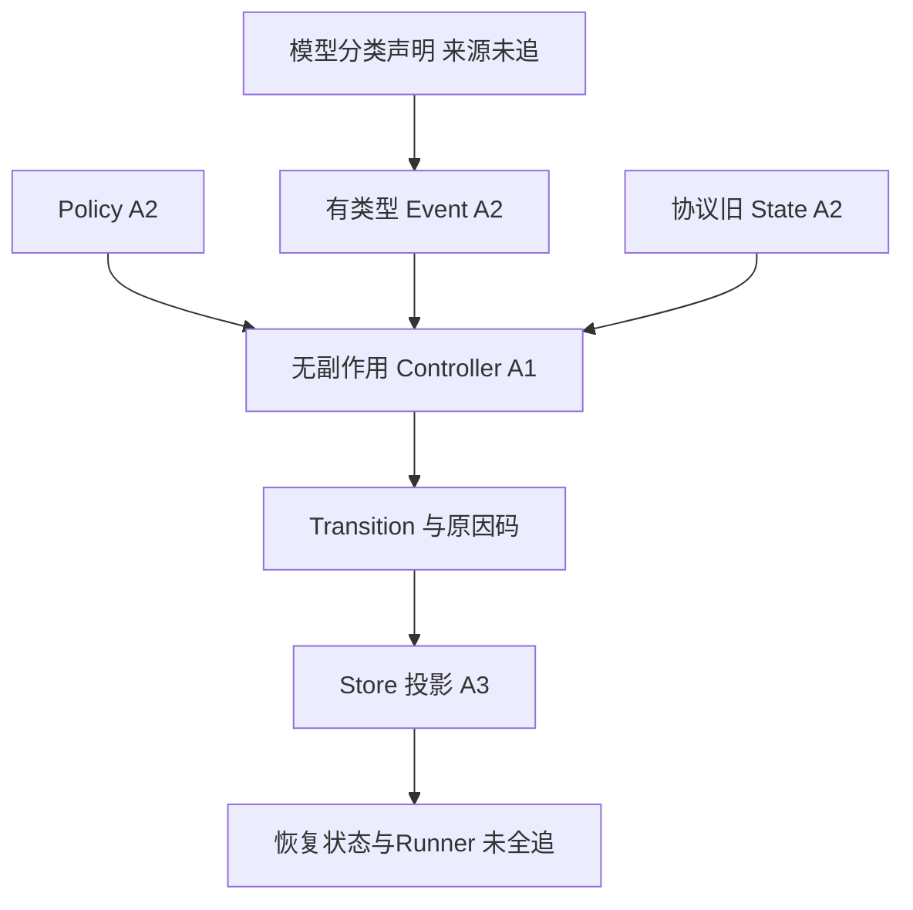

# AWorld：控制器异常与模型的长任务声明

2026-11-22，固定冻结版 `82af4062e29e128910afa8622c866f4b99a4d23d`。接续 long-running-agent 的传递依赖。仅源码静态核对；未启动上游、模型、故障实验或测试。

## 问题、原文与输入输出

模型声明“长任务”之后，控制器是否重新按置信度判定？控制逻辑异常时是否仍允许提交？本卡追 safe_transition 与初始化/模型分类分支，其余完整审查状态机尚未验收。

| ID | 固定原文 | 已读范围 |
| --- | --- | --- |
| A1 | [controller.py](https://github.com/inclusionAI/AWorld/blob/82af4062e29e128910afa8622c866f4b99a4d23d/aworld/core/execution_protocol/controller.py) | safe_transition全文；transition的类型检查、OFF和MODEL_EXECUTION_PROFILE分支 |
| A2 | [models.py](https://github.com/inclusionAI/AWorld/blob/82af4062e29e128910afa8622c866f4b99a4d23d/aworld/core/execution_protocol/models.py) | Mode/Horizon/Phase枚举；Policy默认字段、Event定义/部分校验、State字段 |
| A3 | [前次存储卡](aworld-protocol-persistence-boundary.md) | 调用safe_transition的适配层；并非完整Runner已读 |

两份大文件整文件归档，阅读只限表中范围；[证据](../evidence/2026-11-22/source-review.json)明确边界。输入为 State、Event、Policy，输出 Transition(state, decision)，不调用模型或工具；事件生成与结果装回模型仍需Runner证据。

## 流程图

## 架构图

## 状态归属与真实分支

Policy类默认 mode=OFF，但注释明确 LLMAgent 在调用方省略时提供活动默认值；不能据数据类默认就声称CLI默认关闭。OFF分支不追加事件，返回旧状态与DISABLED。非OFF先append_event，history_limit限定记录，具体事件计数与序列化未完整核。

MODEL_EXECUTION_PROFILE首次记录模型profile，只要 horizon为LONG就armed；该分支没有用confidence、milestone_count或expected_tool_actions再做阈值裁决。短或未知分别记录原因，已存在profile时不在此分支重写。Policy虽然列出置信度和动作阈值字段，也不能反推这里使用了它们。armed只代表执行控制状态，不代表任务一定需要多步或结果正确。

safe_transition先调用transition，捕获Exception。合法类型事件为CANDIDATE_FINAL、REVIEW_RESULT、TERMINAL_FALLBACK_SUBMIT之一时，设置phase=REVIEW、review_pending=false、terminal_incomplete=true、finalization_entered=true，返回STOP_INCOMPLETE和CONTROLLER_ERROR；普通异常返回原state与CONTINUE。它不保存状态，仍要进入Store保存流程。

这个兜底以有效State为前提：终态分支用dataclasses.replace(state, ...)，如果传入不合格对象，replace自身仍可能抛异常；不能宣传成“所有输入都永不崩溃”。Event对象构造也有类型/字段校验，构造前失败是否被捕获要查调用方，不凭wrapper名字保证。上述是静态反例推断，未注入故障。

## 权限、副作用与恢复验收

已读控制器分支是纯状态转换，无网络或业务权限。它返回CONTINUE不等于工具获授权，STOP_INCOMPLETE不等于外部副作用回滚；恢复须保留具体原因和已有产物。异常来源、工具执行状态和持久化是否成功是三个不同记录。

| 条件 | 预期控制含义 | 不能推广 |
| --- | --- | --- |
| 类型正确，mode OFF | 旧状态与DISABLED | 实际宿主也OFF |
| 首次LONG声明 | armed | 分类正确或成功验收 |
| 普通事件转换异常 | CONTINUE，旧状态 | 原动作已成功 |
| 三个终态事件转换异常 | 终态未完成，STOP_INCOMPLETE | 写回一定已成功 |
| 错误State进入终态兜底 | replace仍可能失败 | wrapper对任意对象安全 |

与 [MiniMax校验器](minimax-skill-review-validator-boundaries.md)比较，二者都需要清楚区分默认放行与已经验证。MiniMax检查静态内容，AWorld按事件性质限制提交；普通工作保可用与最终结论需证据是两类选择。替代设计可先规范化State并给兜底输出做独立类型校验，但仍要处理持久化失败；本仓建议，尚无收益实验。

## 学习练习与下一步

未运行练习：合法假State下，把普通事件和三个终态事件分别送到“总抛异常”的假转换器，观察返回状态；再输入无效State，区分wrapper异常和转换异常。把低confidence但LONG的profile与OFF策略对照，检查谁决定armed，勿接入真实业务。

下一小批追真实Runner如何生成Event/构造Policy、失败回传与取消，并读模型计划/最终复核的其余分支。完整协议与技能整组仍未验收，不能据两份大文件已备份称全文已学完。
