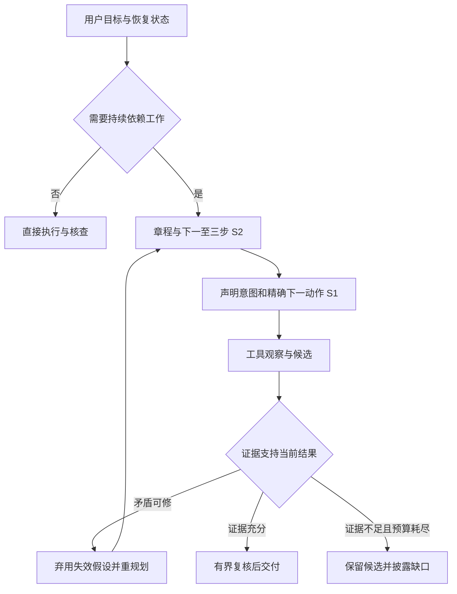
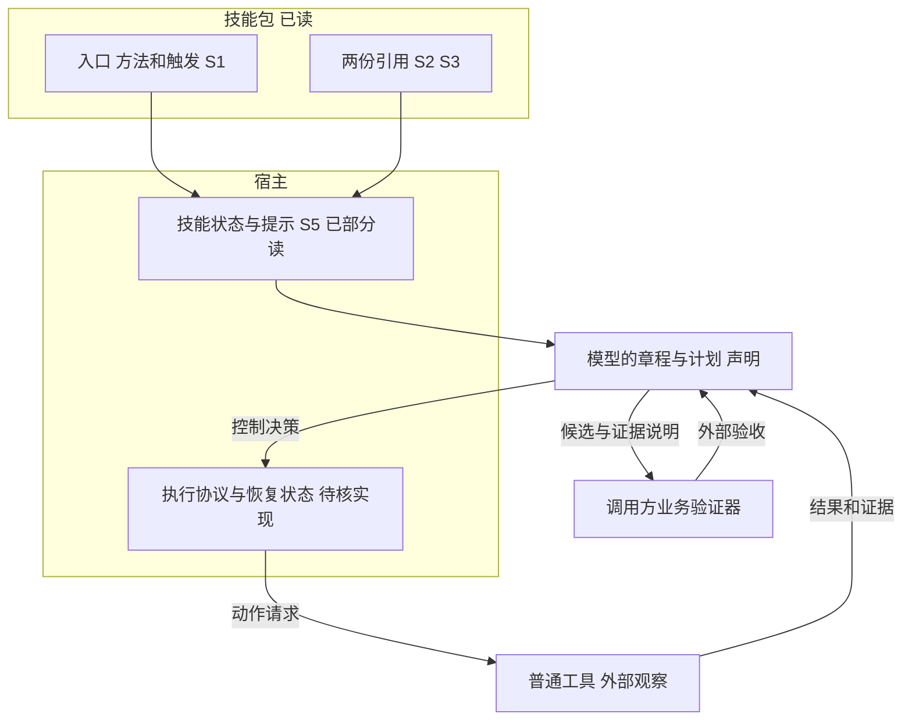

# AWorld 长任务技能：滚动计划与证据恢复

研究 ID：SKILL-AWORLD-LONG-20261120。2026-11-20。冻结组 `69472b4e8d888820e251fa10180933be9e2963447b6d615033d76c39682867d4`，唯一 occurrence `88db3ba554f3e23ef7f1b3e5`。完整阅读入口和两份直接引用；宿主部分静态核对，传递依赖未完成，未实跑。新版是同来源版本增量，不替换冻结组，也不新增冻结分母。

## 问题与适用条件

持续工具操作、多个依赖里程碑或反复重规划时，摘要容易把“计划做”“已经观察”“已经验证”混成成功。该技能把工作章程、当前里程碑、下一至三步计划和证据分别记录；短任务不因启用了技能就强制造计划。适合需恢复的研究、编程与文档产物任务，不能代替业务验证器。

## 原文与证据

O 固定为 `82af4062e29e128910afa8622c866f4b99a4d23d`，N 固定为 `bef598fcfb60da988c2660cafcf0d45f0128e8bf`。记录 [occurrence 证据](../evidence/2026-11-20/long-running-skill.json)，[冻结快照清单](../../snapshots/inclusionAI/AWorld/82af4062e29e128910afa8622c866f4b99a4d23d/manifest.json)。

| ID | 固定原文与完整阅读范围 | 结论种类与边界 |
| --- | --- | --- |
| S1 | [O/SKILL.md](https://github.com/inclusionAI/AWorld/blob/82af4062e29e128910afa8622c866f4b99a4d23d/aworld-skills/long-running-agent/SKILL.md) | 官方提示契约；入口12810字节，并非运行时实现 |
| S2 | [O/execution-semantics.md](https://github.com/inclusionAI/AWorld/blob/82af4062e29e128910afa8622c866f4b99a4d23d/aworld-skills/long-running-agent/references/execution-semantics.md) | 章程、里程碑、计划、证据的定义 |
| S3 | [O/checkpoints-and-review.md](https://github.com/inclusionAI/AWorld/blob/82af4062e29e128910afa8622c866f4b99a4d23d/aworld-skills/long-running-agent/references/checkpoints-and-review.md) | 恢复顺序、typed delivery、旧终审契约 |
| S4 | [N/入口](https://github.com/inclusionAI/AWorld/blob/bef598fcfb60da988c2660cafcf0d45f0128e8bf/aworld-skills/long-running-agent/SKILL.md)、[N/复核引用](https://github.com/inclusionAI/AWorld/blob/bef598fcfb60da988c2660cafcf0d45f0128e8bf/aworld-skills/long-running-agent/references/checkpoints-and-review.md) | 用全文差分核读新增 reviewer value lease；运行时未核 |
| S5 | [O/提示器](https://github.com/inclusionAI/AWorld/blob/82af4062e29e128910afa8622c866f4b99a4d23d/aworld/core/context/amni/prompt/neurons/skill_neuron.py)、[O/SkillService](https://github.com/inclusionAI/AWorld/blob/82af4062e29e128910afa8622c866f4b99a4d23d/aworld/core/context/amni/services/skill_service.py) | 读正文/激活状态实现；不包含完整执行协议 |

## 输入、输出与组件职责

真实输入包括用户目标和约束、运行时给出的 checkpoint/review、工具 Observation、已有候选与反馈。技能要求模型输出 `__aworld_execution_profile` 和 `__aworld_plan_update`；前者含 horizon、confidence、milestone_count、expected_tool_actions、verification_required，后者记录当前里程碑、下一动作、验证计划、假设、弃用方案、证据引用和候选身份。字段来自提示契约，本批未验证实际工具 schema。

五种 delivery_intent 为 continue_exploration、produce_candidate、validate_candidate、submit_current、submit_uncertain。前三者要求 next_action_tool 为精确函数名，next_action_arguments 为完整参数对象的 JSON **字符串**，均非 null；后两者两字段必须都是 null，进入无工具收尾。官方提示要求运行时剥离控制字段、规范化后留 SHA256，不保存声明动作的原始参数。本批没有读到底层签名与遥测代码，故这项仍是待核承诺。

章程是当前用户请求的解释；里程碑是应有外部证据的阶段结果；计划只保留下一至三步；证据标为 observed、inferred、claimed、unknown。模型负责方法选择和调整；宿主声称负责协议状态、复核调度与修复策略；业务工具执行和外部验收属于另一边界。

## 流程图

图按 S1—S3 还原**提示要求**，不表示已运行或实现已验收。

## 架构图

## 状态、上下文与执行契约

恢复以新直接观察、未失效旧观察、有依据推断、计划和复核声明排序。摘要只作定位索引；命令成功不自动证明任务成功，已完成动作列表也不证明里程碑成功。一次修改可能让先前验证过期，需要重新观察受影响部分。

技能要求首次控制工具记录执行分类；错误格式重提有次数边界，fail-open 后可能以 unknown/unacknowledged 继续普通工具。不能将此解释为短任务、已验收或无权限限制。deadline 是机械停止边界，复核修复仍用原预算；review 不发新预算。具体次数、持久存储、崩溃恢复原子性和工具取消本批未读实现。

权限与副作用：控制声明按文档不修改用户状态；后续普通工具仍可能写文件、调用业务。技能建议在消费唯一输入前做只读检查或可恢复备份，但建议不等于宿主强制。独立 reviewer、evaluator、developer 只在可改变决策时使用；可用不等于必须委派。技能内容是研究对象，不构成本次研究的委派授权。Workbench 是另选的候选管理组件，不是所有任务的前置依赖；评测隐藏答案也不应进入普通任务证据。

S5 的旧提示器把主动技能正文纳入 usage；同版服务将描述、staging、loaded cache 和 active 分开。它们只证明文本可进入上下文，不证明 execution_decision、签名和复核按入口承诺工作。新版提示器修正工具名、转义/XML 包装与方法权限说明；不能把它当作冻结宿主的等价副本，详见[激活卡](aworld-skill-activation-attestation.md)。

## 验收和反例

| 要求 | 合格证据 | 容易误判 |
| --- | --- | --- |
| 里程碑完成 | 对应工具观察证明结果 | 计划步骤全勾选 |
| 提交动作 | 两个下一动作字段均 null，明确候选状态 | 把空字符串当 null |
| 工具动作 | 名称和完整 JSON 字符串参数符合提供的工具 | prose 命令或原生 object |
| 新产物有效 | 新候选对应的当前验证 | 复用修改前的通过 |
| 复核 ready | 仅支持复核者这样判断 | 当成外部评分通过 |
| 尝试次数耗尽 | 准确停止、保留候选与缺口 | 当成目标完成 |

对“入口相同就可复用完整结论”的反证：本包直接引用也是执行方法的一部分。本批冻结 O 与 N 的 execution-semantics 字节相同，但入口与 checkpoints-and-review 都已改变，宿主提示器也不同；三项不同不能靠一份相同引用证明整包等价。

## 横向比较与选择

| 实现与版本 | 复核何时发生 | 验证权限与重试边界 | 本批证据 |
| --- | --- | --- | --- |
| O 冻结技能 | active 时每个候选做同类最终复核，short/unknown 也涵盖 | ready/repairable/uncertain；在原预算内修复，复核失败保留结果 | 提示全文，运行协议待核 |
| N 版本增量 | 仅 armed long、有真实候选、存在未闭合公开义务时提供 lease | 一候选代次一断言；一次独立工具验证，只有观察到矛盾才一次修复和再验证；ready 仍是建议 | 新旧全文差分；实现待核 |
| [飞书高风险确认](lark-confirmation-argv-contract.md) | 写入前需要确认，dry-run 分支另行处理 | 授权允许执行，不证明写入业务正确；回放还要保留输入 | 先前固定 service 静态链 |

三者处理“声明能否推进状态”的不同门槛。AWorld 计划与 reviewer 不提供业务权限；飞书 --yes 不提供质量证明。本仓建议将授权、执行、验证分别留证据。复杂复核会消耗时间，短任务可直接核查；本批没有收益、成本或成功率实测，不能承诺更快、更准。

## 学习练习

未运行：给一个假 CSV 汇总任务，公开要求“合计与源数据一致”。制作候选 A 后记录 observed 验证；再改一个输入生成 B，只把旧通过结论复制过去。要求恢复者识别证据过期，先做一个可区分 A/B 的只读核查。分别填写 continue_exploration 和 submit_uncertain 的 JSON/null 字段；再模拟 reviewer ready 但校验合计错误，观察哪个证据应阻止成功声明。练习只用合成文件，不调用模型或业务 API。

## 接续事项

冻结目录3/3完整阅读，**整包研究尚未验收**：需沿 O 的 execution_protocol controller/models/store、runner 与实际 schema 核对控制字段、签名、恢复、review 和验证器，另核可选 Workbench/协作者条件。N 的 reviewer lease 留在版本增量，不覆盖冻结 O 状态。lark-doc/lark-shared 原有宿主与 SDK 待办继续保留。
