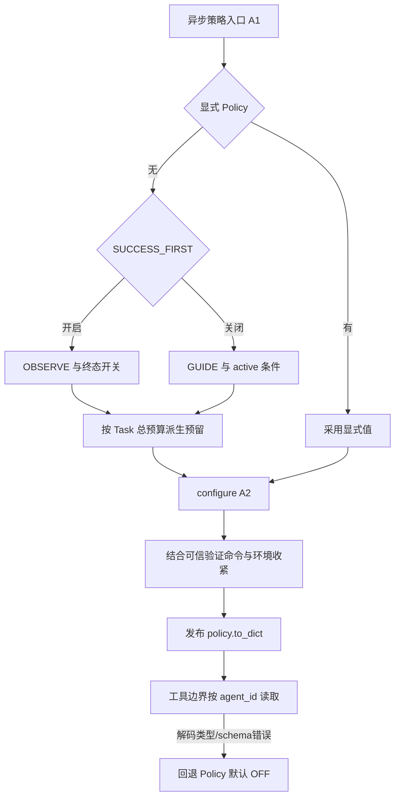
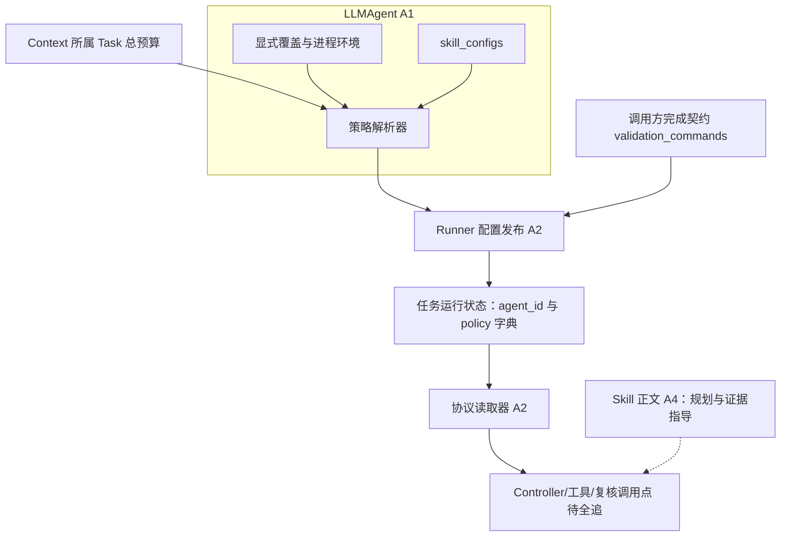

# AWorld：策略默认值如何真正进入运行时

2026-11-24；冻结版 `82af4062e29e128910afa8622c866f4b99a4d23d`；接续 long-running-agent 内容组 `69472b4e…67d4`，出现路径 ID `88db3ba554f3e23ef7f1b3e5`。源码静态核对、无模型/上游代码/实验执行。不是新入口组，也不增加完整依赖验收数。

## 问题与证据

Policy 数据类默认 OFF、Skill 标记 active、普通 LLMAgent 的实际配置，究竟谁决定行为？适合实现“技能指导推理、框架管理状态”的宿主，避免把配置声明误当执行门禁。

| ID | 同一固定提交原文 | 实读范围 |
| --- | --- | --- |
| A1 | [llm_agent.py](https://github.com/inclusionAI/AWorld/blob/82af4062e29e128910afa8622c866f4b99a4d23d/aworld/agents/llm_agent.py) | 环境辅助 302—342；构造参数/类型检查 690—755、854—867；策略解析 1017—1121；异步调用配置 6366—6378。大文件整体备份，其余主循环未全文学习 |
| A2 | [execution_protocol.py](https://github.com/inclusionAI/AWorld/blob/82af4062e29e128910afa8622c866f4b99a4d23d/aworld/runners/execution_protocol.py) | configure_execution_protocol 1016—1083；execution_protocol_policy 2178—2183。其余 Runner 事件/工具/终态接线未全读 |
| A3 | [models.py](https://github.com/inclusionAI/AWorld/blob/82af4062e29e128910afa8622c866f4b99a4d23d/aworld/core/execution_protocol/models.py) | Policy 默认字段 802—856、序列化字段与 from_dict 的模式/schema 入口 965—1012；前次范围保留 |
| A4 | [Skill](https://github.com/inclusionAI/AWorld/blob/82af4062e29e128910afa8622c866f4b99a4d23d/aworld-skills/long-running-agent/SKILL.md) 与其两份 references | 本批全文复读；入口+直接依赖 3/3，仍有运行时传递依赖 |
| A5 | [固定官方完成文档](https://github.com/inclusionAI/AWorld/blob/82af4062e29e128910afa8622c866f4b99a4d23d/docs/Agents/Runtime/Completion%20and%20Progress.md) | 全文；属于官方说明，未逐项验证全部承诺 |

[清单与许可](../../snapshots/inclusionAI/AWorld/82af4062e29e128910afa8622c866f4b99a4d23d/manifest.json)和[本批证据](../evidence/2026-11-24/source-review.json)保留整文件哈希、选读范围和依赖缺口。浮动官网本日也打开，内容已有更多 inline guidance / public contract ledger 描述；不把它倒灌为冻结源码事实。

## 输入、输出与真实配置真值表

输入为构造器可选 ExecutionProtocolPolicy、进程环境、skill_configs 中的 long-running-agent 字典、Context 的 Task.timeout/completion_reserve_seconds，以及调用方 completion_contract.validation_commands。解析输出是类型化 Policy；configure 再调整字段并发布为 execution_protocol_policy 运行状态，按 agent_id 读取。

| 前提（没有显式 Policy 时） | 解析出的 mode | 终态门禁/未 armed 候选复核 | 独立验收开关 |
| --- | --- | --- | --- |
| SUCCESS_FIRST 未设、空值或非假值 | OBSERVE | terminal gate 默认开；review_unarmed=false，不由 active 决定 | false |
| SUCCESS_FIRST 同上，TERMINAL_GATE=off | OBSERVE | terminal gate 关；无该路径终态预算 | false |
| SUCCESS_FIRST=off，技能 active 严格为 true | GUIDE | review_unarmed 按对应环境默认开 | 按环境默认开，再经发布过滤 |
| SUCCESS_FIRST=off，技能不 active | GUIDE | review_unarmed=false | 按环境默认开，再经发布过滤 |
| 显式传入类型正确 Policy | 保留其 mode | 先返回显式对象，不走解析器预算推导 | 发布时仍可能收紧 |
| 只构造 Policy 数据类 / 读取坏 schema 后回退 | OFF | 不能据此反推 LLMAgent 默认 OFF | 类字段不是实际已启用验证器 |

假值集合为去空白转小写后的 0/false/no/off。环境未设置或空串均算开启；active 判定是字典且 `get("active") is True`，不能把字符串 "true" 当布尔真。SUCCESS_FIRST 全名为 AWORLD_SUCCESS_FIRST；终态开关为 AWORLD_SUCCESS_FIRST_TERMINAL_GATE。GUIDE 路径的相关环境为 AWORLD_EXECUTION_PROTOCOL_REVIEW_UNARMED_CANDIDATES、AWORLD_INDEPENDENT_ACCEPTANCE_CRITIC、AWORLD_SEMANTIC_PROGRESS_LEDGER。

前次只读 Policy 注释还无法确认实际默认；本批补出默认 success-first=开，因此实际默认 OBSERVE，而 GUIDE 是关闭该开关后的分支。技能未 active 不会直接关闭协议。A4 的“每个候选同样复核”属于技能契约；上述配置分支已经表明不能仅凭 active 承诺实际每次都会产生同样的复核事件，仍需候选/Runner 调用点证据。

## 流程图

图是配置子链，不表示已经执行模型、工具或验证命令。构造器传错误类型会先抛 TypeError。

## 架构图

Skill 文本不是策略对象，进程环境不是模型消息，policy 字典不是业务产物。模型负责规划/候选判断的完整消息装配未在本子链追完；配置由普通程序决定，不能称为模型自行修改模式。

## 预算、发布与状态

默认 success-first 且终态开时，解析器设 max_final_reviews=2、max_repairs=1、初始 finalization reserve=60、candidate reserve=240、final review timeout=120 秒。这是配置上界/预留，不是保证发生两次复核，亦非新获一份任务预算。终态开关关闭时，max 值为 None、预留为零，并提前返回；不能把 None 宣传为所有流程无限重试，具体调用点未核。

有 Context 且 Task.timeout 为非 bool 的正数时，解析器从原始总时长与调用方 completion_reserve_seconds 推导预留，不每次按剩余秒数缩短。外部预留不合格则按零；get_task 异常或总时长不合格则保留原策略。最终化窗口取 review timeout（无值取45）与 15% 可用时长较小者，叠加外部预留、最少0.1秒，再受总时长钳位；候选窗口另加 min(300,max(120,总时长×10%))，同样钳位。

静态手算例，非程序运行：Task 总600秒、外部预留30秒。默认 success-first 得 finalization=115.5秒、candidate=235.5秒、review timeout=120秒。关闭 success-first 的 GUIDE 路径先得 finalization=75秒、candidate=195秒；configure 在 review timeout 未设时再算 min(180,max(60,可用时长×5%))，此例为60秒。三个字段用途不同，不能合称一个超时。

configure 不直接信任 independent_acceptance_enabled=true：它还要求 completion_contract.validation_commands 非空，并且环境没有显式假值；旧值 false 也不会被它提升为 true。仅 required artifacts 而无 validation_commands 不能通过这里的独立验收开关。semantic_progress 同样只能被环境收紧。这里只验证命令配置可用性，没有执行命令、验证来源可信度或证明结果通过。

发布以 to_dict 写运行状态，读取时 from_dict 校验类型/schema，捕获 TypeError/ValueError/KeyError 后回退 OFF。读取本身在 try 外，不能宣称任意 I/O 故障都获兜底。真正持久化、原子更新和作用域隔离仍参见[前次保存卡](aworld-protocol-persistence-boundary.md)，本批未验证跨进程恢复。

## 权限、错误、验收和对照

已读子链只构造/发布配置，未执行用户命令；业务副作用在工具和调用方明确配置的验证命令处。一个启用字段不构成新增权限。官网 A5 区分默认关闭的 generic completion contract 与 success-first 终态控制：二者是不同层，不能用“开启复核”推断“强制业务验收”。

| 可观察条件 | 支持什么 | 不支持什么 |
| --- | --- | --- |
| Skill active=true，默认环境 | success-first 配置仍 OBSERVE | active 自动切 GUIDE 或启用独立验证 |
| 显式 Policy independent=true、无验证命令 | configure 收紧为 false | Policy 创建成功即业务可验证 |
| 坏序列化 schema | 此读取分支可回退 OFF | 已修复来源或磁盘状态 |
| Task timeout=600、外部预留30 | 能静态复核预留公式 | 实际600秒内必交付正确产物 |
| max_repairs=1 | 已配有限修复次数 | 所有内外循环共只重试一次 |

对照 [JoyAgent](joyagent-tool-join-and-finish.md)：其 Executor 的模型超时与工具 latch 等待分离，AWorld 显式区分总预算、候选和最终化窗口；工程结构更可表达，但本批尚不能证明全链遵守或收益。替代方案可用单一任务 deadline 加阶段子预算，减少环境组合；代价是兼容性和迁移测试，属于本仓建议。

## 学习练习与接续

未运行练习：假 Task 与假 Context 下列出“环境未设/关闭”“active 为 bool/字符串”“有无验证命令”“显式覆盖/坏 schema”的输入矩阵，记录解析值和发布值；先不调用模型、shell或服务。观察显式对象与发布字典是否不同，以及回退 OFF 是否应被报告为配置降级。

下一步追候选决策/复核/修复的实际事件回传、真实 Context registry 与 CLI 构造参数；完整 llm_agent、Runner、Controller 仍未全文读完。Workbench/协作者为条件性能力，未验证宿主。冻结组保持 dependency/host partially_reviewed、in_progress、not_run；直接目录3/3只代表这三份材料已读。
