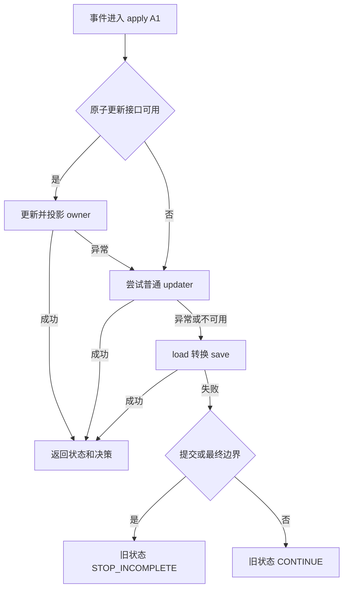
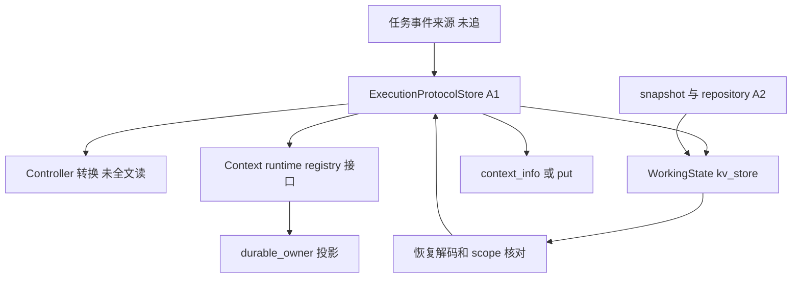

# AWorld：协议状态保存失败时谁能批准提交

2026-11-21；long-running-agent 冻结版本 `82af4062e29e128910afa8622c866f4b99a4d23d` 的传递依赖子单元。源码静态核对、未运行模型或上游测试。适用问题：内存中的复核已经得出提交决定，但运行状态写入失败，恢复会话能否仍依据该决定交付？

## 原文与证据

| ID | 固定原文 | 实读范围 |
| --- | --- | --- |
| A1 | [ExecutionProtocolStore](https://github.com/inclusionAI/AWorld/blob/82af4062e29e128910afa8622c866f4b99a4d23d/aworld/core/execution_protocol/store.py) | 全文：scope、load、save、apply、失败决策 |
| A2 | [execution_state.py](https://github.com/inclusionAI/AWorld/blob/82af4062e29e128910afa8622c866f4b99a4d23d/aworld/core/context/execution_state.py) | 仅 state_context、checkpoint_execution_state；整文件备份 |
| A3 | [冻结技能卡](aworld-long-running-evidence-contract.md) | 前次入口与两份引用；不是运行协议全文已读 |

[快照](../../snapshots/inclusionAI/AWorld/82af4062e29e128910afa8622c866f4b99a4d23d/manifest.json)与[证据](../evidence/2026-11-21/source-review.json)记录原文。controller/models/runner 仍未全文追完；本卡只还原持久化适配层，不宣称已验证完整恢复。

## 真实输入输出与职责

输入为 context、agent_id、ExecutionProtocolPolicy 和 ExecutionProtocolEvent。scope 是 task_id、task_epoch、agent_id；本地 key 是 execution_protocol_state:agent_id。输出 ProtocolTransition 包含 state 与 decision。模型产生的工作/复核通过别处转为事件，本类不调用模型，也不执行业务工具。

load 先读任务 runtime state，解码失败、类型不对或 scope 不匹配则转本地 WorkingState/context_info/get；都不可用则建 initial。恢复状态受 history_limit 限制。恢复到某状态不证明对应外部效果已经发生。

## 流程图

A1 还可能在前一个接口无 captured transition 时退到下一路径；图只概括分支，不保证整个更新跨进程原子。

## 架构图

durable_owner 是接口里的所有者命名，不等于已证明磁盘持久性；真正 checkpoint 的存储实现仍待核。

## 状态、失败和恢复

save 检查类型和 scope，先写 runtime writer；writer 抛错则立即抛出，不投影一个假 COMPLETE。若无 writer，则仍可投影并返回，故“save 返回成功”不能自动翻译成磁盘已写。_project 对 context_info/kv_store 做深复制；回退 put 的异常被吞掉，本层也没有回读所有投影结果。

apply 优先使用 update_and_project_task_runtime_state，再普通 updater，最后 load/转换/save。前两路捕获异常后清除 captured 并尝试回退；是否跨副本一致、是否会重复应用非幂等事件，依赖真实 Context 接口，不靠名字推断。

若最后 save 抛错，_persistence_failure_transition 返回旧状态、PERSISTENCE_ERROR。CANDIDATE_FINAL、REVIEW_RESULT 或原本 SUBMIT_CURRENT_RESULT 均改为 STOP_INCOMPLETE；其余 CONTINUE。这里既没有丢弃有用业务产物，也没有把未记录的终态授权为提交。错误的控制器转换规则不在本卡验收范围。

A2 的 checkpoint_execution_state 走 owner.snapshot(cache_boundary=False)，支持时再传 checkpoint_only=True。旧 snapshot 接口且无 repository/session 则记 memory_only 返回；有旧 repository 且 aget 可读时，检查 checkpoint id 读回为空便记 checkpoint_failed 并抛错。并非所有能力分支都做同样回读；没有 snapshot 时也不能声称已落盘。

## 验收与跨实现反证

| 观察 | 支持的结论 | 不支持 |
| --- | --- | --- |
| scope 不匹配 | 该记录被拒绝解码 | 旧任务外部副作用被撤销 |
| writer 抛异常 | 本层不投影该新状态 | 远端写绝对没有发生 |
| 最终 save 失败 | 终态边界不获提交授权 | 所有业务操作失败 |
| save 返回状态 | 适配层返回 | 已持久化到磁盘 |
| 旧接口无目的地 | memory_only | 跨进程恢复成功 |

与 [RTC Stop](trtc-stop-gate-boundaries.md)相比，AWorld 对保存失败的终态采取保守停止，RTC 对 guard 依赖故障允许宿主结束。选择取决于“继续普通工作”与“宣告完成”的授权分工；二者都需要外部产物验证。替代实现可要求写入确认和业务回执分别持久化，本仓建议，未做收益实验。

## 学习练习与待核

未运行：用假 Context 分别提供成功 writer、抛异常 writer、无 writer；对普通事件与候选结束事件观察返回旧/新状态和 CONTINUE/STOP_INCOMPLETE。再让 writer 先写后报错，检查是否会重复事件，练习区分效果未知和明确未执行。勿接真实业务副作用。

下一小批追 controller 的 safe_transition、models 的事件/策略约束，再追真实 Context 原子接口与 runner 调用点。当前技能仍为部分依赖/宿主核查、完整组0、实跑0。
