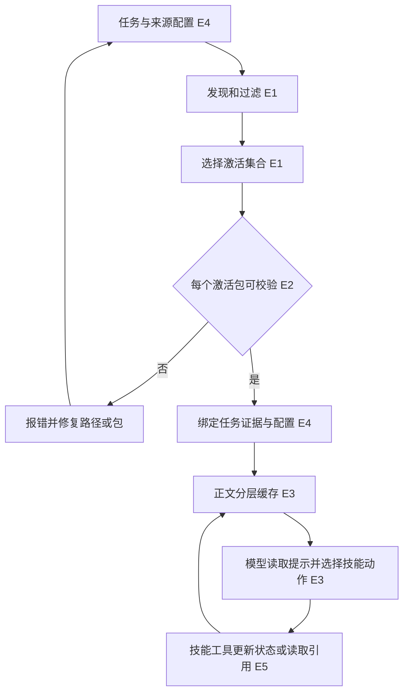
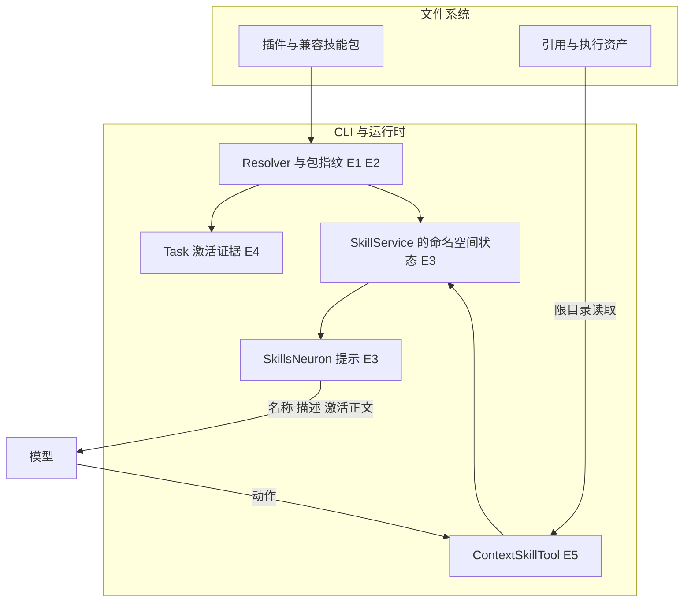

# AWorld：技能选择、正文加载与激活证据

研究 ID：AWORLD-ACTIVATION-20261120。日期：2026-11-20。官方源码静态核对，未启动上游 CLI、模型或工具；未运行上游测试。比较冻结版 `82af4062e29e128910afa8622c866f4b99a4d23d` 与本日 main `bef598fcfb60da988c2660cafcf0d45f0128e8bf`，不将旧结论静默套入新版本。

## 问题与适用条件

一个宿主同时安装多个同名或不同用途的技能，用户显式选择两个技能时，模型究竟得到什么？运行结果声称“使用了技能”，需要能指回实际目录和依赖，而不能只保存技能名称。适合研究多来源发现、按任务装配与回放审计；它不证明技能方法正确、产物达标或外部业务执行成功。

## 原文与证据

下列均为固定源码事实，非收益实验。原文及哈希见[本批证据](../evidence/2026-11-20/aworld-review.json)和[新版节选清单](../../snapshots/inclusionAI/AWorld/bef598fcfb60da988c2660cafcf0d45f0128e8bf/manifest.json)。

| ID | 实际已读范围 | 固定源码 | 边界 |
| --- | --- | --- | --- |
| E1 | 来源优先级、过滤、评分、配置、证据构造 | [新版解析器](https://github.com/inclusionAI/AWorld/blob/bef598fcfb60da988c2660cafcf0d45f0128e8bf/aworld-cli/src/aworld_cli/core/skill_activation_resolver.py)、[旧版](https://github.com/inclusionAI/AWorld/blob/82af4062e29e128910afa8622c866f4b99a4d23d/aworld-cli/src/aworld_cli/core/skill_activation_resolver.py) | provider 内部发现、远程获取未全追 |
| E2 | 包校验、逐文件指纹；旧版独立实现与新版封装 | [核心 Skill](https://github.com/inclusionAI/AWorld/blob/bef598fcfb60da988c2660cafcf0d45f0128e8bf/aworld/core/agent/skill.py)、[指纹适配器](https://github.com/inclusionAI/AWorld/blob/bef598fcfb60da988c2660cafcf0d45f0128e8bf/aworld/skills/package_fingerprint.py) | 没有锁定文件系统快照或执行期不可变证明 |
| E3 | 配置构造、描述/正文分离、激活缓存、提示渲染 | [Registry](https://github.com/inclusionAI/AWorld/blob/bef598fcfb60da988c2660cafcf0d45f0128e8bf/aworld/skills/registry.py)、[SkillService](https://github.com/inclusionAI/AWorld/blob/bef598fcfb60da988c2660cafcf0d45f0128e8bf/aworld/core/context/amni/services/skill_service.py)、[SkillsNeuron](https://github.com/inclusionAI/AWorld/blob/bef598fcfb60da988c2660cafcf0d45f0128e8bf/aworld/core/context/amni/prompt/neurons/skill_neuron.py) | 程序读入与模型可见分开 |
| E4 | LocalExecutor 的 _resolve_swarm_skills、_build_task 与任务证据绑定片段 | [local.py](https://github.com/inclusionAI/AWorld/blob/bef598fcfb60da988c2660cafcf0d45f0128e8bf/aworld-cli/src/aworld_cli/executors/local.py) | 整文件归档，未声称逐行解读全部执行器 |
| E5 | 模型可见技能工具的动作、读文件边界、结果回传 | [ContextSkillTool](https://github.com/inclusionAI/AWorld/blob/bef598fcfb60da988c2660cafcf0d45f0128e8bf/aworld/core/context/amni/tool/context_skill_tool.py) | 通用模型传输、业务工具执行器与恢复未全追 |
| E6 | 多技能顺序、缺指纹报错、显式数量及符号链接断言 | [上游测试](https://github.com/inclusionAI/AWorld/blob/bef598fcfb60da988c2660cafcf0d45f0128e8bf/tests/core/test_skill_activation_resolver.py) | 已读相关断言，未运行；monkeypatch 不等于 OS 故障实测 |

## 输入、输出与组件职责

输入 `SkillResolverRequest` 包括 plugin_roots、runtime_scope、agent_name、task_text、requested/default/enabled/disabled_skill_names、兼容来源及隔离候选来源。输出 `ResolvedSkillSet` 含 skill_configs、active_skill_names、available_skill_names、activation_evidence；后者保存 skill_name、canonical_skill_file/root、package_fingerprint、source，执行器再补 agent_name。它是读取时的包身份记录，不是业务成功回执。

来源顺序为隔离候选、插件、兼容来源、内置 provider；同名候选先出现者保留。隔离未发布候选仅对显式请求例外可见。过滤 public、禁用、default_enabled、作用域、Agent selector 后，显式请求与合格默认技能合并；已禁用者仍不可选。没有显式请求时，关键词出现次数评分，取最高的一项再加默认项，同分按名称排序。此处不是语义检索。未知作用域回落 workspace 排位；这是解析器规则，不是操作系统权限边界。

新版最多允许64个去重后的显式名称。配置和证据保持激活顺序，其余可用项按名称排列。默认名称常量列 filex 与 long-running-agent；[内置 manifest](https://github.com/inclusionAI/AWorld/blob/bef598fcfb60da988c2660cafcf0d45f0128e8bf/aworld-cli/src/aworld_cli/builtin_skills/manifest.json) 的 provider 清单另含 workbench，两个名单用途不同。是否默认激活还取决于传入的 default_skill_names；不能把“已安装”等同“本次已激活”。

## 流程图

以下还原 E1—E5；业务执行完成不在本子链验收范围内。

## 架构图

## 状态、上下文与执行契约

Registry 的 build_skill_config 调 load_content，解析器对候选构造配置；因此当前链已可能把未激活正文读入程序。SkillService 再分为 descriptor、staging、loaded cache，命名空间用 Agent 身份区分。初始化对 active 配置调用 active_skill；get_skill 将 staging 提升到 loaded。提示器给全部可用项名称/描述，只有实际 active 且非 agent 类型才展示 usage。**模型上下文渐进展示不等于磁盘正文按需读取。** offload 删除 active 名单，未见此函数清空已加载正文缓存。

执行器在上下文初始化前解析，回写 Agent conf 与 Agent 的配置；共享 sandbox 收集各 owner 的并集，后写者不能简单覆盖先前技能。证据绑定具体 Task，避免后续 executor.last 值覆盖本任务记录。共享沙箱“同名、两个 Agent 的不同包”如何冲突仍待专项，不由并集设计自动解决。

模型可通过 SKILL__active_skill 激活可用项，ContextSkillTool 返回 Observation 和 ActionResult；读引用先解析 asset_root/skill_path，再限制在技能目录内。动态 active_skill 进入 SkillService 更新名单和正文，本次已读函数未重新调用包指纹；初始 Task 证据不能自动称为全程动态激活审计。错误恢复要区分任务前解析报错与工具返回失败；失败后改路径或依赖再解析，不伪造成功证据。该链没有业务写入重试、取消或幂等保证。

指纹包含目录内文件的相对路径、内容 SHA256、大小、权限 mode；新版先校验真实目录、SKILL.md、无符号链接及已声明路径。入口相同、引用不同或 mode 不同，包指纹可以不同。指纹不包含模型、运行配置、网络状态及外部服务版本；扫描与后续使用之间文件仍可能变化。本仓推断：需要强回放时应另留不可变包或使用前复核，不能只依赖“canonical”字段。

## 验收和反例

| 场景 | 可核查预期 | 不能据此声称 |
| --- | --- | --- |
| 显式选择两个技能 | active 顺序与 activation_evidence 一一对应 | 两个技能方法都实际执行 |
| 激活包读指纹失败 | 新版抛 SkillActivationAttestationError；旧版跳过该证据 | 旧版所有调用方都继续；旧注释要求需要证明的调用方自行拒绝 |
| 入口相同、引用改变 | 身份核对必须包含引用 | 整包等价 |
| 关键字同分 | 名称排序形成确定选择 | 相关性更高 |
| 模型运行中再激活 | namespace 状态与正文变化 | 初始证据自动涵盖后续激活 |
| 解析完成后修改包 | 旧指纹只说明先前观察 | 执行时仍使用相同内容 |

新版测试用 monkeypatch 制造指纹失败，支持异常契约的设计意图。本次未运行，不把上游断言记为本仓复现。

## 横向比较与选择

与 [BrowserSkill 同步](browserskill-managed-skill-update.md) 比较同一问题“宿主到底装入了哪份技能”：BrowserSkill 用安装基线哈希发现本地编辑和逐文件更新冲突；AWorld 用任务时包指纹归属激活身份。前者服务更新保护，后者服务任务证据，均不能单独证明模型已遵循全部方法。BrowserSkill 的多文件中间态与 AWorld 的扫描后变更，都是不能用入口哈希抹去的反例。

与 [飞书内嵌读取](lark-cli-embedded-skill-read.md) 比较，CLI 输出正文只证明提供了文本，宿主是否读入需另证；AWorld 可追到命名空间和提示器，但模型执行、业务完成仍需观察。实现复杂度来自多来源优先级、状态归属与回执一致性；本批无性能或收益对照。

## 学习练习

未运行练习：用两个假技能，入口字节相同但 reference 内容不同。先记录入口哈希、目录清单与 mode，再算包身份；切换 disabled 和 requested 配置，检查“可用/激活/有证据”三个集合。最后在解析后修改引用，比较读取时与使用时身份，设计能发现漂移的检查点。不要接入真实业务工具。

## 接续事项

补 provider 路径获取、ApplicationContext 到模型请求的完整装配、动态激活证据与后续使用身份、共享 sandbox 同名冲突；旧新整版差异未全审，当前仅指定文件快照。long-running-agent 的运行协议见[技能卡](aworld-long-running-evidence-contract.md)，其全文实现仍待核。
