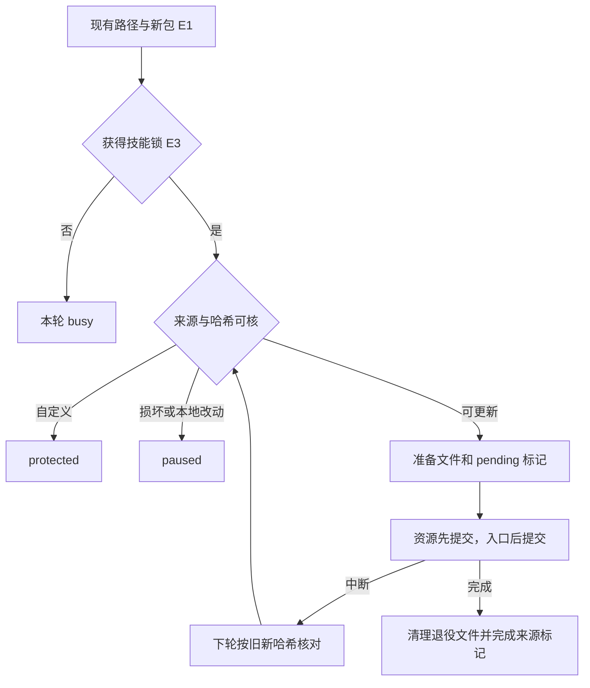
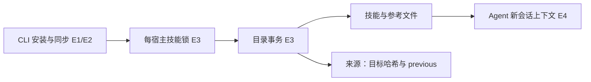

# BrowserSkill 受管理技能更新如何保护修改

2026-11-18，固定 `3d4c1bb3b1a29908a299c1ccac1d55bdd54a0a62`。源码静态阅读、测试断言阅读与独立 Python 合成演算。适用于 CLI 升级后向多种 Agent 宿主交付技能，同时需要保留用户编辑和处理多文件中断的场景。

| ID | 固定证据 | 阅读范围 |
| --- | --- | --- |
| E1 | [安装命令](https://github.com/Tencent/BrowserSkill/blob/3d4c1bb3b1a29908a299c1ccac1d55bdd54a0a62/crates/bsk-cli/src/cli/install_skill.rs) · [安装器](https://github.com/Tencent/BrowserSkill/blob/3d4c1bb3b1a29908a299c1ccac1d55bdd54a0a62/crates/bsk-cli/src/skill_install/mod.rs) | 目标宿主、捆绑/自定义来源、跳过和显式 force |
| E2 | [自动同步与测试](https://github.com/Tencent/BrowserSkill/blob/3d4c1bb3b1a29908a299c1ccac1d55bdd54a0a62/crates/bsk-cli/src/skill_install/sync.rs) · [冲突检查](https://github.com/Tencent/BrowserSkill/blob/3d4c1bb3b1a29908a299c1ccac1d55bdd54a0a62/crates/bsk-cli/src/skill_install/conflicts.rs) | 来源记录、已管理文件、未管理路径、旧版迁移和暂停 |
| E3 | [事务顺序](https://github.com/Tencent/BrowserSkill/blob/3d4c1bb3b1a29908a299c1ccac1d55bdd54a0a62/crates/bsk-cli/src/skill_install/transaction.rs) · [标记格式](https://github.com/Tencent/BrowserSkill/blob/3d4c1bb3b1a29908a299c1ccac1d55bdd54a0a62/crates/bsk-cli/src/skill_install/provenance.rs) · [文件操作](https://github.com/Tencent/BrowserSkill/blob/3d4c1bb3b1a29908a299c1ccac1d55bdd54a0a62/crates/bsk-cli/src/skill_install/storage.rs) | 锁、临时文件、旧新哈希、逐文件提交和最终标记 |
| E4 | [技能入口](https://github.com/Tencent/BrowserSkill/blob/3d4c1bb3b1a29908a299c1ccac1d55bdd54a0a62/crates/bsk-cli/skill/SKILL.md) · [README](https://github.com/Tencent/BrowserSkill/blob/3d4c1bb3b1a29908a299c1ccac1d55bdd54a0a62/README.zh-CN.md) | 页面观察与恢复指引，更新加载属于宿主行为 |

输入是宿主目标、捆绑技能包、已有来源记录和目录内容。输出包括 updated、up_to_date、protected、paused、busy、errors，分别表示已更新、相同、自定义保护、暂停、锁占用和 I/O 错误。这里不调用模型，也不操作浏览器；模型会在后续会话读取交付的入口和参考文件。

自动同步对自定义来源直接保护，对未知/损坏标记暂停。已管理路径逐个与基线比较，修改或删除均形成冲突；新资源路径若已有不同内容也暂停。中断标记保存旧值和目标值，只有当前字节属于旧或新的一边时才继续。相同目标包可以接续，不同目标包会记录 InterruptedUpdate。显式安装的 force 会覆盖当前包路径，调用者应明确区分它与自动同步。多宿主结果逐个收集，一个路径失败后其他路径可继续。

多文件交付逐项替换，过程中的目录可包含新旧版本。锁约束遵守该锁的安装者，读取宿主是否在事务中途加载，需要额外证据。正常顺序资源先于入口，但还不能据此承诺旧入口读取新资源时一定兼容。目录完成也不能证明已有 Agent 会话重新加载。这里归纳的限制属于静态推断。

对照 [飞书嵌入技能读取](lark-cli-embedded-skill-read.md)，飞书绑定二进制嵌入树，BrowserSkill 把包同步到宿主目录。可选实现是版本目录加入口指针，成本是宿主需支持版本寻址及旧版本清理。本卡没有测出收益。

合成练习用旧哈希 v1、新哈希 v2 和用户修改三类状态，检查重试只接受旧值、新值或原本不存在的路径。5 个独立 Python 分支用例通过；上游测试含本地修改暂停、旧内容恢复后再升级、替换失败等断言，只做静态阅读。下一步用固定 Rust 源码和隔离临时目录测试中断点，再观察真实宿主加载时机。
