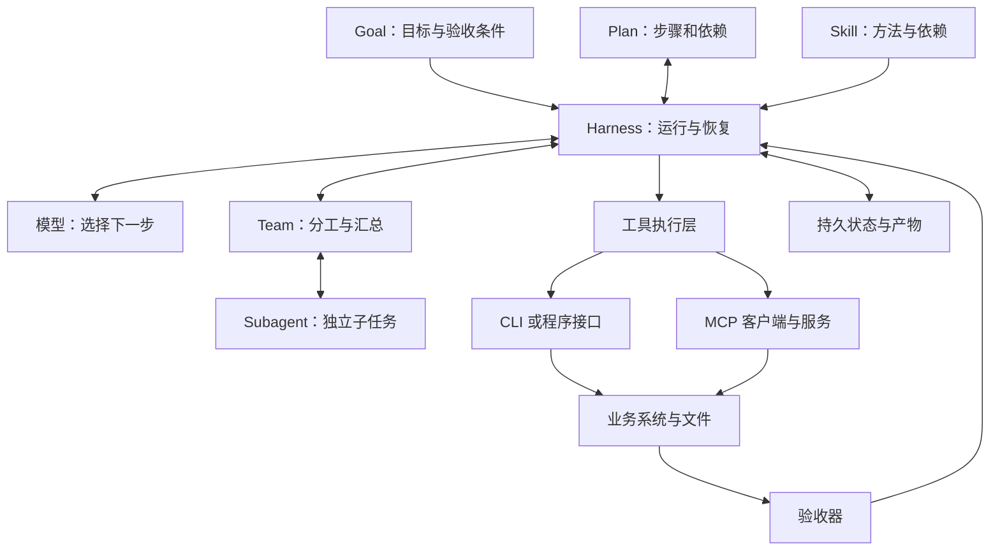
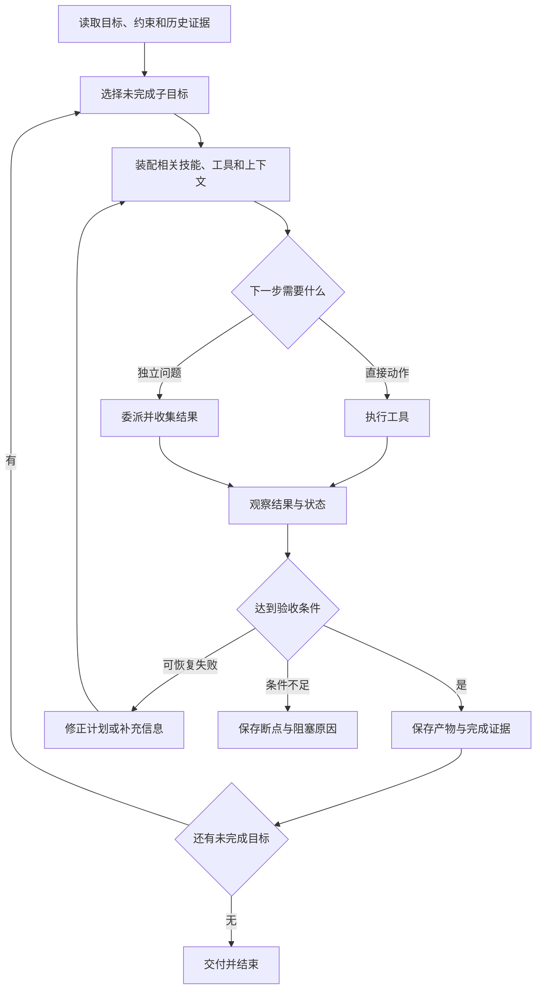

# 八类组件怎样组成一个可学习、可维护的 Agent

日期：2026-10-25。性质：本仓教学综合与研究框架。下图是我们的抽象设计，不代表任何一家公司的完整内部实现，也不是已部署系统。

先用“任务是否完成”统一比较组件，再理解各家的命名。一个系统可以把多种职责放进一个进程；同名组件也可能承担不同职责。研究时以调用链、状态归属和接口为准。

| 组件 | 核心问题 | 研究时必须看到的证据 |
| --- | --- | --- |
| Skill 技能包 | 这类任务怎样做，何时启用？ | 入口描述、正文、依赖、加载器、完成检查 |
| MCP 协议服务 | Agent 应用怎样发现并调用外部能力？ | 协议版本、客户端/服务端、工具模式、错误与授权 |
| CLI 命令行 | 一个能力怎样以可组合命令执行？ | 参数、帮助、结构化输出、退出码、分页和异步约定 |
| Harness 运行骨架 | 谁管理推理—行动循环及运行状态？ | 主循环、上下文、执行器、预算、轨迹、恢复与终止 |
| Subagent 子任务执行者 | 怎样委派有边界的问题？ | 输入契约、隔离范围、消息、结果、取消和回收 |
| Team 协作组织 | 多个执行者怎样分工和共享工作？ | 角色、任务归属、依赖、共享状态、冲突与汇总规则 |
| Goal 目标 | 跨步骤甚至跨会话，最终要达到什么？ | 成功标准、约束、持久状态、截止/唤醒/取消条件 |
| Plan 计划 | 当前准备按什么顺序达成目标？ | 步骤、依赖、假设、状态、反馈触发的重规划 |

这些定义用于本仓对照，不宣称是统一行业标准。尤其 Team、Goal、Plan，必须逐产品核对；有任务列表不自动意味着实现了完整团队协作。

## 教学架构

这里把 Goal 和 Plan 分开，是为了在步骤失败时修改路线，同时保存用户要的最终结果。把执行层从模型分开，是为了知道副作用到底在哪里发生。Skill 可指导调用 CLI，也可指导使用 MCP；不能只凭存在 Skill 文件就认定工具已安装或权限已生效。

## 教学流程

## 同一任务怎样贯穿这些组件

以“每周整理一份某领域技术调研”为教学例：Goal 保存范围与质量要求；Plan 指定待研究问题和依赖；Skill 规定原文、图和证据格式；CLI/MCP 读取材料与写入文件；Harness 管循环和失败；Subagent 可处理明确独立的阅读单元；Team 在确有多执行者时处理归属、合并和复核；验收器检查证据和交付物。这个例子说明职责，不表示本次已经启用了多 Agent。

## 当前一手材料给出的边界

[Agent Skills 规范](https://agentskills.io/specification)定义技能目录及按需加载；[参考实现的拆解](skills-spec.md)进一步检查格式验证与真正任务质量的区别。

[MCP 架构与版本拆解](mcp-versioned.md)固定在 2026-07-28 版本，研究 Host/Client/Server 职责。它不替应用定义业务成功。

[OpenAI Multi-agent 文档](https://developers.openai.com/api/docs/guides/agents-api/multi-agent)说明子 Agent 有各自上下文，主 Agent 负责协调与合并，并提示并行编辑共享文件需要协调。这里只核对文档可见契约，不推断完整实现。

[Anthropic 长任务文章](https://www.anthropic.com/research/effective-harnesses-for-long-running-agents)描述初始化与后续增量工作的分工，以及通过进度文件和 Git 历史接续；其例子聚焦应用开发，不能直接推出所有领域都应采用同一种结构。

[Microsoft checkpoints 文档](https://learn.microsoft.com/en-us/agent-framework/workflows/checkpoints)描述工作流状态恢复。我们接下来要分别检查工作流断点、对话摘要和外部业务状态，避免把三者混成“记忆”。

## 下一步比较和学习练习

对同一份只读资料整理任务，比较：单 Agent 顺序处理；同一 Agent 加显式计划；明确独立子任务委派；带持久断点的跨会话接续。固定材料和验收问题，记录漏项、重复工作、引用正确率、恢复损失与成本。尚未运行。

研究重点不是添加组件数量，而是找出哪个失败由哪个组件解决，加入它是否带来新的成本和故障。此页完成概念框架；具体实现仍按 backlog 分别深读。

