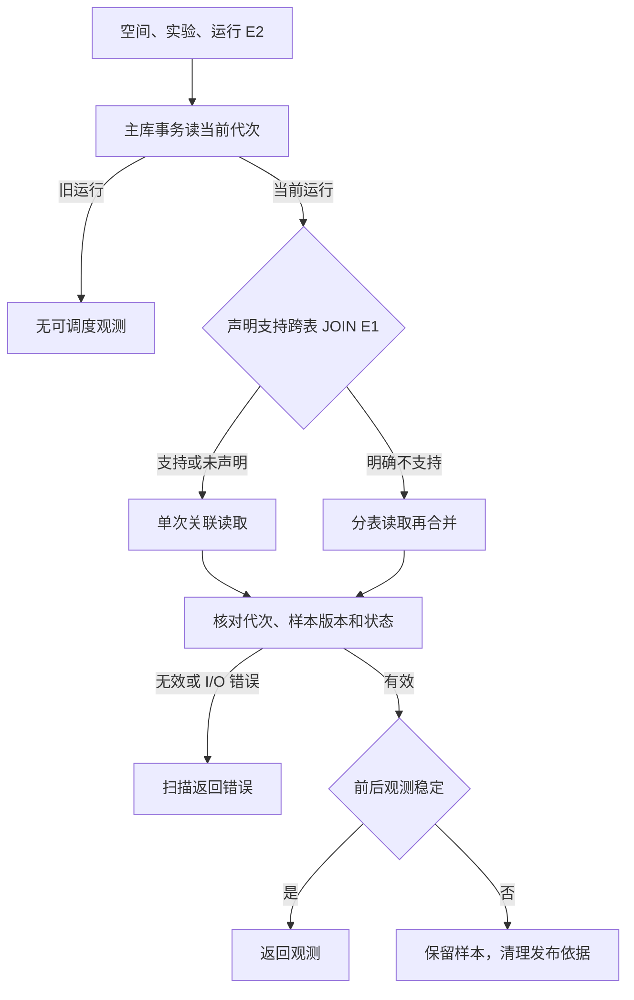
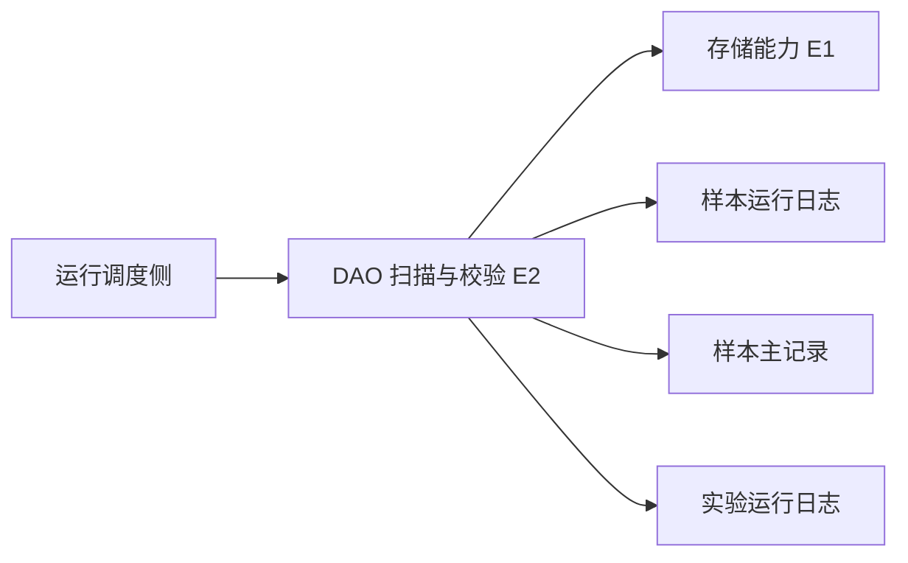

# Coze Loop 评测恢复扫描如何读可信状态

2026-11-15，固定 `36b9796878604bc87e0fadd047dc27e89dfe8c26`。静态源码和上游断言阅读，另有无模型的合成演算。适用于评测任务拆成多条样本、调度器要区分旧运行、占位中的样本与可发布结果的场景。

| 证据 | 固定原文 | 所见边界 |
| --- | --- | --- |
| E1 | [存储能力接口](https://github.com/coze-dev/coze-loop/blob/36b9796878604bc87e0fadd047dc27e89dfe8c26/backend/infra/db/db.go) | 存储可声明是否支持跨表 JOIN，未声明时沿用 JOIN |
| E2 | [当前请求扫描](https://github.com/coze-dev/coze-loop/blob/36b9796878604bc87e0fadd047dc27e89dfe8c26/backend/modules/evaluation/infra/repo/experiment/mysql/expt_item_current_request.go) | 组合运行日志、项目主记录与运行模式，核验版本和前后观测 |
| E3 | [测试](https://github.com/coze-dev/coze-loop/blob/36b9796878604bc87e0fadd047dc27e89dfe8c26/backend/modules/evaluation/infra/repo/experiment/mysql/expt_item_current_request_split_read_test.go) | 以 SQL mock 断言两种查询形态与部分行结果 |
| E4 | [实验文档](https://docs.coze.cn/cozeloop_create-experiments) | 公开配置与字段映射，商业运行细节需单独验证 |

## 业务边界

用户先选评测集、目标版本和评估器，再映射数据列。官方文档描述目标输出进入 actual_output（实际输出列），再提供给评估器。固定源码所见恢复子链输入是 spaceID、exptID、runID、retryFirst，对应空间、实验、运行和排序开关。扫描输出为 ExptItemCurrentRequest（当前样本请求观测）或错误。这一步读状态和校验结果。模型输入装配、执行器调用和消息队列的下一跳不在该文件中，接续时沿实际调度调用追查。

## 流程图

## 架构图

## 恢复、权限与验收

这里读取既有空间下的数据库状态。权限校验属于上游调用边界，源码片段未验证鉴权。拆读路径是预先分流，JOIN 抛错后会返回错误。普通扫描在主库事务中做前后观测，并逐项核对发布来源。某些逐项不一致会延期发布或隔离，仍可保留处理中占位。错代次的主记录跳过，版本不符能让扫描失败。已完成主记录覆盖滞后运行日志的状态。单项 GetCurrentRequest 的读取入口单列，不能把 Scan 的观察窗口套给所有读路径。

E3 验证样本行和查询形态，未验证真实分布式存储、并发写入下的隔离或最终发布。对照 [Lagent 动作契约](lagent-action-status-and-hooks.md)，工具动作结束由当前进程结果报告，Coze Loop 扫描需要重判跨记录所属运行。备选设计可用显式事务快照或单个版本化视图，分别以存储能力和投影维护成本换取更易复查的读证据。

合成练习用 run=8、样本版本31 扫描四个用例。相同版本且观测稳定返回可见，主记录 run=9 跳过，版本32 触发扫描错误，前后变化则保留占位但剥离发布证据。已运行独立 Python 逻辑模拟验证这四种形态，未执行 Go 测试或数据库调用。后续用固定测试数据库分别验证缺行、软删除、并发版本切换和同一事务选项实际传递。
