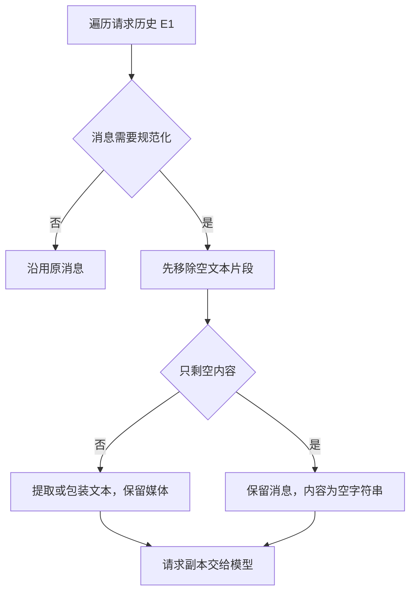
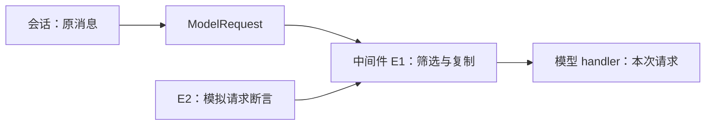

# DeerFlow 模型请求的空文本归一化

2026-11-10，固定 `c612531213b2505857bf733a6a332fd7653f84b4`。适用于多模态消息历史含空文本片段、需要在模型请求边界做兼容处理的场景。静态核对。

| 证据 | 固定原文 | 范围 |
| --- | --- | --- |
| E1 | [请求中间件](https://github.com/bytedance/deer-flow/blob/c612531213b2505857bf733a6a332fd7653f84b4/backend/packages/harness/deerflow/agents/middlewares/input_sanitization_middleware.py) | 同步和异步调用包装、历史消息处理、复制及异常分支 |
| E2 | [单测源码](https://github.com/bytedance/deer-flow/blob/c612531213b2505857bf733a6a332fd7653f84b4/backend/tests/test_input_sanitization_middleware.py) | 空片段各位置、图像、空白、原请求不变等断言 |
| E3 | [中间件说明](https://github.com/bytedance/deer-flow/blob/c612531213b2505857bf733a6a332fd7653f84b4/backend/packages/harness/deerflow/agents/middlewares/AGENTS.md) | 组装顺序与供应商兼容动机，属于仓库说明 |

## 输入输出与执行

输入是 `ModelRequest.messages`，其中符合 `requires_input_sanitization` 的消息可能有列表式内容。先去掉空裸字符串和空 typed text，再进入文本提取和包装，因此图像旁的空片段、已包装内容旁的空片段均能处理。只含空文本片段的消息变成空字符串，消息本身保留。空白字符串和图像不按空片段处理。变更走 `model_copy` 和 `request.override`，传给模型 handler；这段实现不写回原消息状态。

## 失败、权限与验收

单条处理抛出普通异常时保留该条并继续，`GraphBubbleUp` 传播。外层普通异常回退到原请求。整个空用户轮次仍可能被供应商拒绝。该子链本身不调用工具或修改授权，也不决定任务完成；未核验真实供应商接受率、Gateway 来源字段完整性或工具执行。验收项是输入对象未改、文本形状正确、媒体留存、同步异步同样处理。上游测试仅静态阅读。

对照[飞书文件输入](lark-input-provenance.md)，飞书按入口解析内容与来源，DeerFlow 按模型请求反复适配。若在写入会话时永久归一化，可以减少重复处理，但会改变历史原貌；只在供应商序列化器转换，则保留状态但需在各适配器维护规则。离线练习构造图像、空裸串、空 typed text、空白文本和正常文本混合的历史，对照请求与原会话；再注入单条处理失败，检查其余行是否继续。未执行。
