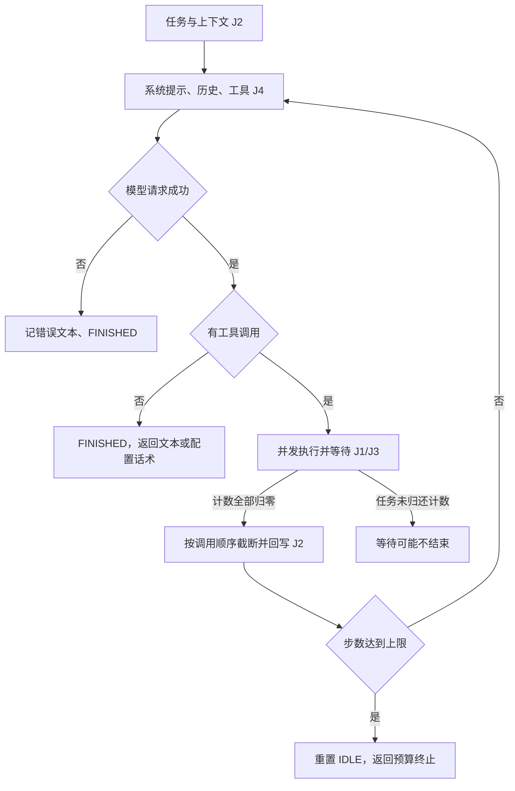
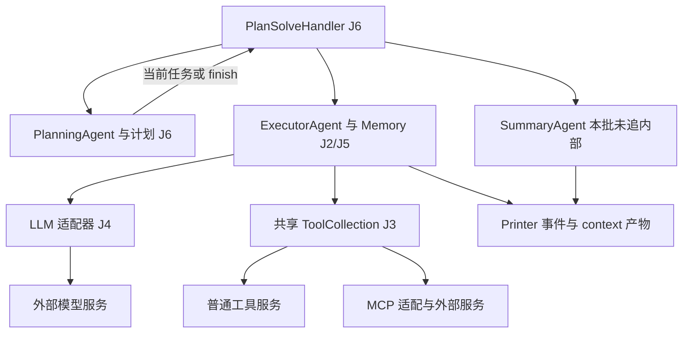

# JoyAgent-JDGenie：并发工具回传与结束的证据边界

2026-11-24；官方源码，固定默认分支 data_agent 的 `2417e0b8b636d941ad5fb14c59b20dddfef5375d`。本卡完成 Executor 的输入、模型请求、工具汇合及退出子链静态拆解；未启动 Java、工具服务、模型或上游测试，不代表完整 DataAgent 或产品已复现。

## 问题与适用条件

输入一个需要多工具检索和报告的任务，执行器返回“完成”时，调用者需要知道工具是否成功、等待是否结束、报告是否符合要求。适合学习 Harness 的错误归因和并发汇合。不能拿 README 的产品承诺或 GAIA 分数替代当前部署的业务验收。

## 原文与证据

| ID | 固定原文（同一提交） | 已读范围与边界 |
| --- | --- | --- |
| J1 | [BaseAgent.java](https://github.com/jd-opensource/joyagent-jdgenie/blob/2417e0b8b636d941ad5fb14c59b20dddfef5375d/genie-backend/src/main/java/com/jd/genie/agent/agent/BaseAgent.java) | 全文；run、executeTool、executeTools |
| J2 | [ExecutorAgent.java](https://github.com/jd-opensource/joyagent-jdgenie/blob/2417e0b8b636d941ad5fb14c59b20dddfef5375d/genie-backend/src/main/java/com/jd/genie/agent/agent/ExecutorAgent.java)、[ReActAgent.java](https://github.com/jd-opensource/joyagent-jdgenie/blob/2417e0b8b636d941ad5fb14c59b20dddfef5375d/genie-backend/src/main/java/com/jd/genie/agent/agent/ReActAgent.java) | 全文；任务前缀、提示装配、think/act、数字员工标签 |
| J3 | [ToolCollection.java](https://github.com/jd-opensource/joyagent-jdgenie/blob/2417e0b8b636d941ad5fb14c59b20dddfef5375d/genie-backend/src/main/java/com/jd/genie/agent/tool/ToolCollection.java)、[ThreadUtil.java](https://github.com/jd-opensource/joyagent-jdgenie/blob/2417e0b8b636d941ad5fb14c59b20dddfef5375d/genie-backend/src/main/java/com/jd/genie/agent/util/ThreadUtil.java) | 全文；工具路由、线程池、计数锁 |
| J4 | [LLM.java](https://github.com/jd-opensource/joyagent-jdgenie/blob/2417e0b8b636d941ad5fb14c59b20dddfef5375d/genie-backend/src/main/java/com/jd/genie/agent/llm/LLM.java) | 仅 askTool 360—546 与非流式 callOpenAI 请求构造 558—587；其余流式、解析辅助、模型配置未全文审计 |
| J5 | [Memory.java](https://github.com/jd-opensource/joyagent-jdgenie/blob/2417e0b8b636d941ad5fb14c59b20dddfef5375d/genie-backend/src/main/java/com/jd/genie/agent/dto/Memory.java)、[FileUtil.java](https://github.com/jd-opensource/joyagent-jdgenie/blob/2417e0b8b636d941ad5fb14c59b20dddfef5375d/genie-backend/src/main/java/com/jd/genie/agent/util/FileUtil.java) | 全文；内存、清理、产物元信息 |
| J6 | [PlanningAgent.java](https://github.com/jd-opensource/joyagent-jdgenie/blob/2417e0b8b636d941ad5fb14c59b20dddfef5375d/genie-backend/src/main/java/com/jd/genie/agent/agent/PlanningAgent.java)、[PlanSolveHandlerImpl.java](https://github.com/jd-opensource/joyagent-jdgenie/blob/2417e0b8b636d941ad5fb14c59b20dddfef5375d/genie-backend/src/main/java/com/jd/genie/service/impl/PlanSolveHandlerImpl.java) | 全文；调度交接和字面量 finish 分支；PlanningTool、SummaryAgent 内部未在本批审计 |
| J7 | [ToolResult.java](https://github.com/jd-opensource/joyagent-jdgenie/blob/2417e0b8b636d941ad5fb14c59b20dddfef5375d/genie-backend/src/main/java/com/jd/genie/agent/dto/tool/ToolResult.java)、[ToolCallPrompt.java](https://github.com/jd-opensource/joyagent-jdgenie/blob/2417e0b8b636d941ad5fb14c59b20dddfef5375d/genie-backend/src/main/java/com/jd/genie/agent/prompt/ToolCallPrompt.java) | 全文；有类型结果定义与提示后备值，不证明部署实际选用 |

[规范快照清单](../../snapshots/jd-opensource/joyagent-jdgenie/2417e0b8b636d941ad5fb14c59b20dddfef5375d/manifest.json)保留原许可和第三方 NOTICE；[本批证据](../evidence/2026-11-24/source-review.json)区分整文件备份、实际阅读和既有整仓归档。

## 输入输出和职责

真实入口 Executor.run(String request) 先通过模型生成“工具名→数字员工名称”的展示标签，再拼 taskPrePrompt、设置 context.task，并把任务放入 Memory。标签更新修改共享 ToolCollection，不能当成创建了隔离的独立 Agent。

构造器按 GenieConfig 选择默认键对应的提示模板，注入工具名称/描述、用户原始 query、日期、SOP 及 executorSopPrompt；think 每轮把产物文件名、描述、URL 填入 files，占位信息不是文件全文。内部文件被 Executor 过滤，Planner 不过滤。非 USER 结尾会追加 nextStepPrompt。模型调用使用消息历史、系统消息、真实 ToolCollection、ToolChoice.AUTO、非流式模式和参数 300。

J4 按 function_call 或 struct_parse 两路装配：前者发送工具 schema，后者把 schema 写进系统文本；Claude 路径另放 system。extParams 最后 putAll，可覆盖已组装参数，因此这里还原的是构造顺序，不保证所有配置下请求相同。300 传给 HTTP 连接、读、写超时，不是整任务或工具汇合的统一 300 秒 deadline。

模型决定调用名和参数；普通工具由 BaseTool.execute，MCP 路由由 McpTool.callTool 执行。真实服务、权限校验与副作用依赖具体工具，本批不泛化。executeTools 输出 Map<toolCallId,String>；Executor 最后按原 toolCalls 顺序收集，不按完成时间。原生调用写 TOOL 消息并关联 ID；struct_parse 直接把结果附到最近助手文本。

## 流程图

## 架构图

图中 Memory 是进程内 ArrayList，产物列表在共享 context；本链没有证明跨进程恢复、消息持久化或共享 context 线程安全。

## 状态、错误和恢复

源码事实：executeTool 对 JSON 参数解析异常、工具异常、结果非 String 的强制转换异常统一捕获，返回 `Tool{name} Error.`。未知工具返回 null，随后也变成该错误字符串；非法调用对象另返回格式错误文本。该执行链不消费 J7 的 SUCCESS/FAILED/TIMEOUT 等字段。存在一个结构化 DTO 不代表真实路径使用了它。

工具错误字符串可以进入下一轮上下文，但 maxObserve 会先截断，不能保证错误与业务证据完整。清理选项为 1 时移除 TOOL、带原生 toolCalls 的助手消息及特定前缀的引导消息；struct_parse 的助手文本内嵌结果不自动被同一条件移除。两路上下文不能视为完全等价。

并发任务没有 finally 保护 countDown。若结果放入 ConcurrentHashMap 时 ID 为 null 而抛错，或提交被线程池拒绝，则计数可能不减；后者拒绝处理器为空、SynchronousQueue 不缓冲任务，达到线程上限且无法交付时会静默丢弃。ThreadUtil.await 调用无超时 latch.await，并吞掉等待异常。以上是代码条件推导，未压测、未证明正常运行必然卡住；模型 HTTP 超时不能解除这个等待。重复 ID 还会覆盖结果，需由上游调用标识保障。

think 捕获模型处理异常后写助手错误消息、标 FINISHED 并返回 false；ReAct.step 返回固定“无需行动”文本。因此 FINISHED 既可能来自无工具回答，也可能来自故障，并非业务成功。think 中 files 装配和最后消息访问在 try 之前，异常也可能向 BaseAgent.run 传播并标 ERROR；不应宣传全部故障都被吞掉。

BaseAgent.run 起始只重置 state，不重置 currentStep。到上限后将 currentStep 归零、state 改 IDLE，并追加预算终止文本，即使该步刚标 FINISHED 也会进入此判断；多次 run 的步数也不必各自从零开始。它返回最后一个步骤结果，不是带验收凭据的任务对象。J6 根据计划 stepStatus 全 completed 产生 finish，外层收到该字面量便进入汇总；这些已读分支没有独立业务验证器调用，不能把计划标记或汇总可生成当成报告正确。

权限、副作用、幂等键、服务重试和取消传播仍由未读工具及更外层承担；没有据本卡证明自动回滚。错误字符串只给模型一次重新选择的机会，不是已经发生恢复。

## 验收和跨实现比较

| 反例条件（静态推导） | 本链可观察结果 | 仍需外部证明 |
| --- | --- | --- |
| 工具抛异常但模型下一轮不给工具 | 错误文本后 FINISHED | 目标是否完成、错误是否已补偿 |
| 线程池饱和丢弃一项 | latch 计数可能不归零 | 超时取消与剩余任务归属 |
| 最后一允许步骤返回最终答案 | 预算分支可能覆盖返回 | 是否应交付该答案与停止原因 |
| 清理开启、两种调用模式 | 原生/文本内嵌结果保留不同 | 恢复后证据是否齐全 |
| Planner 全部 completed | 返回 finish 并开始汇总 | 产物内容和所有业务条件 |

对照 [Open-AutoGLM](open-autoglm-finish-and-observation.md)：后者某些动作失败 message 未入模型上下文，而 JoyAgent 会回传错误字符串；后者解析失败可转成功 finish，JoyAgent 模型故障也可标 FINISHED。两者都需要把“循环停止、工具效果、业务验收”分开。再对照 [AWorld 策略发布](aworld-policy-resolution-and-runtime.md)：后者有独立策略和终态预算接口，复杂度更高，但静态结构并不证明质量更好，没有同模型同预算实验。

本仓替代建议：统一返回包含 call_id、执行状态、效果是否已知、重试资格的结果；并发汇合用带 deadline 的 Future，拒绝提交也形成结果、finally 归还计数；业务完成谓词单列。成本是维护类型、取消和服务幂等契约，不能只换一个状态枚举就宣称可靠。

## 学习练习与接续

未运行练习：用两个假工具分别返回字符串和抛异常，比较原生/struct_parse 的下一轮消息；再用可控假调度器拒绝一项，检查是否能在指定 deadline 返回部分结果。用 maxSteps=1 的假 step 标 FINISHED，记录 state 和最终返回值。只用自建假接口，勿调用真实服务或运行未知脚本。

下一步读具体 MCP/报告/数据工具、PlanningTool、SummaryAgent、真实请求配置和取消路径；归属专项完成一条，整仓备份沿用历史记录但本批未重新下载验算，P1 与完整产品研究继续。
