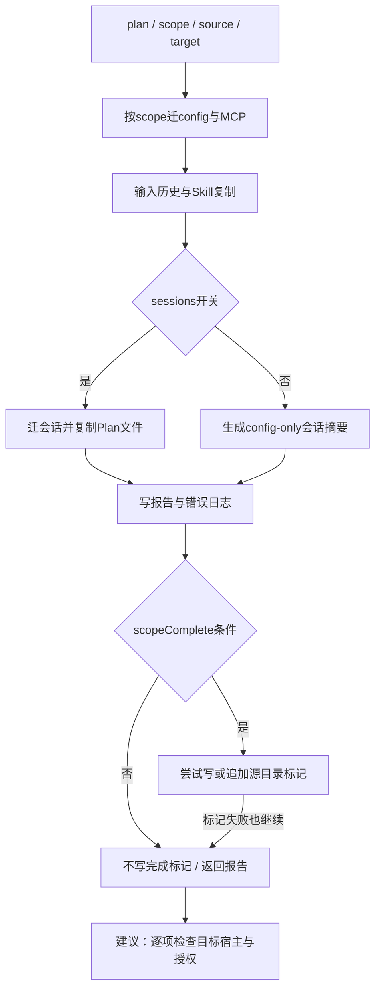
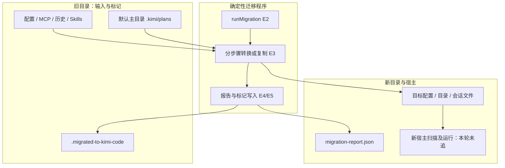

# 技术方案：Kimi 迁移的复制、运行语义与完成标记

2026-11-04；P1-01迁移子单元。官方源码固定 MoonshotAI/kimi-code @ 444c609e8e6629d43fb7fd571a8db48ce5a41570，MIT；10份选定文件全文静态阅读，未实跑。完整原文、SHA256、Git blob、未读依赖见[manifest](../../snapshots/MoonshotAI/kimi-code/444c609e8e6629d43fb7fd571a8db48ce5a41570/files/../manifest.json)。新增来源属于迁移增量，不改变31仓冻结基线。

## 问题与适用条件

从Python版迁移终端Agent时，配置、Skill目录、历史会话与Plan文件能否恢复原来的工作能力？这需要分别验证文件复制、目标宿主识别、运行状态恢复与权限。迁移程序本身是确定性文件处理，不需要模型决定复制动作；它也不证明迁移后Agent的上下文、工具和任务行为等价。

## 原文与证据

| ID | 原文 | 事实与边界 |
| --- | --- | --- |
| E1 | [迁移指南](../../snapshots/MoonshotAI/kimi-code/444c609e8e6629d43fb7fd571a8db48ce5a41570/files/docs/zh/guides/migration.md) | 声称配置/MCP/输入历史/所选会话可迁；OAuth及插件不迁；不是实测 |
| E2 | [run-migration.ts](../../snapshots/MoonshotAI/kimi-code/444c609e8e6629d43fb7fd571a8db48ce5a41570/files/packages/migration-legacy/src/run-migration.ts) | 按scope串行调度、报告与完成标记；转换器未全部读 |
| E3 | [skills.ts](../../snapshots/MoonshotAI/kimi-code/444c609e8e6629d43fb7fd571a8db48ce5a41570/files/packages/migration-legacy/src/steps/skills.ts)、[plans.ts](../../snapshots/MoonshotAI/kimi-code/444c609e8e6629d43fb7fd571a8db48ce5a41570/files/packages/migration-legacy/src/steps/plans.ts) | Skill顶层条目复制；Plan只复制普通文件 |
| E4 | [paths.ts](../../snapshots/MoonshotAI/kimi-code/444c609e8e6629d43fb7fd571a8db48ce5a41570/files/packages/migration-legacy/src/paths.ts)、[marker.ts](../../snapshots/MoonshotAI/kimi-code/444c609e8e6629d43fb7fd571a8db48ce5a41570/files/packages/migration-legacy/src/marker.ts) | 源目录迁移标记、目标路径集合与提示抑制 |
| E5 | [report.ts](../../snapshots/MoonshotAI/kimi-code/444c609e8e6629d43fb7fd571a8db48ce5a41570/files/packages/migration-legacy/src/report.ts)、[atomic-write.ts](../../snapshots/MoonshotAI/kimi-code/444c609e8e6629d43fb7fd571a8db48ce5a41570/files/packages/migration-legacy/src/atomic-write.ts) | 报告写临时文件后rename，权限0600；不是跨步骤事务 |

## 输入、输出与职责

runMigration接收plan、scope、source、target，可选plansSourceDir和进度回调。scope逐项控制config、mcp、userHistory、skills、sessions；plans跟随sessions开关，没有在此另设计划执行恢复开关。Skill源可由plan.skillsSourceHome覆盖；Plan默认源硬编码为用户主目录的.kimi/plans，不跟随通用source参数。这一差异在自定义旧目录迁移时尤其需要检查。

返回MigrationReport，含各类summary和notices；目标目录写migration-report.json并调用错误日志写入器。该报告列出重新登录、MCP重新授权、插件与冲突通知；这些不是已修复证明。

## 流程图

源码还原E2—E5，末端业务复核为本仓建议。

已读入口没有包围所有迁移步骤的全局回滚；早期步骤完成后，后一步异常可以直接向外抛出。图中的顺序只代表无未捕获异常时的推进。

## 架构图

模型上下文装配与工具决策位于目标宿主，未在本次迁移子链中出现；不能把目录搬运图当作Harness运行图。会话转换、模型消息与工具状态是否可重放仍未验明。

## 状态、权限与恢复

Skill复制以顶层条目为单位，不过滤非技能资产；目标同名条目存在就skippedExisting，没有哈希等价检查。它先复制到带进程ID的临时路径再rename，失败清理临时目录并抛错。源目录readdir任意错误返回0/0，条目stat错误则跳过；因此copied=0不能独立证明源中没有技能。

Plan只复制普通文件，目标同名跳过，源readdir错误同样返回0/0。入口notices明确说这些文件未接入Plan模式。计划文本可用不等于计划步骤状态、依赖图或恢复游标已经生效。

scopeComplete只检查sessionsFailed、sessionsConflicts以及被选中config/mcp的sourceUnreadable。它没有要求copied>0，也不逐一验证所有技能可被新宿主解析。标记写失败会被捕获忽略；返回报告不意味着完成标记存在。报告写入器失败则不同：入口没有同样的catch保护。

路径函数把迁移标记定位在source/.migrated-to-kimi-code；marker.ts用writeFile写该文件。这是源码可见的源目录写入，与指南“不改动或删除旧数据”的宽泛表述需要区分：至少不能承诺源目录字节级完全不变。是否修改任何业务原文件，仍须读完所有步骤才能全局断言。

提示抑制器遇到不可读/损坏标记返回true；readMarker遇坏JSON、错误版本或非数组runs则返回undefined。前者服务于避免重复提示，后者服务于重跑写入；“不再提示”不是成功证明。标记含target_paths，区分不同目标目录，Windows路径比较还做大小写归一。

atomicWrite使用0600临时文件并chmod后rename，降低配置中凭据的文件权限暴露；不代表凭据可以出现在报告或共享日志中。未审计日志脱敏，不对外转发用户实际文件。普通复制的原子可见性不等于并发排他、整批事务或断电持久性。

## 验收与反例

| 输入情形 | 可见结果 | 不能据此声称 |
| --- | --- | --- |
| 目标同名Skill内容已改 | skippedExisting增加 | 新旧Skill及依赖等价 |
| 源Skills无读取权限 | readdir捕获后0/0 | 没有Skill待迁 |
| scope.sessions为false | Plan不复制 | Config only迁完所有工作状态 |
| Plan文件已复制 | notice提示未接入Plan模式 | Goal/Plan执行已恢复 |
| 完成标记损坏 | 自动提示可能被抑制 | 本次迁移已经成功 |

验收建议：检查各summary的失败、冲突、跳过原因；对关键Skill比较入口与依赖哈希、目标宿主是否发现；对Plan确认仅为参考文档；重新授权后用无副作用任务检查功能。没有实际运行记录时不得声称收益或兼容通过。

## 横向比较与选择

与[飞书原子发布](lark-atomic-publication.md)比较：本方案Skill采用“存在检查→临时复制→rename”，减少半复制目录被下一次重跑误判完整的风险；飞书已研究的排他发布路径使用不同原语，不能将其并发保证套到这里。本方案跳过依据是名称存在，不是文件内容或宿主等价。

与[Runtime中断状态](agentscope-runtime-interruption.md)比较：运行标记控制任务启动；迁移标记控制提示和目标覆盖记录。两者均不代替业务内容验证。替代方案（本仓建议）是建立逐项哈希清单、语义转换版本、可恢复步骤日志，并把“已复制”“目标可加载”“任务可继续”分开；成本是额外存储、比较和目标宿主验证，暂无性能实验。

## 学习练习与接续

未运行练习：在临时假目录放两个同名但内容不同的技能，列出按当前规则应跳过什么；再设置sessions=false，预测Plan不会被复制；最后比较损坏标记在提示抑制与readMarker的不同结果。只做假数据，不操作真实.kimi目录。

下一步读config/MCP/session转换器、目标技能扫描和会话恢复；核查入口对上述条件的补救。旧Python仓库与新仓库许可不同，不能因产品同名继承旧许可。整仓备份、全部组件等价与上游实跑均未完成。
