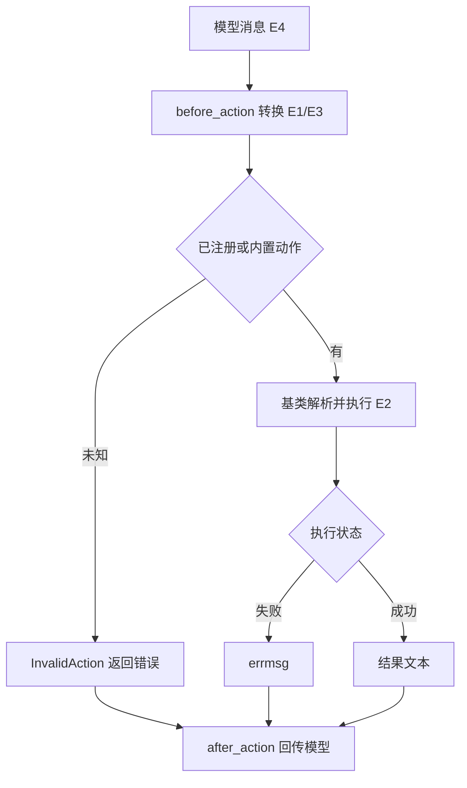
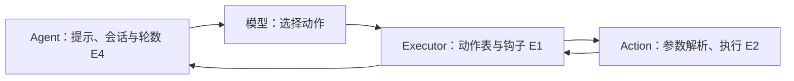

# Lagent 动作执行、钩子与完成判定

2026-11-11，固定 `0ab2e2f550477884743cd63fbca7bc4aa7b00290`。输入是宿主模型产生的调用消息，适用于研究工具前后钩子如何转换消息以及结束条件归属。静态阅读，未实跑。

| 证据 | 固定源码 | 核对内容 |
| --- | --- | --- |
| E1 | [执行器](https://github.com/InternLM/lagent/blob/0ab2e2f550477884743cd63fbca7bc4aa7b00290/lagent/actions/action_executor.py) | before/after 顺序、动作查找、同步与异步路径 |
| E2 | [基类](https://github.com/InternLM/lagent/blob/0ab2e2f550477884743cd63fbca7bc4aa7b00290/lagent/actions/base_action.py) · [内置动作](https://github.com/InternLM/lagent/blob/0ab2e2f550477884743cd63fbca7bc4aa7b00290/lagent/actions/builtin_actions.py) · [结构](https://github.com/InternLM/lagent/blob/0ab2e2f550477884743cd63fbca7bc4aa7b00290/lagent/schema.py) | 参数错误、执行错误、valid 与 state |
| E3 | [消息处理钩子](https://github.com/InternLM/lagent/blob/0ab2e2f550477884743cd63fbca7bc4aa7b00290/lagent/hooks/action_preprocessor.py) | 将 formatted 转为 name/parameters，并将结果转为文本 |
| E4 | [ReAct](https://github.com/InternLM/lagent/blob/0ab2e2f550477884743cd63fbca7bc4aa7b00290/lagent/agents/react.py) | 工具描述拼入模板、模型选择、结论和轮数终止 |

## 真实输入输出与调用链

E1 接受 `AgentMessage`，钩子转换后 `content` 为 `name`、`parameters` 或 FunctionCall。工具名可以是 `WebBrowser.search`。执行器按工具名查表，再由基类处理参数和 API。结果的 `state` 表示执行状态，`valid` 表示动作语义。钩子可将成功结果格式化为文本或将错误转为 errmsg。上层模型决定下一步，执行器本身不做任务规划。

## 权限、恢复与验收

基类会捕获参数 ParseError 与方法执行异常并返回不同状态，但执行器前后钩子、断言和工具名拆分不在这一捕获范围内。不能把工具基类错误结构外推到全部流程。执行器将已注册工具返回的 valid 设为 OPEN，需同时检查 state。FinishAction 返回 FINISH 与 SUCCESS 的文本结果，函数里没有外部业务验证。E4 的默认结束逻辑另检查 conclusion 字段；轮数耗尽也返回最后消息。因此工具返回成功、结束字段出现和目标达标应分别验证。

对照 [飞书媒体插入](lark-media-insert-recovery.md)，飞书用多阶段副作用和补偿信息帮助恢复；通用执行器依赖具体工具提供此类证据。替代方案是在 after_action 保留结构化阶段、已执行副作用和恢复键，而非仅转文本，代价是模型上下文和统一模式维护。不同工具是否能补偿需要各自验证，未测收益。

离线练习用返回 ARGS_ERROR、API_ERROR、SUCCESS 的假动作，以及直接返回 FINISH 的动作，对照模型实际能看到什么。另让 before_action 抛异常，观察外层宿主怎样处置。练习未运行。
