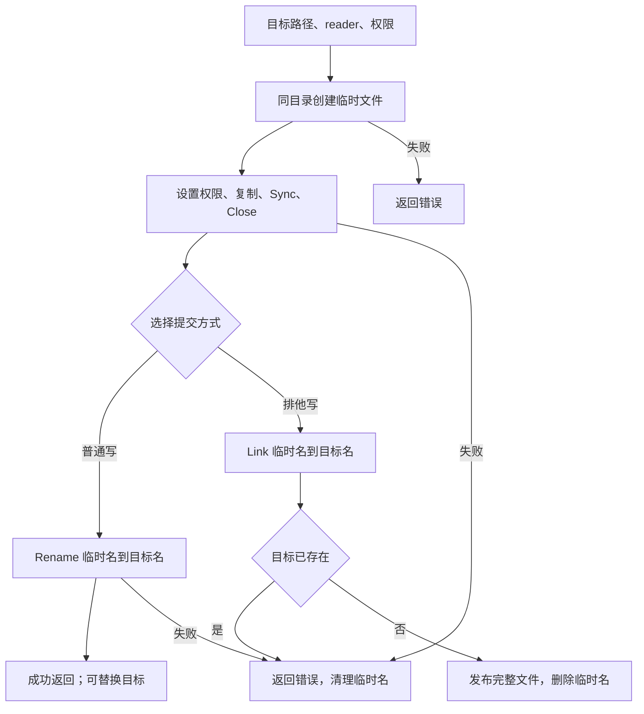
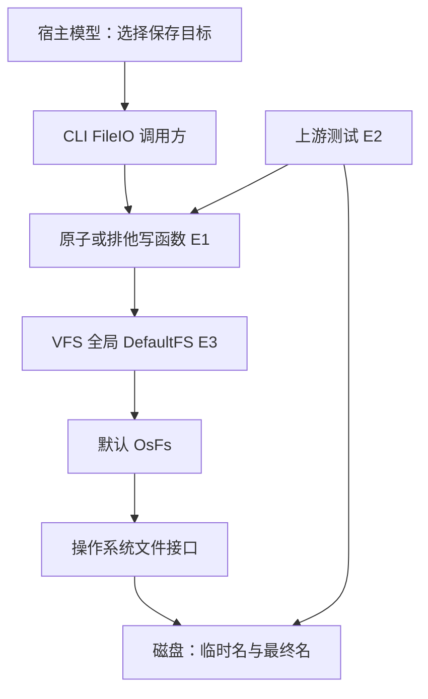

# 飞书文件写入：原子可见、排他提交与测试证据
日期：2026-10-28。固定 larksuite/cli @ 017b19a793ad71794a02887ede04757f3d82e10d；源码与测试静态阅读，未执行测试或业务系统。接续[FileIO 后端](lark-fileio-and-draft-contract.md)。

## 问题、输入输出与证据
Agent 输出一个文件时，“写入成功”至少涉及内容完整、是否允许覆盖、失败清理、掉电持久性四个不同问题。适合草稿、下载产物与验收基线存储设计；不涉及模型权重学习。

[节选原文与哈希](../evidence/2026-10-28/lark-code/manifest.json)中的 atomicwrite.go（E1）、atomicwrite_test.go（E2）、vfs/fs.go、default.go、osfs.go（E3）均全文读取。输入 path、io.Reader、perm；FromReader 函数成功返回复制字节数，错误返回 0 和 error。返回 0 不表示临时文件里从未写过字节。

## 流程图
下图为 E1 源码；失败后的宿主重试决策不在此函数内。

## 架构图

E3 接口要求自定义实现符合对应 os 语义；DefaultFS 默认 OsFs，Link/Rename 最终直接委托 os.Link/os.Rename。自定义 VFS 不能仅因满足 Go 接口就视为已验证语义等价。模型上下文与调度并不由这些函数管理。

## 调用链、状态与副作用
E1 两种方式都先在目标目录 CreateTemp，写完后 Sync 并 Close。普通写用 Rename 发布；排他写用 Link 发布，目标已存在时由提交操作本身拒绝。后者避免“先 Stat 再写”的检查与使用间竞态，也避免直接 O_EXCL 打开最终名时让读者看见尚未复制完的内容。

排他写无论成功失败都尝试删除临时名；普通写失败时尝试关闭和删除。defer 内的 Remove、部分 Close 错误没有回传，因而不能把“有清理代码”升级为“所有故障下零残留”。没有目录 Sync 调用，不能据此承诺所有平台、文件系统和断电条件下的目录项持久性。Link 不支持时返回错误，本函数没有自动降级为覆盖写。这里没有 context 参数，也没有自动重试循环。

这些是默认后端的静态实现事实；不能外推为所有平台上 Rename 的行为完全相同，也不证明调用方总会选择排他接口。此前草稿 Save 的随机路径仍不能被视作禁止覆盖的证明。

## 验收与反证
|E2 测试|实际断言|不能证明|
|---|---|---|
|OverwritesExistingFile|再次写入后读到 new|禁止覆盖|
|HandlesCorrectlyUnderConcurrentWrites|20个写者结束后文件可读且非空|全部调用成功、JSON合法、内容恰好来自一个写者；测试忽略写返回错误|
|PreservesOriginalFileOnFailure|另一个不存在目录的写入失败，原路径内容不变|同一目标在复制中途失败时的保护|
|PublishesOnlyCompleteContent|reader回调执行时最终路径不存在，结束后内容和字节数正确|进程崩溃、掉电或持续并发读取下的全部情形|
|RefusesExistingTarget|错误匹配 fs.ErrExist、原内容不变、目录仅原文件|所有并发竞争和所有文件系统行为|

测试名称和注释不是验收器；必须看断言。特别是“并发正确”测试并未解析 JSON，不能作为完整并发一致性证据。上述测试均未在本轮执行。

## 横向比较与迁移
|方案|适用任务|关键代价或边界|
|---|---|---|
|临时文件 + Rename|允许替换的单文件更新|可能覆盖他人提交，不等于业务事务|
|临时文件 + Link|只能创建一次的完整产物发布|依赖硬链接支持；冲突要交给调用方处理|
|最终名直接 O_EXCL 写入|仅要求拒绝已存在目标|复制期间可能暴露半成品|
|Stat 再普通写|事前提示|不能作为并发排他保证|

后两项是对照设计，不是声称该 CLI 采用它们。单文件提交也不能保证 XML、决策 JSON 与线上文档三者事务一致。用于 Harness 时，可将“产物发布策略”做成可替换工具后处理，但是否提高成功率须另做同模型实验。

## 学习练习与接续
练习设计，未运行：用独立假目录准备原文件 A；模拟复制器写一半后报错，检查最终 A、临时文件、返回错误；再安排两个写者提交同一路径，分别统计每个返回值和最终字节，比较 Rename 与 Link。断言必须包含最终内容属于候选集合、冲突计数和临时残留，不能只检查非空。崩溃/断电测试需独立资源与方案，不由普通单元测试替代。

未完成：@file 参数与 decision 读取、SafeInputPath/SafeOutputPath 全链、平台异常、宿主实际选择排他保存的位置；整项技能仍进行中。
