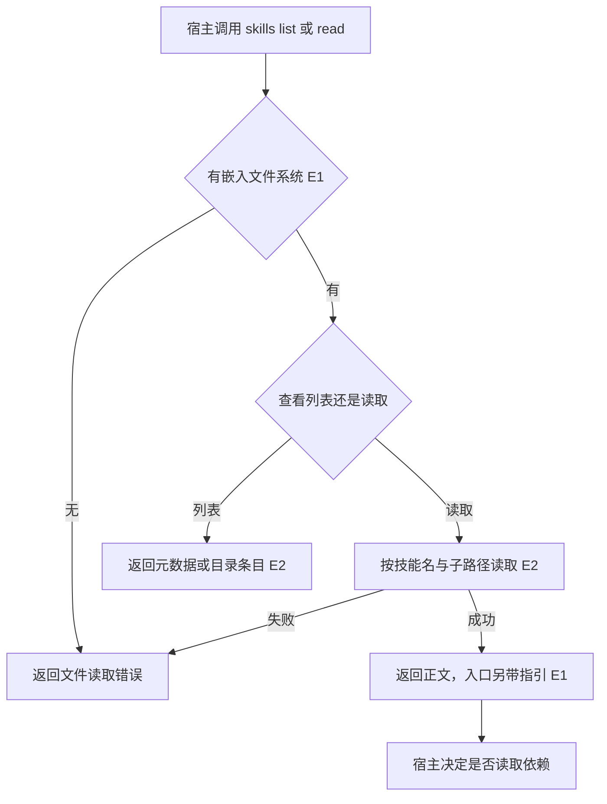

# 飞书 CLI 嵌入技能的读取与宿主交接

2026-11-15，固定 `017b19a793ad71794a02887ede04757f3d82e10d`，静态核对。适用于同一入口在不同软件构建中出现、Agent 需要避免把磁盘技能路径与 CLI 内嵌技能混用的任务。

| 证据 | 固定原文 | 可复查内容 |
| --- | --- | --- |
| E1 | [命令](https://github.com/larksuite/cli/blob/017b19a793ad71794a02887ede04757f3d82e10d/cmd/skill/skill.go) · [测试](https://github.com/larksuite/cli/blob/017b19a793ad71794a02887ede04757f3d82e10d/cmd/skill/skill_test.go) | 参数、输出格式、提示分流、无嵌入构建错误 |
| E2 | [读取器](https://github.com/larksuite/cli/blob/017b19a793ad71794a02887ede04757f3d82e10d/internal/skillcontent/reader.go) · [测试](https://github.com/larksuite/cli/blob/017b19a793ad71794a02887ede04757f3d82e10d/internal/skillcontent/reader_test.go) | 从注入文件系统读入口、元数据和限定路径 |
| E3 | [平台扩展说明](https://github.com/larksuite/cli/blob/017b19a793ad71794a02887ede04757f3d82e10d/extension/platform/README.md) | 构建可按允许列表、移除项或 overlay 变更内嵌树，还可重映射引用 |
| E4 | [文档入口](https://github.com/larksuite/cli/blob/017b19a793ad71794a02887ede04757f3d82e10d/skills/lark-doc/SKILL.md) | 权限相关问题触发共享规则阅读的指引 |

## 流程图

## 架构图

CLI 的 list 在文件系统内读各 SKILL.md 提取元数据，返回给调用方时只给元数据。read 接受技能名及可选相对文件，返回正文。原始模式正文经过 stdout 保持原字节，入口提示去 stderr。JSON 模式入口有独立 guidance 字段，参考文件没有该提示。跨技能路径须在调用前转换为另一技能下的路径，沿用当前树读取。CLI 读文件命令关闭常规认证检查，命令结果本身没有执行文档 API，也没有替宿主批准后续写入。

## 反例、验收与练习

只收 stdout 的宿主可以拿到入口正文，却看不到跨技能转换提示。相同入口字节在插件覆盖后也能读到不同参考文件。验收应锁定构建、嵌入树与输出方式，确认宿主把 guidance 或 stderr 送到明确的处理分支。对照 [Agent Skills 规范](skills-spec.md) 的目录渐进披露，CLI 将文件选择绑定到构建，宿主直读更便于替换磁盘技能，二者需要不同的依赖证明。

离线练习用含两个技能和一份参考的假文件系统，比较 raw、JSON 与没有嵌入树三个场景。预期 raw 正文不含指引，JSON 入口指引独立，参考不带指引，缺树返回错误。宿主应该单独记录最终加载了哪份参考。只阅读了上游测试，未运行 CLI。真实宿主的批准、输出捕获和上下文注入仍待验证。
