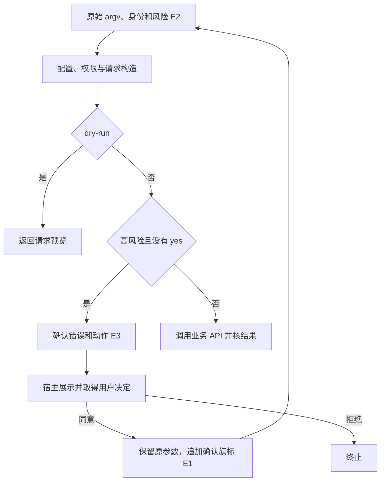
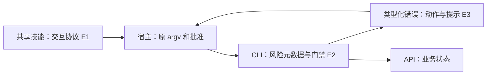

# 飞书高风险确认如何交回调用者

2026-11-18，固定 `017b19a793ad71794a02887ede04757f3d82e10d`，静态源码和测试阅读。适用于 lark-shared 指引需要宿主展示动作、取得批准并继续同一条命令的任务。范围是通用 service 命令的执行路径。

| ID | 固定证据 | 范围 |
| --- | --- | --- |
| E1 | [共享技能参考](https://github.com/larksuite/cli/blob/017b19a793ad71794a02887ede04757f3d82e10d/skills/lark-shared/references/lark-shared-high-risk-approval.md) | exit 10、动作和确认后重试指引 |
| E2 | [通用服务命令](https://github.com/larksuite/cli/blob/017b19a793ad71794a02887ede04757f3d82e10d/cmd/service/service.go) · [风险标记](https://github.com/larksuite/cli/blob/017b19a793ad71794a02887ede04757f3d82e10d/internal/cmdutil/risk.go) | 请求构造、dry-run、确认门禁及业务 API 调用顺序 |
| E3 | [确认错误构造](https://github.com/larksuite/cli/blob/017b19a793ad71794a02887ede04757f3d82e10d/internal/cmdutil/confirm.go) · [测试](https://github.com/larksuite/cli/blob/017b19a793ad71794a02887ede04757f3d82e10d/internal/cmdutil/confirm_test.go) | action、risk、hint 和 exit code，提示不包含重建命令 |

输入是命令参数、身份、风险元数据、dry-run 和 yes 旗标。E2 先完成配置、权限相关检查与请求构造，再处理 dry-run，然后判断高风险操作是否具有 yes。缺少时返回确认错误，业务请求在后续 NewAPIClient 与 DoAPI 分支。dry-run 可在确认前返回预览，这个顺序在固定源码可直接观察。

错误构造只提供动作和确认提示，源码解释原始管道、stdin 字节、重定向和可执行路径无法由错误信封恢复，且完整 argv 可能带入自由文本或凭据。宿主要保留原 argv 与输入来源，批准后如何重开 stdin 需要明确实现。flag 到位只能证明调用端满足门禁条件，用户批准的来源与参数一致性仍由宿主保证。接口执行成功后的目标对象与业务效果也需回读。

对照 [BrowserSkill 包更新](browserskill-managed-skill-update.md)，浏览器技能的 force 和飞书业务命令的 yes 作用于不同副作用面，都应与具体动作、版本和调用上下文关联。替代设计可用绑定请求摘要的批准令牌，代价是审批状态和请求规范化的维护。本次不假定既有 CLI 实现了该设计。

独立 Python 合成分支检查 dry-run/高风险未批准/高风险已批准三个用例，依次返回 preview、confirmation_required、execute。读取的 Go 测试核对类型化错误及 JSON 字段。未运行 CLI、Go 测试或业务接口。下一步核实际宿主捕获 stderr、保留 stdin 与批准回传，其他快捷命令入口逐条追查。三个共享技能 occurrence 的宿主仍待验证。
