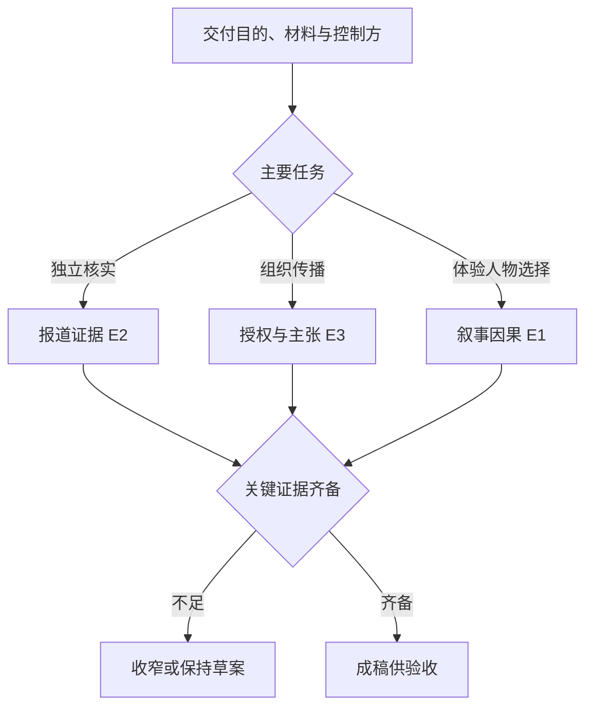
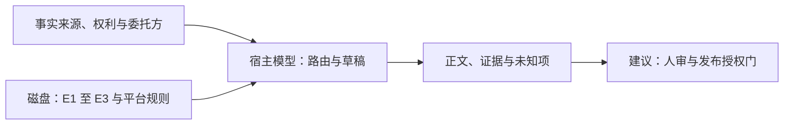

# 飞书创作、报道与公关路由

2026-11-09，固定 `017b19a793ad71794a02887ede04757f3d82e10d`，三个目录依赖全文静态阅读。

| 证据 | 固定原文 | 读者任务与门槛 |
| --- | --- | --- |
| E1 | [叙事创作](https://github.com/larksuite/cli/blob/017b19a793ad71794a02887ede04757f3d82e10d/skills/lark-doc/references/genres/route-creative.md) | 允许有约束的虚构，交付可追因果、可演或有后果的叙事；诗歌和歌词另走。 |
| E2 | [资讯媒体](https://github.com/larksuite/cli/blob/017b19a793ad71794a02887ede04757f3d82e10d/skills/lark-doc/references/genres/route-media.md) | 编辑独立核实，区分事实、说法、推断与未知；严重负面指控需合理回应机会。 |
| E3 | [营销公关](https://github.com/larksuite/cli/blob/017b19a793ad71794a02887ede04757f3d82e10d/skills/lark-doc/references/genres/route-marketing.md) | 组织控制口径，证据强度与主张相称，关键交易条件与发布授权可核。 |

输入包括受众、委托关系、事实材料、真实或虚构约束、权利和最终交付格式。相同“新闻稿”字样可指独立报道或组织通稿。明确要求公众号成稿时，平台叶规则优先选择输出形态，新闻核实约束仍适用。叙事若用真实引语、人物或素材，授权和核实仍需独立检查。输出包括正文或标记待确认的草稿。

技能的 blocked 是文本约束，未确认宿主强制执行，也没有在此轮发布内容。对照 [MiniMax MCP 交付链](minimax-mcp-video-delivery.md)，工具可证明生成或落盘，但报道中的核实、回应机会和发布许可需要外部证据。可替代的实现是在交付层将关键主张绑定 `source_id`、核实状态和发布角色，增加录入与维护成本；证据真实性仍须复核。

离线练习用一份新产品素材，分别写虚构场景、独立报道草稿和组织通稿。移除关键性能证据，验收是否将虚构清楚标示、保持报道未知项并去除无依据营销承诺。练习未运行；其余路由、平台叶与宿主执行仍待核。
