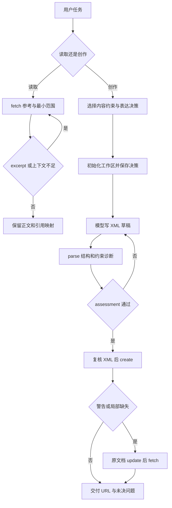
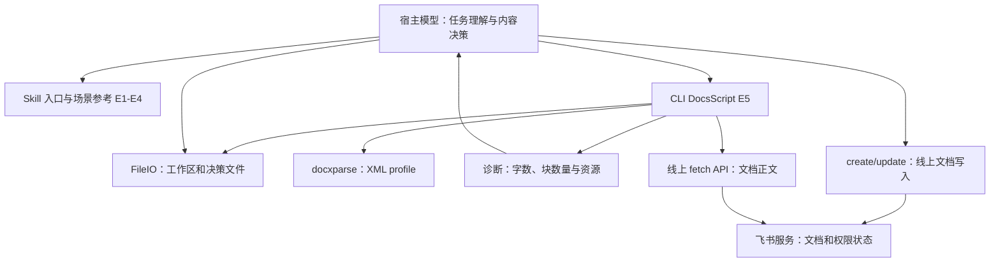

# 飞书文档技能：场景路由、草稿契约与分层验收

研究日期：2026-10-26。固定版本：larksuite/cli @ 017b19a793ad71794a02887ede04757f3d82e10d。状态：入口与选定依赖静态阅读；整包未验收、未实跑。属于 P1 的官方技能样本，不能据此提前完成 P2。

## 问题与适用条件

具体任务是“根据材料新写一篇飞书文档”或“读取已有文档并总结”。二者虽然都处理文档，却需要完全不同的上下文和工具序列。这个技能的主要方法是把入口做成场景路由，把创作决策保存为草稿的验收基线，再由 CLI 检查部分可计算约束。它依赖安装好的 lark-cli、可用文件访问提供者，以及真正访问线上文档时的身份与授权；技能文本自身不执行命令，也不提供模型或持久调度器。

本次完整读了入口、fetch、create-workflow、create 和 lark-shared 五份文档，并读取五份固定源码。lark-doc 目录在 manifest 中有 44 个文件，本次仅其中四份已读；其他体裁、XML、更新、图片、历史等材料仍待逐项研究。shared 也只是入口阅读，不算另一个组完成。

## 原文与证据

原有原文根目录：[固定技能快照](../../snapshots/larksuite/cli/017b19a793ad71794a02887ede04757f3d82e10d/files/skills/lark-doc/SKILL.md)。新补的代码是[指定文件节选](../evidence/2026-10-26/lark-code/manifest.json)，保留 MIT 许可证、上游 Git blob 和 SHA256。不是重新归档整个项目。

|证据|可见事实|原文|
|---|---|---|
|E1|入口按读取、创作、导入、编辑等分流；授权错误才加载共享技能|skills/lark-doc/SKILL.md|
|E2|局部 fetch 可只返回 excerpt；正文和 reference_map 应一起保留|references/lark-doc-fetch.md|
|E3|创作要求先确定表达决策，再初始化、写 XML、检查、创建；局部失败修复原文档|references/lark-doc-create-workflow.md|
|E4|创建成功仍可有 warnings；bot 自动授权也可能 failed 或 skipped|references/lark-doc-create.md|
|E5|解析结果的 assessment 与命令执行结果分开；无决策时不执行决策约束检查|shortcuts/doc/docs_script.go|
|E6|资源路径只在相对路径缺失且非策略错误时尝试 XML 源目录|shortcuts/doc/doc_resource_path.go|
|E7|共享入口称仅相对路径，文档入口允许权限范围内绝对路径；底层路径验证并非一律禁绝对路径|skills/lark-shared/SKILL.md；internal/vfs/localfileio/path.go|

E1—E4 是官方技能/参考文件中的行为要求，不保证宿主每次遵循；E5—E7 的代码部分是源码事实，不是本次运行结果。

## 输入输出与调用链

用户目标先由模型分类。读取场景给模型 fetch 参考；创作场景给模型工作流，再按体裁选择 contract（内容约束）与 adapter（渠道适配）。这些是按需读取的材料，不是必须同时塞进系统提示的全文。技能没有公开证明所有宿主都会自动执行这些加载顺序。

创作的结构化决策包含 audience、reader_task、genre_contract、adapter、presentation_mode、visual_plan，用户明确有字数要求时才填 word_count。模型产生决策和草稿；CLI 不替模型判断读者是谁。DocsScript 注册了 Validate、DryRun、Execute。validateDocsScript 检查 init-draft 必须有决策且不能同时给正文或线上 doc；parse 的 content 与 doc 互斥。

initDocsScriptDraft 解析 JSON，经 newDocsScriptWorkspace 取得支持 WorkspaceFileIO 的文件接口，通过 savePresentationDecision 保存基线，返回 cwd、workspace、draft_path。此时尚未写出 draft.xml；它只是模型接下来应写的路径。输出失败时会尝试非递归清理本次创建的条目，清理错误和原错误合并报告。

executeDocsScript 的 parse 分支将本地正文或 fetch 得到的正文交给 ParseCompatibleXML 生成结构与字数 profile，再 resolveDocsScriptPresentationDecision。显式决策参数优先，否则根据记录的正文路径寻找同目录 .presentation-decision.json。找不到返回 hasDecision=false；只有 hasDecision=true 才添加表达约束与资源诊断。diagnostics 非空令 assessment.status=failed，随后输出结果并返回 nil。因此“命令成功”并不蕴含“草稿合格”。

## 流程图

下图还原 E1—E5 的技能规定与局部代码，创建服务内部尚未追完。

## 架构图

工作区状态、模型上下文和线上文档状态是三个存放位置。把其中一个摘要存好不意味着另两个可以恢复。以上图没有假定隐藏的自动恢复系统。

## 权限、副作用、恢复与边界

共享规则区分 user 和 bot；以错误身份读到空结果，不能证明用户没有该资源。创建返回 document_id、revision_id、url；bot 的 permission_grant 失败并不等于文档没创建。对这种部分成功重复 create 可能产生重复文档，工作流要求更新已创建文档，而不是重建。

本地 parse 不总是离线：docs_script.go 的 dry-run 描述和资源诊断分支明确考虑远程图片探测；parse --doc 会请求线上正文。init-draft 也会写本地决策文件。因此 Risk=read 不能被解释为“没有任何文件或网络副作用”。本次没有调用这些命令。

路径存在同提交文档冲突：shared 声称绝对路径会报错，doc 和创作工作流允许访问范围内的绝对路径。safePath 依次做平台形状、真实路径、deny、allow 和相对路径不得逃离 CWD 的检查；checkRelativeStaysInCwd 对绝对路径提前返回，但它仍先受 deny/allow 约束。不能把这个事实推广为任意绝对路径都可访问。doc_resource_path.go 在 fs.ErrNotExist 时才回退；权限失败、路径验证失败、绝对路径、Markdown 输入都不走相同回退。外部 FileIO 提供者仍可能采用不同策略。后续应追具体命令如何注入 FileIO 和读取 @file，而不是只凭底层函数宣布所有命令已验证。

fetch 的 simple 适合浏览，full 用于保留编辑需要的结构；只拿关键词切片回答“全文是否无遗漏”是不成立的。评论也可能被截断，要检查 comments.tips.data，必要时走独立评论分页；本次未读 Drive 分页实现。

## 验收、对照与反例

|层级|能证明什么|不能证明什么|
|---|---|---|
|命令 ok|命令执行层成功|所有草稿检查通过|
|assessment=passed|该次实际启用检查未报告诊断|约束填写完整、事实正确、服务端可接受|
|create ok 与文档 ID|线上对象创建|图片完整、用户已获权限、业务要求满足|
|fetch 回读|返回范围内的线上内容可见|所有范围、评论和外链均完整|

同仓的“原样导入”是有用对照：用户给定完整内容或只要空文档，入口允许直接走 create；从零创作必须先走 Authoring。前者减少内容决策步骤，后者增加固定验收基线，但没有实验说明其成功率提升多少。学习重点不是“一切都加更多步骤”，而是按任务所有权分流：内容已由用户确定，和内容仍待模型创作，不应混用同一流程。

反例：用户要求至少一张流程图，模型却保存空 visual_plan.blocks。即使 parse 得到 passed，也不能证明满足该要求。又如把正文通过 stdin 提交且不提供决策，无法直接假定它会找到原草稿旁的约束文件。验证器遗漏约束与草稿违反约束是两种不同失败。

## 学习练习（设计完成，未运行）

准备不含外链的本地 XML，声明至少一个 whiteboard；先故意不放该块，再补上。分别保留决策与去掉决策输入，观察 ok、assessment、diagnostics 的区别。另设计两个目录各放同名资源：优先 CWD；移除 CWD 资源后才观察 XML 源目录回退；权限失败应停止而不是换另一个文件。只验证本地受控目录，不访问真实业务账号；不要把本练习设计当作实跑记录。

下一步先读 XML 和 script 参考、FileIO 接口/注入链、相关测试与 create/update 实现；再逐项覆盖目录中其余 40 份材料及跨技能依赖，最后做可控验证。仍保留整包 pending，不复用到其他版本或第三方同名技能。
