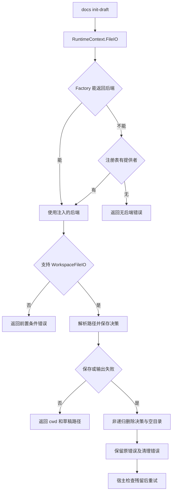
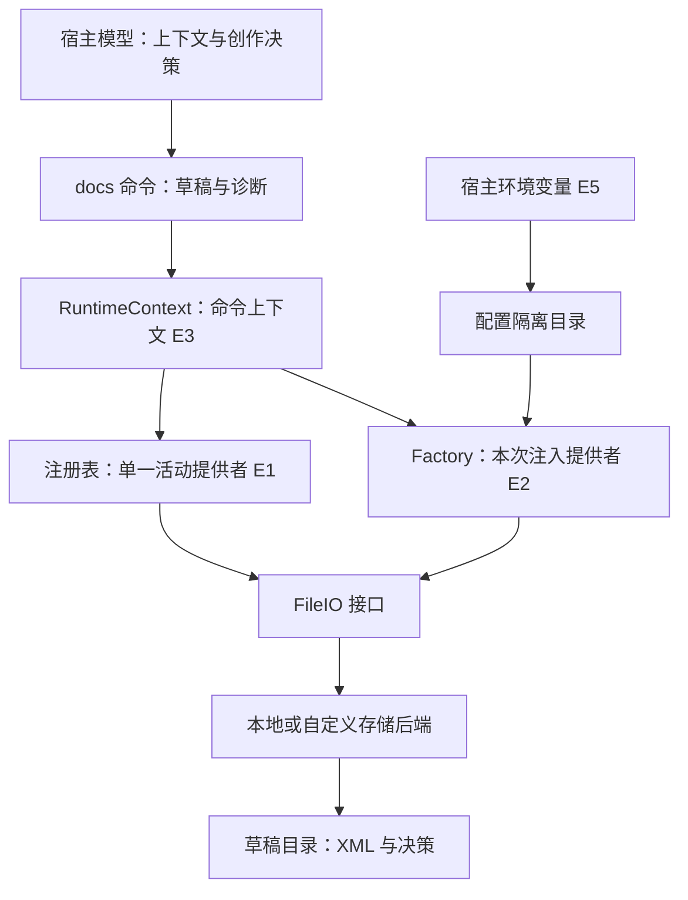

# 飞书文档：文件后端、草稿状态与验收基线
研究日期：2026-10-27；固定版本：larksuite/cli @ 017b19a793ad71794a02887ede04757f3d82e10d。源码静态核对，未实跑。接续[文档路由方案](lark-doc-routing-and-validation.md)，属于同一技能组的依赖深化，不新增整包完成数。

## 问题与适用条件
具体问题：同一条 docs +script 命令嵌入不同宿主后，文件究竟写在哪里，检查的是什么，失败时能否安全清理？Skill 文本规定流程，CLI 承担文件访问与部分验收，但宿主仍决定工具是否被调用、以什么后端运行。本方案适合把 CLI 嵌入 Agent 的场景；不代表飞书服务端或所有宿主已验证。

## 原文与证据
[本次7份源码节选及哈希](../evidence/2026-10-27/lark-code/manifest.json)保留 MIT 许可；完整文件不代表所有函数都已审计，manifest 分别记录阅读范围。script、XML 两份原文复用既有快照，并与既有 SHA256 核对。固定上游根地址为 https://github.com/larksuite/cli/tree/017b19a793ad71794a02887ede04757f3d82e10d 。

|证据|文件与已核对范围|结论性质|
|---|---|---|
|E1|extension/fileio/types.go、registry.go 全文|源码接口契约与注册实现|
|E2|internal/cmdutil/factory_default.go 的 NewDefault；factory.go 的 ResolveFileIO|源码注入链|
|E3|shortcuts/common/runner.go 的 RuntimeContext、FileIO、ResolveSavePath|源码回退逻辑；未读完整个 runner|
|E4|internal/vfs/localfileio/localfileio.go 全文|本地后端调用；原子写底层实现本轮未展开|
|E5|internal/core/workspace.go 全文|配置隔离与环境探测|
|E6|skills/lark-doc/references/lark-doc-script.md、lark-doc-xml.md 全文|官方操作契约|
|E7|上一轮已备份 docs_script.go，本轮重读 newDocsScriptWorkspace、保存与清理函数|源码可见的工作区机制|

## 输入输出与职责
init-draft 输入 presentation-decision JSON，输出 cwd、workspace、draft_path。决策文件已落盘，XML 只预留路径。parse 输入 content 或 doc，可显式指定 presentation-decision；输出 assessment、profile、diagnostics。模型选择约束、写 XML、理解诊断；CLI 解析、调用文件接口并返回结构化结果。模型会话、配置目录、草稿目录、线上文档四者不能混为一个状态。

E6 明确描述性字段如 audience、reader_task、purpose 不参与通过/失败判定。visual_plan 条目仅 type 和 min_count 都有效时才启用数量检查；缺失约束不检查，但显式非法值仍拒绝。passed 因此不是任务验收的同义词。

## 流程图
实线按 E1—E4、E7 源码还原；最后“修复后重试”为宿主处理建议，不是后台自动重试。

## 架构图

图中自定义后端是扩展接口允许的替代实现，不表示本次取得并运行了某个云端后端。

## 调用链与状态边界
默认构造通过空导入触发 localfileio.init 注册，NewDefault 把 GetProvider 的结果保存到 Factory.FileIOProvider。注册表是单值、后注册覆盖先注册，不像凭据链依次尝试多个来源。Factory.ResolveFileIO 使用当前上下文委托给提供者；RuntimeContext.FileIO 优先返回 Factory 结果，结果为 nil 才查询注册表。因此不能笼统写“所有命令始终直接读全局注册表”，也不能宣称没有 Factory 就一定失败。

newDocsScriptWorkspace 对后端做 WorkspaceFileIO 类型断言；不支持非递归清理能力时拒绝开始。保存决策调用普通 Save；清理先检查预期路径形状，再删除决策文件和空目录，遇到清理失败通过 errors.Join 保留两种错误。非空目录不能被当成可随意递归删除的临时垃圾。

core.Workspace 是配置隔离上下文，不是 draft 工作区。默认配置根为 LARKSUITE_CLI_CONFIG_DIR 或用户目录下 .lark-cli；非 local 的运行目录追加 openclaw、hermes 或 lark-channel。环境探测有优先级，属于进程信号路由，不是用户身份认证，也不是沙箱安全边界。这能防止研究时把“换了配置目录”误认为“文件访问已经隔离”。

## 权限、副作用与失败
LocalFileIO.Open 先 SafeInputPath，再 openValidated；Save 先 SafeOutputPath，再创建父目录并调用 AtomicWriteFromReader。这里只确认调用关系，没有审计所有平台竞态分支。SaveExclusive 则走 ExclusiveWriteFromReader，接口明确要求目标已存在时失败且不留下半成品。

尤其要区分两个“独占”：script 文档称独占工作区，已读源码通过随机路径降低冲突，但保存基线调用的是 Save，不是 SaveExclusive。本轮没有看到这条保存路径提供排他提交保证，因此不把命名唯一性宣称为严格并发隔离；需要继续读底层原子写、碰撞测试和创建路径。

E6 的 --content 不调用 OpenAPI，并不表示没有任何网络：上一轮已读资源预检可探测远程图片。XML 规则要求 callout 只容纳指定子块，pre 内必须嵌 code。parse 明确不是 XML/SDK schema validator；模型仍需遵守这些规则，服务端接收还须独立确认。

## 验收、反例和对照
|方式|提供的保证|不提供的保证|
|---|---|---|
|Skill 写“不得修改决策文件”|对模型的行为要求|存储只读或防篡改|
|自动加载决策|复用草稿旁的检查基线|禁止显式决策覆盖|
|随机草稿路径加普通 Save|任务路径区分、普通写入|严格的排他提交保证|
|ExclusiveFileIO|接口约定提交时拒绝已存在目标|业务内容正确|
|Workspace 配置子目录|配置路由与隔离位置|任意文件访问隔离|

替代实现是仅调用基础 FileIO 的通用文件保存，适合不拥有临时条目的命令；需要失败清理的创作流程必须要求 WorkspaceFileIO。更强的“不可变验收基线”可以由宿主保存基线哈希、限制覆盖并审计变更，这是本仓建议，不能写成上游现有能力。并发禁止覆盖则应依赖排他提交，不能用 Stat 后 Save 模拟，因为两步之间可能插入另一写者。

反例一：模型把必需图块从显式决策中删掉，再 parse 得到 passed，不能据此证明原要求完成。反例二：注入后端支持 Save 却不支持清理，普通下载可能工作，但 init-draft 拒绝；“能写文件”不能推导“能运行全部文档工作流”。

## 学习练习（设计，未运行）
实现两个内存假后端：A 只有基础 FileIO，B 另实现 WorkspaceFileIO。给定相同决策，检查 A 在能力断言处失败；B 保存后模拟输出错误，观察仅删除一个决策文件和空目录。再模拟两个写者对同一路径先 Stat 后 Save，与提交时排他保存对照。练习不需要飞书账号或模型额度；预期来自已读分支，尚无运行证据。

## 接续
本轮新增阅读 lark-doc 目录内2份，累计6/44，剩余38份；整包仍未完成。下一步追 @file 参数展开与决策文件读取路径、底层原子写和相关测试，再读 XML 扩展块与 whiteboard。当前路径文档冲突只明确了后端可替换边界，没有宣布所有命令路径语义已解决。
