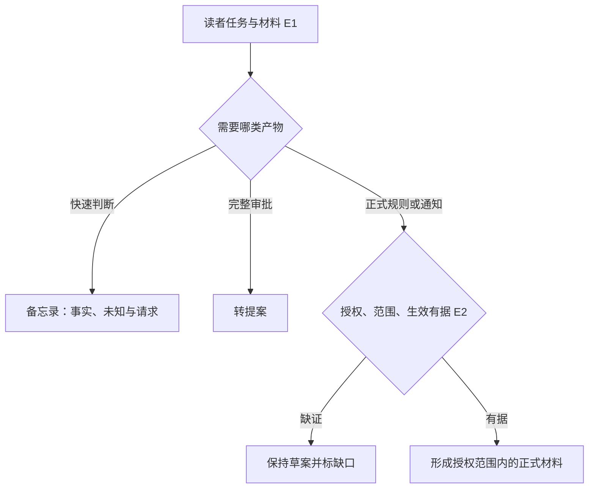
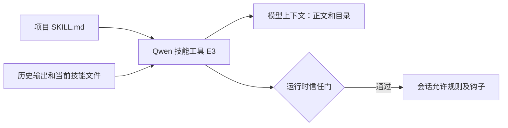

# 从备忘录到正式材料：正文、授权与执行副作用

2026-11-08，P1-01 并行技能线。飞书固定 `017b19a793ad71794a02887ede04757f3d82e10d`，Qwen Code 固定 `53e3e3ac2a01c2c933075d4941d0d2ceb18b106e`。源码静态核对，未实跑。

## 问题与证据

| 证据 | 固定原文 | 核对内容 |
| --- | --- | --- |
| E1 | [办公路由](https://github.com/larksuite/cli/blob/017b19a793ad71794a02887ede04757f3d82e10d/skills/lark-doc/references/genres/route-workplace.md) · [备忘录](https://github.com/larksuite/cli/blob/017b19a793ad71794a02887ede04757f3d82e10d/skills/lark-doc/references/genres/memo-brief.md) | 按读者任务选规则；事实不足且仍要求批准时标记 blocked。 |
| E2 | [正式材料](https://github.com/larksuite/cli/blob/017b19a793ad71794a02887ede04757f3d82e10d/skills/lark-doc/references/genres/formal-doc.md) | 正式规则、通知、整改与已核定立场各有证据；草案不能暗示签发。 |
| E3 | [Qwen 技能工具](https://github.com/QwenLM/qwen-code/blob/53e3e3ac2a01c2c933075d4941d0d2ceb18b106e/packages/core/src/tools/skill.ts#L423) · [副作用实现](https://github.com/QwenLM/qwen-code/blob/53e3e3ac2a01c2c933075d4941d0d2ceb18b106e/packages/core/src/tools/skill-utils.ts#L470) | 首次加载、去重、恢复匹配、运行时授权与钩子分离。 |
| E4 | [上游测试源码](https://github.com/QwenLM/qwen-code/blob/53e3e3ac2a01c2c933075d4941d0d2ceb18b106e/packages/core/src/tools/skill.test.ts) | 读到不受信任仍加载正文、重调恢复副作用、恢复不受信任技能不重新启用等断言，未运行。 |

## 输入输出与流程

飞书输入是具名读者、用途、授权材料及时间点。短备忘录支持告知、决策摘要和会前准备，输出真实事实、未知项和行动请求。完整资源审批走提案，已授权规则或安排才进入正式材料路径。整改则需要发现、对应措施及核验依据。关键授权缺失时保持草案并标缺口，正式版式不能使它生效。规则里的 `blocked` 是提示约束，未验证宿主是否实际拦截。

## 架构和状态

Qwen 工具入参含 `skill` 名称。执行端加载正文，并以 `llmContent` 传回模型，已加载时可以仅回确认。执行器先尝试应用副作用，再决定是否重发正文，因此重复调用可能在信任状态变化后补注册。Workspace Agent 会话跳过副作用；项目技能要求显式目录信任，允许规则和钩子属于运行时状态。恢复时先清加载追踪、按名称对照当前正文与目录构造的输出，历史正文相等或以该正文加换行开头才匹配，然后还要复核技能目前是否允许模型调用以及副作用条件。匹配失败不据该历史输出重新授权。此处只核到工具与辅助函数，实际权限判定、钩子触发重检和 CLI／IDE 信任更新仍需追下游。

## 验收、反例与练习

共同问题是读取信息后能否执行有副作用的动作。飞书叶规则靠作者与宿主遵循内容约束，Qwen 代码在技能激活路径实际区分正文与权限副作用。适用于正式文档的迁移方案是在写入前由程序检查批准依据、适用范围和生效状态，再由人核授权真实性。这样能拒绝缺字段，增加材料结构化成本，也不能自动判断真实批准。

离线练习用合成的“拟于下周实施”材料生成短备忘录和正式通知，检查前者是否保留未知、后者是否保持草案。再为模拟项目技能设置 `allowedTools` 和空操作钩子，比较可信／不可信目录、恢复匹配／修改正文四种情形的正文、会话规则和钩子注册。预期正文读取与允许规则分别变化。练习仅设计；未执行钩子、文件写入、业务 API 或模型。后续核对飞书跨技能与宿主，以及 Qwen 权限经理和钩子发射器。
