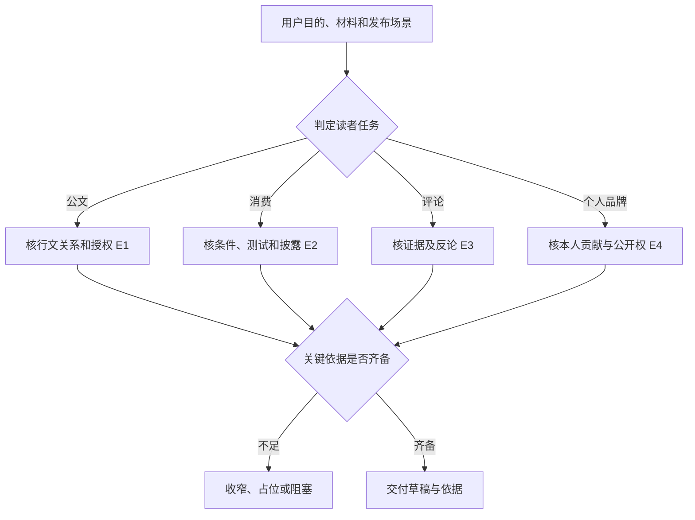
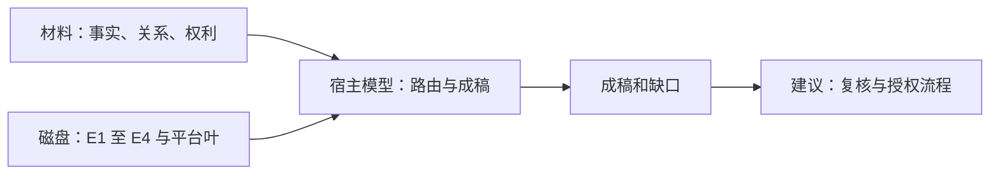

# 飞书体裁证据门槛与目录收口

2026-11-12，固定 `017b19a793ad71794a02887ede04757f3d82e10d`。最后四份目录规则全文读完。适用于同一材料可能落入正式公文、消费测评、评论或个人介绍时的选路与验收。

| 证据 | 固定原文 | 关键输入与输出边界 |
| --- | --- | --- |
| E1 | [公文内容稿](https://github.com/larksuite/cli/blob/017b19a793ad71794a02887ede04757f3d82e10d/skills/lark-doc/references/genres/official-redhead.md) | 机关关系、行文目的和授权决定文种；只交审校内容稿。 |
| E2 | [消费决策](https://github.com/larksuite/cli/blob/017b19a793ad71794a02887ede04757f3d82e10d/skills/lark-doc/references/genres/route-consumer.md) | 同一评价标准、测试条件、价格口径与商业关系；结果给条件化选择。 |
| E3 | [观点评论](https://github.com/larksuite/cli/blob/017b19a793ad71794a02887ede04757f3d82e10d/skills/lark-doc/references/genres/route-opinion.md) | 区分事实、推断与价值判断；给足能动摇结论的反论。 |
| E4 | [个人品牌](https://github.com/larksuite/cli/blob/017b19a793ad71794a02887ede04757f3d82e10d/skills/lark-doc/references/genres/route-personal-brand.md) | 可核本人角色与贡献，区分团队成果，核对披露和公开权限。 |

公文报告与请示分别处理汇报和请求批准。消费测评需区分独立比较与品牌控制的演示。评论以可争辩判断为目标，个人品牌以可核能力与贡献为目标。E2/E4 明确平台成稿优先走平台叶，保留消费或个人身份约束。路由规则来自提示文件，未验证宿主选择或门禁。

## 恢复、替代与练习

当关键材料缺失，先找确切缺项或降低主张强度，不从成稿推出已签发、已发布或已完成鉴权。模板没有执行外发，未核宿主工具权限。对照 [MindSearch 引用](mindsearch-citation-integrity.md)，两者均需区分“有引用形状”和“有可核证据”。替代方案是在成稿前以结构化字段验证角色、事实来源和关键许可，同时保留人工判断主张是否越界。字段检查增加维护成本，不能代替语义审校。

离线练习用同一项团队项目写公文审校稿、独立消费比较、评论和个人案例。移除批准文件、品牌披露、关键反论或本人角色四种材料，检查各稿是否留下不同缺口。练习未运行。44/44 只指此出现路径的目录阅读，跨技能 lark-shared、lark-whiteboard、lark-okr、SDK 重试及宿主行为仍待核。
