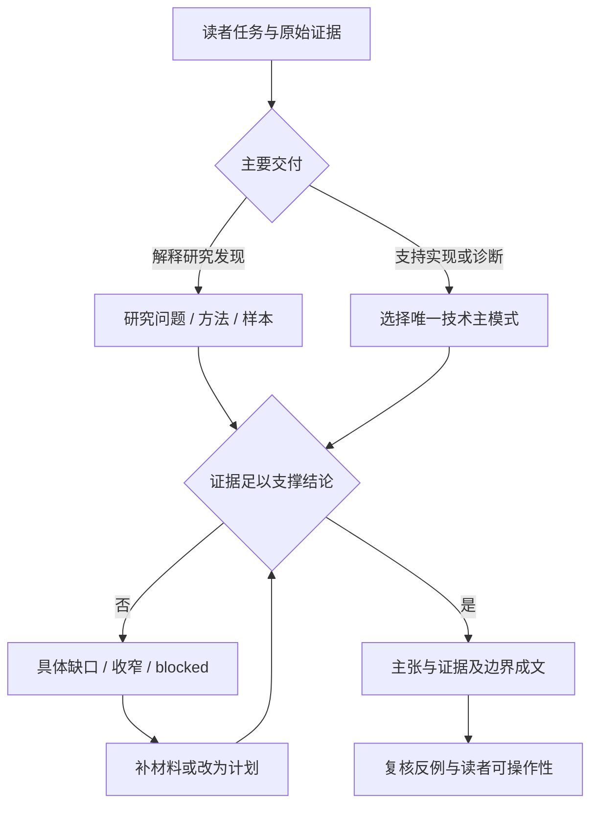
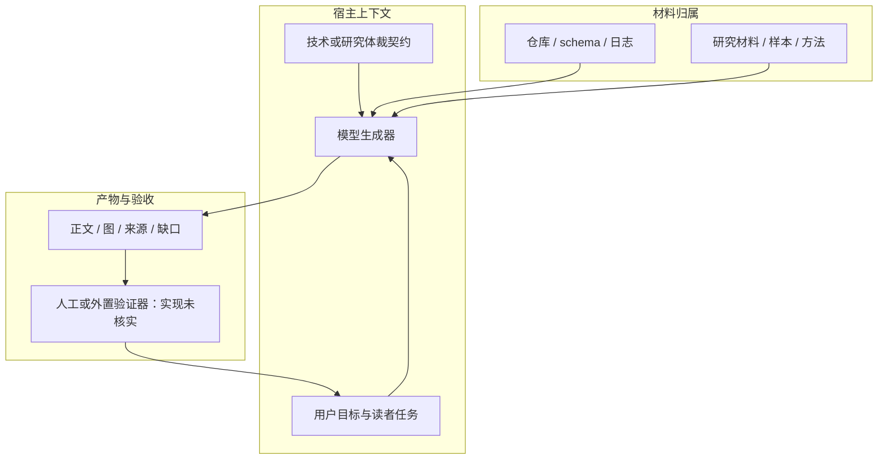

# 技术方案：技术文档与调研报告的证据路由

日期2026-11-04；固定larksuite/cli @ 017b19a793ad71794a02887ede04757f3d82e10d，MIT。仅两份体裁参考全文阅读，作为既有lark-doc组的依赖子单元，未运行模型或CLI。

## 问题、来源与适用条件

用户说“调研并写技术方案”时，关键词不足以决定产物。官方[技术文档契约](../../snapshots/larksuite/cli/017b19a793ad71794a02887ede04757f3d82e10d/files/skills/lark-doc/references/genres/technical-doc.md)要求唯一主模式：design_rfc、api_reference、incident_diagnostic；[调研报告契约](../../snapshots/larksuite/cli/017b19a793ad71794a02887ede04757f3d82e10d/files/skills/lark-doc/references/genres/research-report.md)要求明确问题、方法、发现和限制。两者是给模型的提示契约，不是本轮发现的机器校验器。

## 输入、输出与调用边界

输入是读者任务、已有原始材料、环境版本和证据范围；输出是选定主模式的文档或收窄范围/blocked结果。技术文档的输入可能是schema、日志或设计取舍；研究报告的输入可能是抽样、访谈或检索材料。无原始材料时研究报告只能给范围/计划，不生成findings。

宿主需要把用户意图、对应体裁参考和材料装入模型上下文；何时自动加载、如何限制上下文、怎样强制格式，本轮未追到实现。模型生成正文，读者或另行配置的验证器检查内容；这两份文件自身不执行工具、API、状态保存或恢复。

## 流程图

下图为依据两份提示契约整理的宿主工作流，不宣称程序强制执行。

## 架构图

## 状态、权限、副作用与错误

技术契约要求区分事实、推断、决定、未知；API参考不能从示例推断未规定语义，故昨日revision研究仍须保留服务器语义缺口。诊断文档要求先用可区分假设且副作用低的检查，不把未知故障直接写成根因。涉及改状态时，授权、停止、还原和恢复判据是提示要求，不是权限系统证据。

研究契约要求方法披露、反例、负结果、替代解释；引文不能被当作频率，样本不能任意外推。缺方法时收窄为探索性观察，关键缺口影响结论则blocked。这与本仓“保存原文不等于读完、未跑不说复现”相容，但不意味着模型必然遵守。

两参考未定义分页、重试、持久状态、模型请求schema或完成退出码，不能虚构这些工程实现。文档可用“已验证命令”的要求，本轮不执行命令，因此输出仅为研究解释，练习明确未运行。

## 对照、验收与反例

| 同一材料 | 技术文档路线 | 调研报告路线 |
| --- | --- | --- |
| 三次故障日志 | incident_diagnostic：影响、假设、区分检查、恢复 | 不足以自动产生总体故障频率 |
| 两个API实现 | design_rfc：同口径备选与取舍；或api_reference明确契约 | 有检索纳排和综合方法才形成证据综合发现 |
| 只有客户一句引文 | 说明具体需求或待验证假设 | 不能写成“大部分客户都这样” |

替代实现是只按模板填标题，成本较低却可能隐藏证据缺口；当前方案把路由与证据约束前置，但增加材料核对成本。独立验证器可检查来源存在和字段完备（本仓建议），仍不能仅靠结构判因果或方法有效。暂无收益实验。

验收者要能从每条关键主张回到材料，区分实现事实与建议，并理解unknown为何保留。图不能成为唯一证据。三种技术模式混写或摘要冒充研究发现，都按原文契约视为失败，而不是本轮已执行的自动失败规则。

## 学习练习与接续

未运行练习：给出同一“API请求超时”材料，分别写设计RFC、API参考、故障诊断的第一段，并说明哪个满足当前读者任务；再把三条用户引文改成有范围限制的探索性观察，禁止补造样本量。预期可观察的是结构与主张强度差异，不能据此证明模型性能改善。

本轮新读2份目录依赖，累计15/44；这两份还引用data-report、business-analysis、white-paper等未读依赖，未关闭整包。下一步继续这些消歧依赖和既有SDK/跨技能待办。
