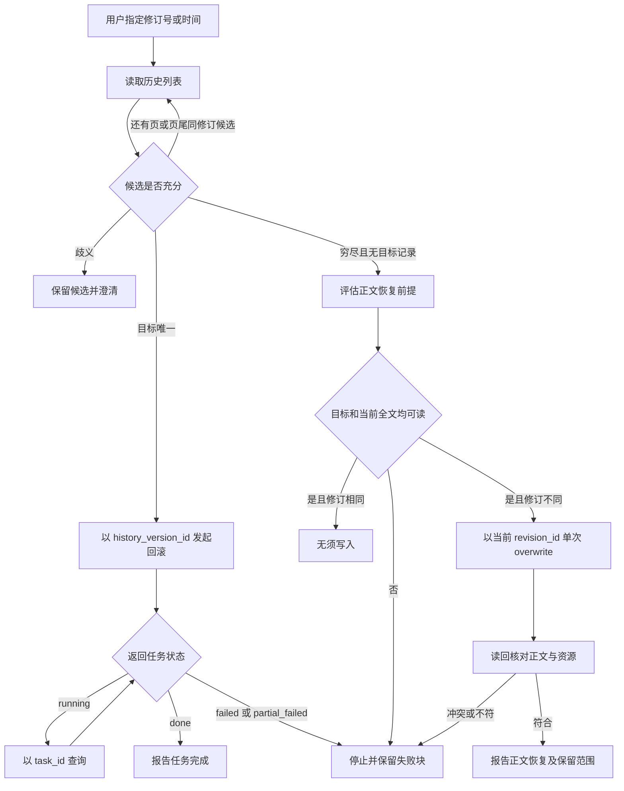
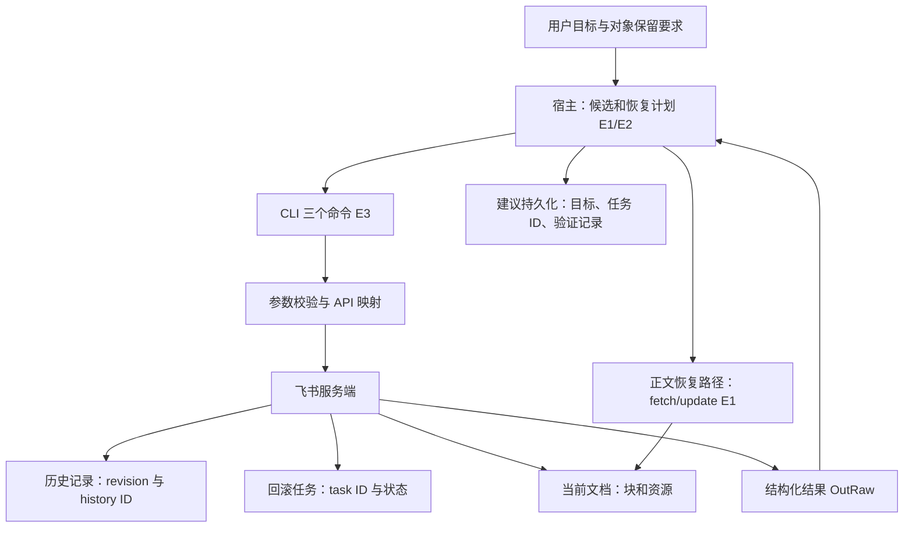

# 飞书文档：异步回滚与正文恢复的两层状态机

日期：2026-10-29。固定版本：larksuite/cli @ 017b19a793ad71794a02887ede04757f3d82e10d。状态：源码与技能静态阅读，未实跑。属于既有 lark-doc 组的依赖深化，非新入口或整包验收。

## 问题与适用条件

用户说“恢复到昨天的版本”，Agent 需要把自然语言目标映射到真实版本，并确认恢复结果。这里同时存在历史记录、文档修订和异步任务三种标识。把它们当成同一个整数，可能恢复错误版本；把工具调用无错误当成完成，则可能在部分失败后误报成功。本卡研究 Docx 历史恢复及缺失历史记录时的正文恢复，不代表完整版本控制系统。

## 原文与证据

本轮[节选原文与校验清单](../evidence/2026-10-29/lark-code/manifest.json)保存完整文件和 MIT 许可。下表 E1—E4 均全文阅读。

|证据|固定文件|性质与范围|
|---|---|---|
|E1|skills/lark-doc/references/lark-doc-history.md|官方技能契约：分页、目标选择、异步状态、正文 fallback|
|E2|skills/lark-doc/references/lark-doc-update.md|官方技能契约：Observe→Diagnose→Patch→Verify，资源与 ID 保护|
|E3|shortcuts/doc/docs_history.go|源码：三个命令的校验、HTTP 参数、结果回传|
|E4|shortcuts/doc/docs_history_test.go|上游测试代码：参数、dry-run、单次模拟响应；本轮未执行|

固定源代码入口：[docs_history.go](https://github.com/larksuite/cli/blob/017b19a793ad71794a02887ede04757f3d82e10d/shortcuts/doc/docs_history.go)。正文 fallback 的 update 服务端实现与通用传输重试本轮未追完，不把技能承诺升级为服务端事务保证。

## 输入输出与职责

revision_id 是文档修订号；history_version_id 是历史列表返回的回滚目标；task_id 是回滚请求返回的异步任务标识。E1 示例里 revision_id=42 对应 history_version_id="11"，两者不能互换。history_version_id 的本地校验只检查可解析为正 int64；即使把修订号错传成正数字也可能通过，业务关联必须由列表结果保证。

模型/宿主读取用户目标及工具 JSON，负责选择候选、翻页、歧义处理和恢复计划。CLI 验证参数并调用 API；服务端拥有历史记录、文档与异步任务状态。三个 Execute 分支各调用一次 CallAPITyped，随后 OutRaw；本文件没有自动翻页、自动循环查询或自动正文恢复。通用传输层内部重试不在本轮已读范围。

列表 GET histories 发送 page_size（1—20）及可选 page_token；回滚 POST history/revert 发送 history_version_id、wait_timeout_ms（0—30000）；状态 GET history/revert_status 发送 task_id。等待参数是请求体字段，不是该 CLI 文件内的 sleep/poll 循环。三个命令支持 user/bot，回滚声明 write_only 与 readonly scopes，其余声明 readonly；声明权限不证明当前账号已授权。旧 doc URL 在本地拒绝，wiki→Docx 解析链本轮未审计。

## 流程图

下图为 E1 的宿主操作契约，API 适配由 E3 支撑；不是声称 CLI 自带整个状态机。

## 架构图

最后的持久化记录是本仓迁移建议；E3 未实现跨会话任务台账。模型上下文如何压缩、调度器如何唤醒，也没有在此 CLI 文件中定义。

## 状态、失败与副作用

E1 要求按时间解析 RFC3339，不能拿不同偏移的时间字符串直接排序。按 revision_id 搜索未命中需翻页到底；命中页尾还要看下一页的相邻候选。网络或权限错误不能当“版本不存在”而触发覆盖恢复。多候选难区分则停在选择阶段。

running 仅表示任务进行中；partial_failed 与 failed 是失败终态，保留 failed_block_tokens。E4 的 TestDocsHistoryExecuteRevertStatus 模拟 partial_failed，依然期望命令不返回 error，同时检查输出保留失败状态与块。这直接说明“命令无异常”和“业务完成”是两层判定。本轮只是读了测试，不声称测试通过或服务端行为已复现。

正文恢复需先取得目标与当前完整正文，拒绝 fragment，并核对目标修订号。同修订不写；不同修订去旧块 ID，以当前 revision_id 做一次 overwrite，非空 reference_map 随正文传递。写后重新读取，比较结构、文本、链接和引用资源，忽略重建的块 ID。warning、partial_success 或 revision conflict 不能直接触发再次覆盖。评论等非正文对象未必保留，因而“正文相同”不等于“文档所有对象恢复”。

超时或断线后能否确定服务端已接受请求、回滚是否幂等，E3 不足以证明。宿主应记录已取得的 task_id，再查询而非盲目重新 POST；尚未取得 task_id 的不确定状态仍需额外服务端契约。本仓建议将重试策略按读与写区分，不能套用通用无限重试。

## 对照：两种恢复实现

|维度|历史回滚 API|fetch + overwrite 正文恢复|
|---|---|---|
|目标标识|history_version_id|目标 revision_id，写入基线用当前 revision_id|
|进度与完成|task_id，running/done/失败终态|单次写结果加全文读回|
|适用前提|历史列表中可确认目标|历史目标记录缺失但目标完整正文仍可读|
|主要代价|分页与异步任务管理|完整读取、资源映射、块 ID 重建和内容比对|
|边界|本轮未证明保留所有非正文对象|明确不能保证评论等非正文对象|
|自动化归属|CLI 提供单次 API 调用，宿主调度|技能要求多步操作，非 history 命令自动 fallback|

局部编辑则优先 E2 的最小 patch：写前定位，写后重新 fetch，不重用失效 ID。它是另一种业务任务，不应当拿来冒充历史回滚。没有同预算实验，以上只比较可见契约，不宣称哪条路线成功率更高。

## 验收、反例与学习练习

反例：收到 code=0、status=partial_failed 即向用户说恢复成功；把 revision_id=42 直接送进要求 history_version_id 的字段；第一页没找到就 overwrite；写后沿用旧 block ID 重试。这四种错误分别暴露完成判定、类型语义、检索完整性和状态新鲜度缺口。

可控练习（设计，未运行）：用假列表构造两页，第一页尾与第二页首分别包含 revision_id=42、history_version_id=11/12；宿主应收齐候选而非立即选择。确认一个候选后，模拟 running→partial_failed，预期只执行一次回滚 POST、查询状态并报告失败块，不启动正文覆盖。再构造目标修订与当前修订一致的全文响应，预期写次数为零。验收比较调用序列及最终报告，不能只检查进程退出码。练习无需真实飞书账号、模型额度或上游脚本。

## 接续

本轮目录累计从8/44到10/44；整包与跨技能依赖仍未验收。继续读取 @file 展开与决策文件读取链、update 的 revision 冲突映射及通用重试范围。源码 docs_script.go 本轮只复读决策选择与解析函数，不计全文新增阅读；显式决策优先于相邻文件，文件缺失视为无约束，其他读取错误保留错误，文件/stdin 不走 shell 引号恢复。相关参数展开尚未追完，不能宣布路径语义冲突已解决。
