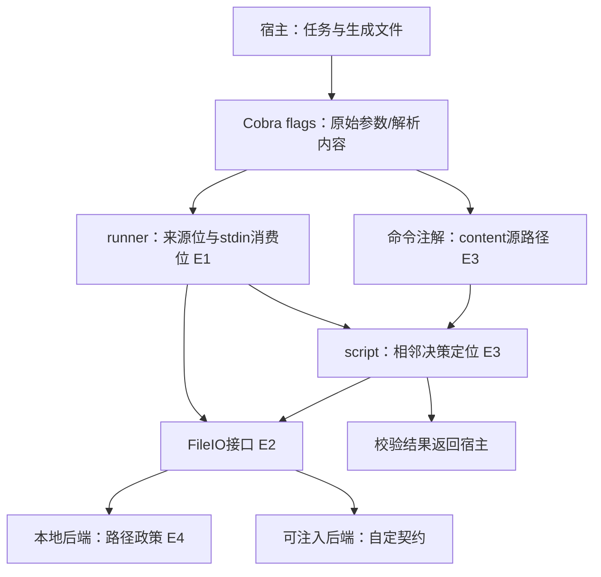

# 飞书CLI：文件输入、来源标记与验收基线
日期：2026-10-30；固定 larksuite/cli @ 017b19a793ad71794a02887ede04757f3d82e10d。源码静态核对，未实跑。延续 lark-doc 的进行中依赖研究。

## 问题与证据
具体任务是把 draft.xml 与决策 JSON 交给 docs +script parse。参数展开后只剩文本，程序如何知道它来自文件、怎样寻找旁边的验收基线、路径到底由谁允许？关键不是给模型再加一句提示，而是保留来源信息并明确访问层。

[原文与哈希清单](../evidence/2026-10-30/lark-code/manifest.json)区分完整文件保存与实际阅读范围。E1 为 runner.go 的 runShortcut、resolveInputFlags、StripUTF8BOM、InputResolvedFromSource、MarkInputResolved；E2 为 cmdutil/resolve.go 全文；E3 为 docs_create.go 的路径捕获与 docs_script.go 的安装、校验、决策选择/解析函数；E4 为 localfileio.go、path.go、policy.go；E5 为 runner_input_test.go 全文；E6 为 doc_resource_path.go 全文。固定链接均在manifest；没有执行上游测试。

## 真实输入输出与职责
声明 Input 的字符串参数才展开：@path 走文件后端，- 走一次性stdin，@@x变为字面量@x；无Input声明的参数不展开。runner将内容写回Cobra flag，并用inputResolved保存来源位。宿主模型负责生成文件/命令、读取诊断；CLI负责读取、解码与校验；模型上下文不会因此自动获得所有文件内容，只有工具返回与宿主另行读取进入上下文。

docs +script安装PreRunE捕获器，在参数变为正文前保存原始content路径到命令注解。显式非空presentation-decision优先；否则有content路径才读取同目录.presentation-decision.json；无路径或该文件不存在均表示没有基线，其他文件错误不会被吞成缺失。该状态只属于本次命令对象，不是长期记忆。

## 流程图
以下为所读函数的调用关系；错误后的重新生成输入由宿主决定。
```mermaid
flowchart TD
 A["原始 content 参数"] --> B["PreRunE 保存单@路径"]
 B --> C["runner 展开已声明输入"]
 C --> D{"输入来源"}
 D -->|文件| E["ReadInputFile → FileIO.Open"]
 D -->|stdin| F["检查仅消费一次"]
 D -->|直接或@@| G["保留为直接值"]
 E --> H["去首个BOM并标记来源"]
 F --> H
 H --> I["Validate 与决策选择"]
 G --> I
 I --> J{"显式决策非空"}
 J -->|是| K["解析显式JSON"]
 J -->|否且有路径| L["读取相邻决策文件"]
 J -->|否且无路径| M["无决策基线"]
 L -->|不存在| M
 L -->|有效| K
 L -->|其他读取或解析错误| X["返回错误"]
 K --> N["后续画像与约束检查"]
```

## 架构图


## 两种实现不能互相代替
|行为|runner.resolveInputFlags E1|cmdutil.ResolveInput E2|
|---|---|---|
|文件/stdin空白|保留，仅去掉首个BOM|TrimSpace，并拒绝空结果|
|空文件|允许进入领域校验；E5明确断言|返回空文件错误|
|BOM|移除开头一个|本函数没有专门移除|
|来源位|记录file/stdin，@@仍是inline|只返回string/error|
|stdin限制|本次调用仅一个flag消费|函数本身无跨flag消费位|
|单引号|未在该解析器去引号|直接值可去外层单引号|

因此不能见到一个ResolveInput函数，就把它的空白语义套到所有快捷命令。实际runner只复用ReadInputFile，而非调用ResolveInput。E5还断言缺文件错误可被errors.Is识别、重复stdin返回参数错误。这里只读断言，未运行测试。

决策解析据来源位决定是否尝试shell引号恢复：file/stdin严格解析失败就返回，不猜测修复；inline才有受限恢复机会。更细的恢复算法本轮未审计。注意空白的显式决策经TrimSpace为空时会回到相邻文件路径，而非强制空基线。

## 路径政策、失败与边界
ReadInputFile始终委托当前FileIO.Open，保留路径验证与缺文件错误原因。默认LocalFileIO.Open调用SafeInputPath，再openValidated；最后一步的平台实现本轮未展开，不能宣布所有竞态已排除。path.go与policy.go的可见规则是：真实路径需在cwd、Unix /tmp或账户~/files允许根内，并且拒绝根优先；相对路径还需留在cwd。绝对路径不是一律禁止，也不是一律允许。Windows临时根另由账户目录推导，不能把Unix规则直接套用。

所以旧说明“只用相对路径”和提示“可用绝对路径”应拆成宿主政策与默认本地实现两层；自定义后端可能更严格。本轮解决默认后端的静态语义，不宣布全部宿主文档冲突都消失。stdin接收的是宿主已提供的字节，不能据文件读取政策推导它能拦截所有敏感输入。

相邻基线调用ReadInputFile直接读原始字节，而显式@decision经过runner去BOM：同一带BOM JSON在两条路径的处理不同，这是代码推导的待实验反例。自动基线缺失仍可继续，意味着passed只能解释为现有约束下通过，不能证明基线从未丢失。E6另规定XML资源相对路径仅在cwd路径缺失时尝试XML目录；权限/政策错误、绝对路径和markdown均不走该回退。它与“决策固定从XML相邻位置读取”不是同一种搜索策略。

## 验收、替代与练习
迁移建议：除内容外保留source_kind、source_path、内容哈希，避免展开后再猜文本是不是路径；这是设计建议，上游这里只保存来源位及局部路径注解。若任务要求基线不可缺失，应由宿主记录并核验基线存在与哈希；上游代码没有提供这种不可变保证。

练习（未运行）：分别输入带首个BOM的JSON、空文件、纯空白、@@file、两个stdin参数，比较两个解析器输出；再对同一JSON比较显式@decision与相邻决策读取。预期按上表判定，不把所有空输入一律失败作为正确答案。测试使用自造文件与假后端，无须账户或模型。业务验收仍需内容质量和最终产物读回，输入解析成功不替代。

接续：上游挂载路径的完整dry-run分支、openValidated平台细节、update修订冲突与通用重试范围。此卡完成快捷命令输入与决策选择静态子链，不包含全部CLI入口。
