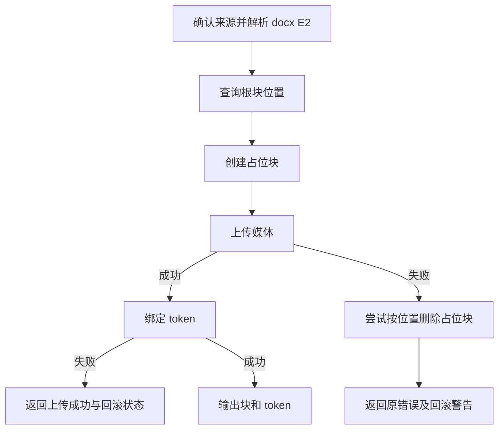
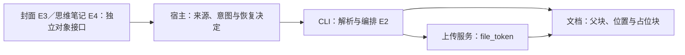

# 飞书媒体插入、封面资源与思维笔记的边界

2026-11-11，固定 `017b19a793ad71794a02887ede04757f3d82e10d`，新读三份目录依赖并静态核对插入实现。适用于需要插入图片、替换封面或编辑已有思维笔记的 Agent。

| 证据 | 原文 | 范围 |
| --- | --- | --- |
| E1 | [媒体说明](https://github.com/larksuite/cli/blob/017b19a793ad71794a02887ede04757f3d82e10d/skills/lark-doc/references/lark-doc-media-insert.md) | 来源选择、写入意图、输出 |
| E2 | [插入代码](https://github.com/larksuite/cli/blob/017b19a793ad71794a02887ede04757f3d82e10d/shortcuts/doc/doc_media_insert.go) · [测试](https://github.com/larksuite/cli/blob/017b19a793ad71794a02887ede04757f3d82e10d/shortcuts/doc/doc_media_insert_test.go) | Docx 解析、创建、上传、绑定、补偿和输出；测试未运行 |
| E3 | [封面](https://github.com/larksuite/cli/blob/017b19a793ad71794a02887ede04757f3d82e10d/skills/lark-doc/references/lark-doc-resource-cover.md) | 独立资源与空封面删除状态 |
| E4 | [思维笔记](https://github.com/larksuite/cli/blob/017b19a793ad71794a02887ede04757f3d82e10d/skills/lark-doc/references/lark-doc-mindnote.md) | 文档 token、节点、图片 token 与 client_token |

## 输入、输出与流程

正文插入接收 `--doc` 和互斥的文件／剪切板来源，输出 document_id、block_id 和 file_token 等字段。封面走 resource-*，思维笔记的节点操作走 mindnotes nodes。封面令牌、正文媒体令牌、Wiki 节点和 Mindnote 文档 token 各有对应对象。E1 仍写 Wiki URL 不支持，E2 的 resolveDocxDocumentID 却能查询 Wiki 节点并在 obj_type=docx 时继续。此为同版本文档和实现差异，正文记录两者，快照不改写。

## 部分成功与重试

占位创建成功后，上传或尺寸读取失败会尝试删除。绑定失败时错误提示明确携带 phase=bind_media、upload_succeeded、file_token、block_id、replace_block_id 和 rollback。回滚失败建议先检查或修复现有块。这里可见的补偿调用删除的是父块的索引区间，不是一个跨服务事务，也没有在此函数中删除已经上传的媒体。由此推断，并发修改父块会使旧索引的有效性成为待测条件。E2 的单元断言检查半开区间和文件嵌套块结构，没有在本轮证明并发原子性。

E3 说明封面 URL 下载需 HTTPS、地址过滤、跳转复验和大小限制，具体服务实现尚未追。空封面删除返回 already_empty，不能据此推断插入操作幂等。E4 的 client_token 是节点写入幂等入口，重试同一业务操作应保留同一个 token；换 UUID 是新请求的教学推断，服务端去重窗口仍待验证。E4 的新建思维笔记指引会转到白板，两个对象是否等价仍待跨技能核查。

## 对照、验收和练习

与 [Lagent 通用执行器](lagent-action-status-and-hooks.md)比较，状态枚举只能提供粗粒度结果；媒体工具还需记录已经发生的上传和补偿。可替代方案是持久化阶段与恢复信息，补偿前读回确认目标块身份，增加状态读写与冲突处理。该建议未实现。

验收应读回确认目标位置及 token，失败时核对上传、占位和回滚。离线练习模拟“上传成功、绑定失败、删除失败”，要求宿主输出残留状态和检查入口，禁止把失败重试当作必然无副作用。再模拟 Wiki→docx 与 Wiki→其他类型，比较文档声明及源码分支。练习未运行。
