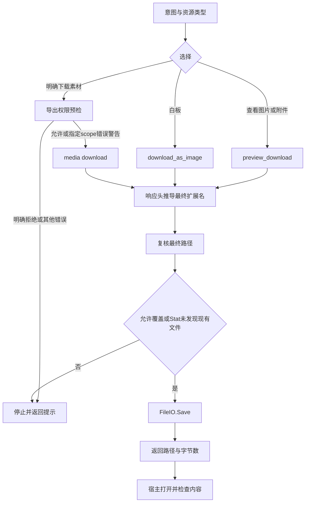
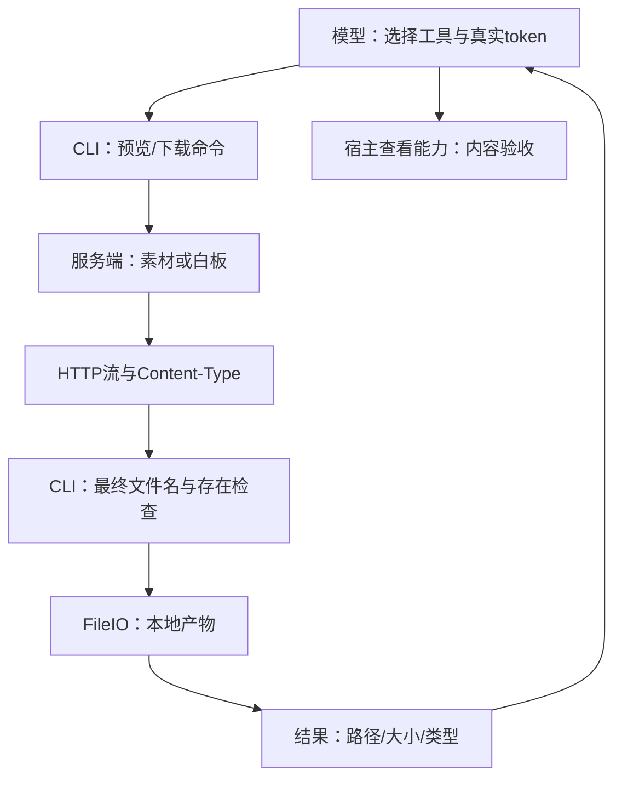

# 飞书素材：预览与下载也有本地副作用
日期：2026-10-30；larksuite/cli @ 017b19a793ad71794a02887ede04757f3d82e10d。两份技能参考与doc_media_preview.go、doc_media_download.go全文静态阅读，未实跑。原文见[清单](../evidence/2026-10-30/lark-code/manifest.json)。

## 问题与输入输出
用户只说“看一下附件”，技能选择media-preview；明确下载选择media-download；白板缩略图必须download --type whiteboard。两者都要求token和output，都会保存本地文件，再输出saved_path、size_bytes、content_type。Risk=read描述不能推导为零文件副作用；模型还需打开产物才算看过内容。

## 证据与调用链
E1：两份media技能参考给出选择、token来源与权限失败提示。E2：doc_media_preview.go校验token与输出路径，GET drive/v1/medias/:token/preview_download，preview_type=16。E3：doc_media_download.go对media先调用CheckDriveFileExportPermission，然后GET medias/:token/download；whiteboard走board/v1/whiteboards/:token/download_as_image并以.png作兜底。权限助手、HTTP错误映射与扩展名解析内部未在本卡审计。

E3的权限检查返回allowed=false则拒绝；特定授权scope错误只警告并继续下载，由后续接口再次判定；其他错误返回恢复提示。这不是客户端取得额外权限。技能建议权限失败后改用预览，不等于CLI自动fallback，也不证明任意下载受限素材都能预览。

## 流程图

## 架构图

## 状态、权限、反例
源码先校验输出路径，收到响应并追加扩展名后再次校验最终路径；防覆盖检查也在最终名上做。它使用Stat后Save，不调用SaveExclusive：若另一写者在两步之间创建目标，不能据此保证不覆盖。这是静态竞态推导，非已实跑漏洞。Stat非nil错误也不在此分支细分，而继续Save，最终由保存层返回结果或错误。

没有CLI状态机自动打开图片，也没有凭size_bytes判定内容可用的保证。网络流失败、文件系统错误与业务权限失败不可互换。工具默认不覆盖已有文件不等于事务级排他；普通Save的原子写也不能补上排他保证，参见[原子提交研究](lark-atomic-publication.md)。

## 对照与可迁移方案
预览与下载是两个不同API路线，但都生成本地文件；白板另有入口。比起先Stat再Save，后端SaveExclusive能在提交时拒绝已存在目标，更适合宿主要求严格不覆盖的场景；这是替代设计，不宣称此两命令已使用它。原子性、排他性、内容正确性分别验收。

练习（未运行）：假后端让Stat返回不存在，再在Save前插入同名文件；比较普通Save与排他保存的结果。另模拟响应Content-Type追加.png，检查最终路径而非原始output是否冲突。最后返回非空但不可解码图片，验证宿主不能只凭保存成功报告“已看清”。不需要真实业务服务。

本轮lark-doc目录新增2份，累计12/44；跨技能lark-shared、网络实现与平台实测仍未完成，整包状态不变。
