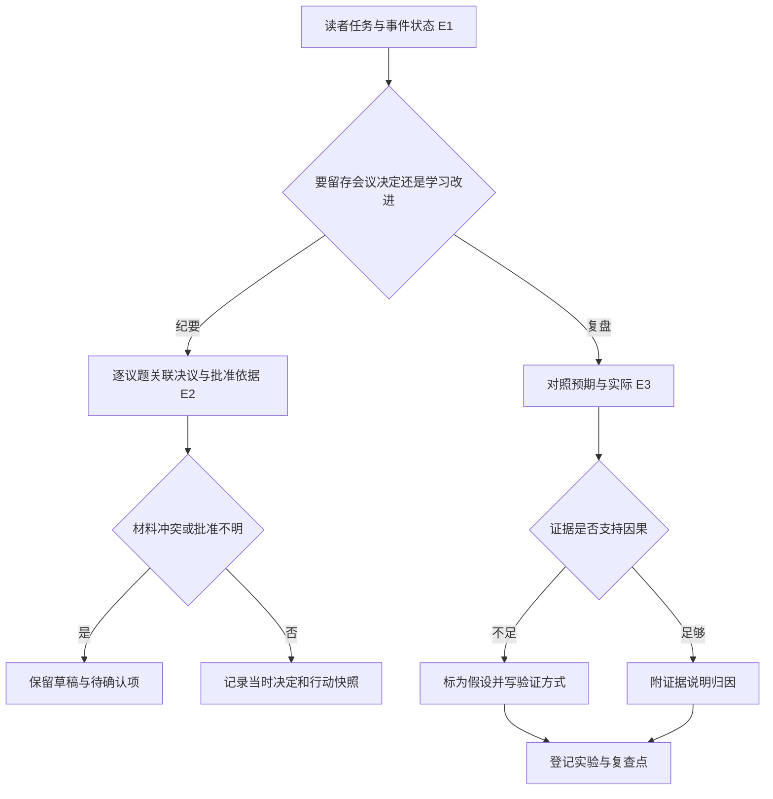
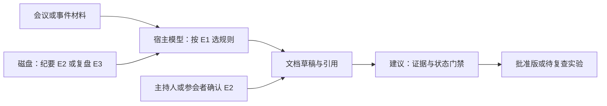

# 飞书会议纪要与复盘的证据契约

2026-11-08。P1-01 并行技能线，固定版本 `017b19a793ad71794a02887ede04757f3d82e10d`。静态阅读与字节复核。

## 问题与适用条件

同一份事件材料可能要交付两种东西。会议纪要是某次会议的治理记录，读者需要确认什么已经决定、谁负责、哪些仍未批准。复盘以已结束事件为输入，读者需要知道观察依据、竞争性解释，以及下一轮怎样验证改进。进行中的故障仍按技术调查路由，周期当前状态走周报。

| 证据 | 已读原文 | 能证明的范围 |
| --- | --- | --- |
| E1 | [办公路由](https://github.com/larksuite/cli/blob/017b19a793ad71794a02887ede04757f3d82e10d/skills/lark-doc/references/genres/route-workplace.md) | 按读者任务和生命周期只读一个叶规则，排除条件优先。 |
| E2 | [会议纪要](https://github.com/larksuite/cli/blob/017b19a793ad71794a02887ede04757f3d82e10d/skills/lark-doc/references/genres/meeting-minutes.md) | 按议题记录决定、异议和行动；治理状态固定为文字，缺证保持草稿。 |
| E3 | [复盘](https://github.com/larksuite/cli/blob/017b19a793ad71794a02887ede04757f3d82e10d/skills/lark-doc/references/genres/retrospective.md) | 分开观察、解释和行动；证据不足保留可证伪假设；行动要能复查。 |
| E4 | [Trae 宿主与完成边界](../ownership-review-2026-11-08.md) · [既有源码拆解](../../cases/bytedance-lark.md) | 可记录运行轨迹，完成信号及特定配置下的补丁检查只证明各自条件。 |

## 输入、输出与流程

真实输入材料包括议程、出席记录、审阅材料、动议或票决、录音或逐字稿，以及复盘所需的目标、实际事件、指标、交付物和上轮行动。E2 要求产出会议身份、记录状态、决定或未决、交付物、责任人和时间。E3 要求产出预期与实际、应保留条件、因果假设、带验证条件和跟踪位置的实验。上述是提示文件中的文档契约，未发现这两份叶规则定义机器可执行的结构模式。

## 架构与状态归属

审批和法定人数的来源是会议材料或具备确认职责的人。后续任务卡即使勾选完成，也不能改写会议当时状态。对因果证据，时间上先后出现只能建立观察顺序。若涉及安全或法务且证据不足，E3 明确转技术调查并标记 `blocked`。技能本身没有授予发布、改审批或发消息的权限；CLI 写入、并发更新、取消和幂等仍由宿主及工具负责，未在此轮测试。

## 验收、反例与替代实现

会议接受条件是每项已决状态可追来源，冲突显式标注，缺批准证据时继续以草稿展示。复盘接受条件是观察能回链、因果表述和证据强度一致，实验有负责人、时间、可观察标准及复查入口。反例是逐字稿里一句“可以考虑上线”被写成已批准，或看到工具调用后异常便将它定为根因。E4 中，补丁非空也只证明工件存在。共同设计是将工具返回、文档状态和外部验收保存为独立字段。

一种适用于高治理风险的替代方案是在模型成稿前用结构化决议台账记录 `source_id`、`approval_state` 和当时行动快照，并为复盘保留 `observation`、`hypothesis`、`test`。程序检查字段与引用，人审语义和真实授权。相较单用文本技能，它增加录入与维护成本，可确定地拒绝缺字段。对漏判率和工作量没有实验数据。

## 学习练习与接续

用合成材料做离线对照。会议转录只有“先讨论灰度”，任务卡后来被勾选。监控显示超时和发布相邻，另有上游流量变化。要求分别生成纪要和复盘，检查纪要是否保持待确认、复盘是否写出区分两种解释的实验，例如按同负载条件对照发布前后错误率，并指定复查时间。练习仅设计。待核其它体裁、跨技能引用、宿主实际加载及线上写入边界。
