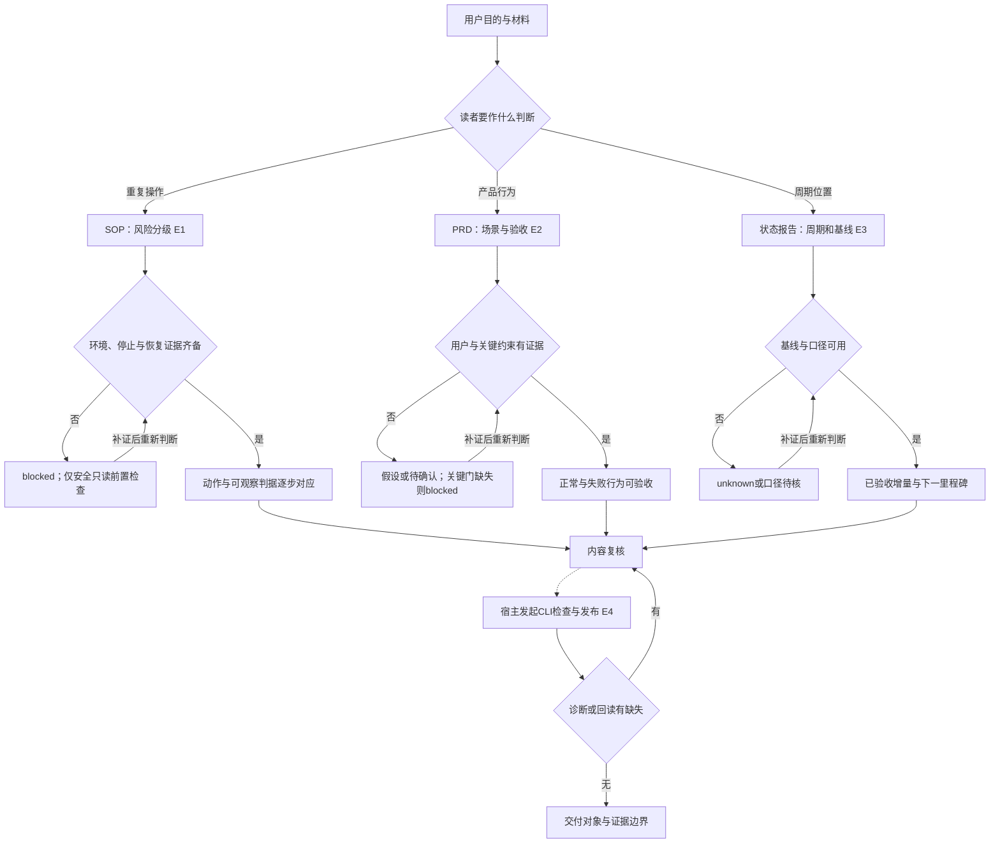
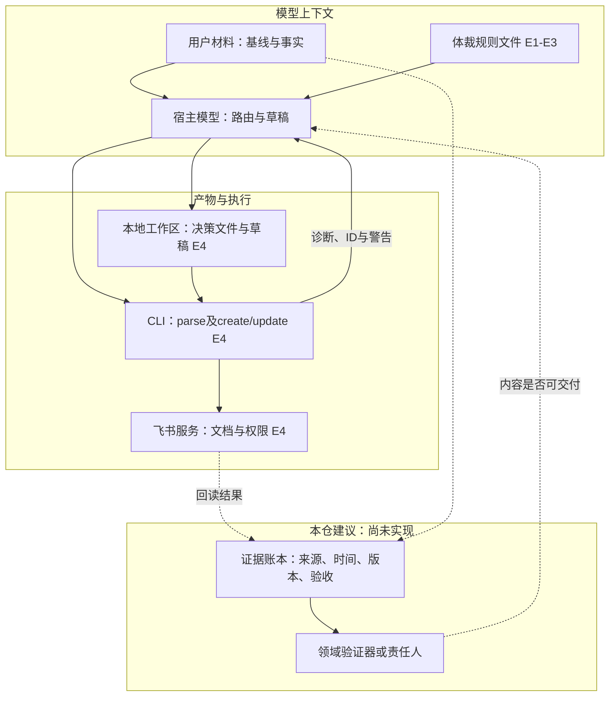

# 技术方案：SOP、产品需求与周期报告的证据契约

研究ID LARK-EVIDENCE-20261107；2026-11-07。官方技能提示文件静态全文阅读；固定 larksuite/cli @ 017b19a793ad71794a02887ede04757f3d82e10d。本轮3份依赖读完，目录24/44，整组未完成，未运行宿主、CLI、模型或业务操作。属于进行中技能子单元，不代表P2/P3/P5验收。

## 问题与适用条件

同一项目的“下一步”“完成”“已批准”在三类文档中含义不同。PRD约定产品应有什么可观察行为；SOP规定具备条件的人如何重复取得终态；周期报告说明截至某时点已取得什么证据。若把三者混在一起，模型会把需求写成已验证命令，把工作活动写成已验收产出，或用格式完整掩盖授权和恢复缺口。这里研究的是办公文档Agent的内容契约，不是让Agent执行SOP里的操作。

## 原文与证据

三个文件全文均与既有规范快照逐字一致，字节数、SHA256和上游Git blob一致，见[本日清单](../evidence/2026-11-07/source-manifest.json)。根MIT许可证已回读；未新增原文镜像或完整归档。以下“要求”来自官方提示文本，不能升级为已实施的机器校验。

| ID | 事实及边界 | 固定原文 | 已读范围 |
| --- | --- | --- | --- |
| E1 | SOP按routine、controlled、high-risk增加证明义务；命令成功不等于业务终态；未知关键项使可发布稿blocked | [sop-tutorial.md](../../snapshots/larksuite/cli/017b19a793ad71794a02887ede04757f3d82e10d/files/skills/lark-doc/references/genres/sop-tutorial.md) | 全文 |
| E2 | PRD在方向/投入原则已定后描述actor、trigger/precondition、observable outcome、failure/edge；无用户证据时收窄为假设 | [prd.md](../../snapshots/larksuite/cli/017b19a793ad71794a02887ede04757f3d82e10d/files/skills/lark-doc/references/genres/prd.md) | 全文 |
| E3 | 周期报告比较基线和已验收产出；无基线或数据不足时unknown，冲突口径不能强行合并 | [weekly-report.md](../../snapshots/larksuite/cli/017b19a793ad71794a02887ede04757f3d82e10d/files/skills/lark-doc/references/genres/weekly-report.md) | 全文 |
| E4 | 入口和创作工作流把模型决策、草稿、parse诊断、线上创建及回读分开 | [先前调用链](lark-doc-routing-and-validation.md) | 本轮回读研究卡；其固定源码与原文沿原卡范围，不计新读源码 |
| E5 | AppBuilder success和mimoagent Idle是控制流结束信号，不能独自证明业务通过 | [两实现源码对照](tool-outcome-and-termination.md) | 本轮回读已保存方案；不声称重新运行或完整复审下游评分器 |

## 输入、输出与组件职责

原文的真实体裁标识为workplace.sop_tutorial、workplace.prd、workplace.weekly_report。它们是内容选择标识，不是API方法。E1的风险分类是routine（常规）、controlled（受控）、high-risk（高风险）。E2的需求表达由角色、触发/前置、可观察结果、失败/边界组成；这是一条写作规则，并非已见JSON schema。E3要求对象、周期/截至时间、基线、产出、偏差、下一里程碑和请求事项，原文未定义统一持久状态结构。

实际链条的可见部分：用户提出读者任务 → 模型按入口选择创作工作流与体裁参考 → 模型组装材料和表达决策 → 模型产出草稿 → CLI执行草稿初始化/parse以及经授权的create/update → 诊断或线上对象状态回到宿主 → 模型修订并回读。前三份新文件只约束内容；工具执行与结果链引用E4既有源码研究。宿主如何保证加载、模型如何遵循、业务事实是否真实，都不是这些文件可证明的。

输出分别应是带动作/判据/恢复记录的操作文档、带行为/验收/依赖的需求文档、带周期/基线/证据增量的状态报告。文档发布成功只证明发布层结果；产品是否达到需求、SOP是否经验证、报告数据是否完整须另验。

## 流程图

图按E1—E3还原提示规定，并用虚线连接E4已研究的执行链。不是声称源码有一个自动门禁函数。

## 架构图

E1—E3只拥有规则文本，没有业务状态库。下面实线是概念上的接口/产物关系，虚线是本仓提出的验证层，尚未实现。E4的文件状态与线上状态分开保管。

## 状态、上下文与执行契约

**证明义务不同。** SOP的controlled增加审批、接受/拒绝、偏差和代表性试跑；high-risk再增加前置检查、暂停检查点、go/no-go、停止、可执行恢复与恢复验证。有状态迁移还须记录写入归属、检查点、幂等与完整/无重复/有序或等价验证。这里只报告文本要求，不声称文件包含任何恢复实现。

PRD不能把实现偏好伪装成用户需要；目标值未知要写待产品/数据确认，并给真实已知的确认责任和时点，不能为填空编造负责人。周期报告也不能用会议数、工时、绿色标签推导完成率；冲突数据保留口径差异。这些都是向模型提供的语义约束，容易受遗漏和上下文截断影响。

**状态归属。** blocked是文稿可交付状态，unknown是证据不足的判断状态，均不是工具进程状态、外部审批系统状态或Agent取消信号。原文未定义它们的序列化、恢复或版本冲突处理。保留草稿不等于恢复业务现场；报告有截止时间也不等于数据已完整分页。

**权限与副作用。** 阅读规则不授予操作系统或飞书权限，生成SOP不授予执行命令权限。E4已显示初始化写本地文件、部分parse可能访问网络、创建写线上对象；这些动作仍由实际宿主/CLI和身份控制。本轮没有执行它们。三份文件未实现超时、并发仲裁、取消、分页和事务；需要相关组件证据，不能因为写着“停止/回滚”就推定可用。创建部分成功应先回读原对象，不能盲目重建。

## 验收和反例

| 情形 | 可检验判据 | 应拒绝的结论 |
| --- | --- | --- |
| SOP写“必要时回滚”，没有触发、步骤、停止和恢复后验证 | E1关键恢复义务缺失；文稿仍待补证 | 有回滚标题所以可安全执行 |
| PRD写“体验更好”，没有角色/情境/结果/异常 | E2不可验收，须拆可观察行为 | 模板章节齐全即需求完成 |
| 周报没有基线却声称80%、绿色 | E3应unknown，追回分母/周期/验收证据 | 文笔肯定代表状态确定 |
| parse通过而SOP命令未验证 | E4只支持所启用检查通过 | 格式通过证明操作有效 |
| Agent返回success或Idle，尚无产品验收记录 | E5控制流结束；另查外部终态 | 循环结束等于业务完成 |

本轮只做原文与论证复核，没有跑自动语义验证器，也没有用户实验。原文“任一出现即失败”仍是提示表达；不能将其误称程序断言。

## 横向比较与选择

围绕同一问题“谁判定完成”比较独立实现：Lark把体裁要求放在提示上下文，CLI检查部分结构；AppBuilder由最后事件success结束迭代；mimoagent由无保留工具调用等路径返回Idle。后两者提供执行控制边界，前者提供内容质量义务，均不能单独替代业务终态验证。具体字段/异常分支沿E4/E5原卡，未把小米的未读grader画成已验证能力。

替代方案是本仓建议的显式证据账本：每条要求记录要求ID、来源/版本、验收谓词、证据时间、责任归属、未决原因；由普通程序检查缺项/冲突，语义与环境终态交给领域验证器或责任人。提示契约易扩展但依赖模型遵循；账本可追溯但增加维护、数据过期和验证器成本。没有实验比较成本或收益，不宣称某路线更可靠。对于简单短报告，可先人工复核固定字段，避免为了结构化牺牲真实性。

## 学习练习

设计完成，未运行。使用教学假数据，不接业务账号：
1. 给出已定方向“用户导出本地报告”，要求PRD写成功、空数据和失败行为；缺少时延基线，预期留下待确认项，不生成毫秒阈值。
2. 给出同功能的重复导出SOP请求，但不提供实际命令、恢复资产和环境验证；预期只形成待验证草稿/安全前置项，不编造可执行命令。
3. 给出周内两次评审活动及一个验收通过的假产物，另附互相矛盾的完成率；预期分别呈现产出与活动，保留口径待核。
4. 人工核对每个断言能否指向输入；删除一条关键证据再检查是否降级。要验证真实模型遵循率，应先固定模型、预算和样例集，再登记运行轨迹；本轮未做。

## 接续事项

[44文件清单](../evidence/2026-11-07/lark-dependency-progress.json)剩20份；跨技能、SDK v3.7.2、身份传输和宿主调度仍待核查。下批先恢复P1-01来源广度，再读少量meeting-minutes/retrospective等相邻依赖，避免无限扩展单一技能。入口内容组、occurrence依赖、宿主和实跑状态分别保留；不把3文件计成3组。
