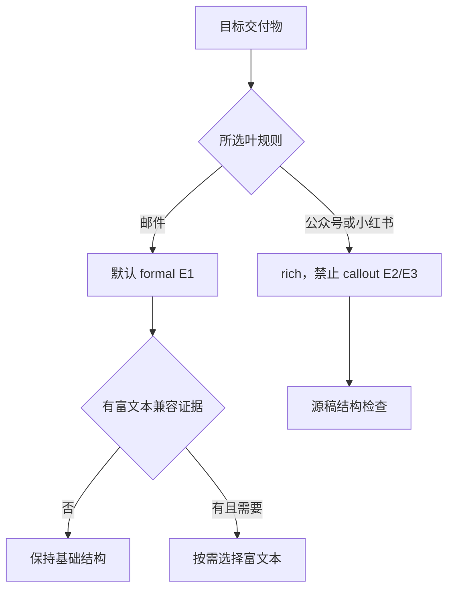
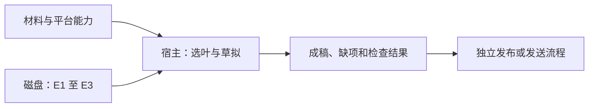

# 飞书平台叶规则与交付状态

2026-11-10，固定 `017b19a793ad71794a02887ede04757f3d82e10d`，全文静态阅读三份叶规则。

| 证据 | 固定原文 | 交付与约束 |
| --- | --- | --- |
| E1 | [邮件](https://github.com/larksuite/cli/blob/017b19a793ad71794a02887ede04757f3d82e10d/skills/lark-doc/references/genres/email.md) | 默认 formal，不用封面或目录；富文本须有目标兼容证据；实际邮箱操作走 lark-mail |
| E2 | [公众号](https://github.com/larksuite/cli/blob/017b19a793ad71794a02887ede04757f3d82e10d/skills/lark-doc/references/genres/wechat.md) | 默认 rich，围绕一个读者任务，至少给出视觉方案，禁 callout |
| E3 | [小红书](https://github.com/larksuite/cli/blob/017b19a793ad71794a02887ede04757f3d82e10d/skills/lark-doc/references/genres/xiaohongshu.md) | 默认 rich，首屏交代场景与判断，真实体验不可编造，禁 callout |

输入为明确的成稿目标、事实材料和承载能力，输出为成稿及缺项。若邮件附件尚未提供，则留占位；未确认邮件富文本兼容时用基础结构。公众号和小红书的 `profile.blocks` 是飞书源稿检查约束，平台审核和实际发布另有状态。未核对跨技能发送链或宿主是否强制门禁。

对照[DeerFlow 模型请求归一化](deerflow-model-input-normalization.md)，飞书在内容交付前选择平台约束，DeerFlow 在发送模型请求时执行结构转换。可替代的做法是用平台结构校验器拒绝不支持的块，增加兼容矩阵维护成本，真实身份、事实和授权仍需外部材料。离线练习用同一份项目更新生成三稿，移除附件与邮件富文本能力证据，检查邮件保留占位、两种平台稿不出现 callout，所有交付状态均只记录成稿。未实跑，未发送。
