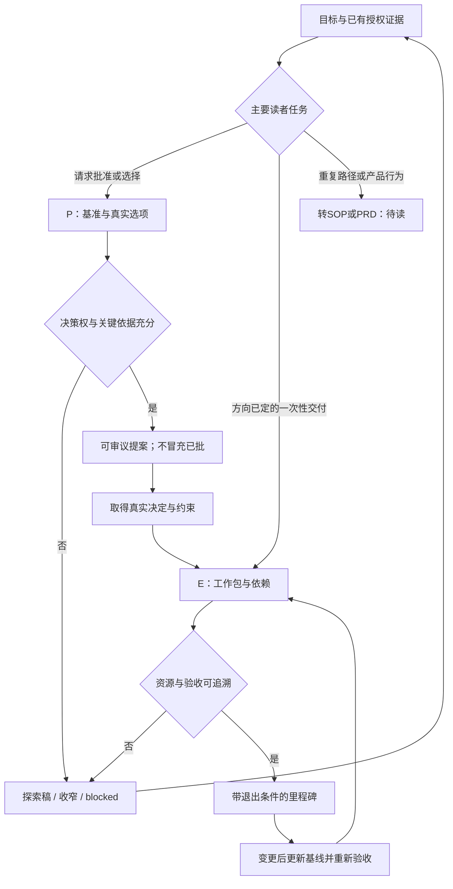
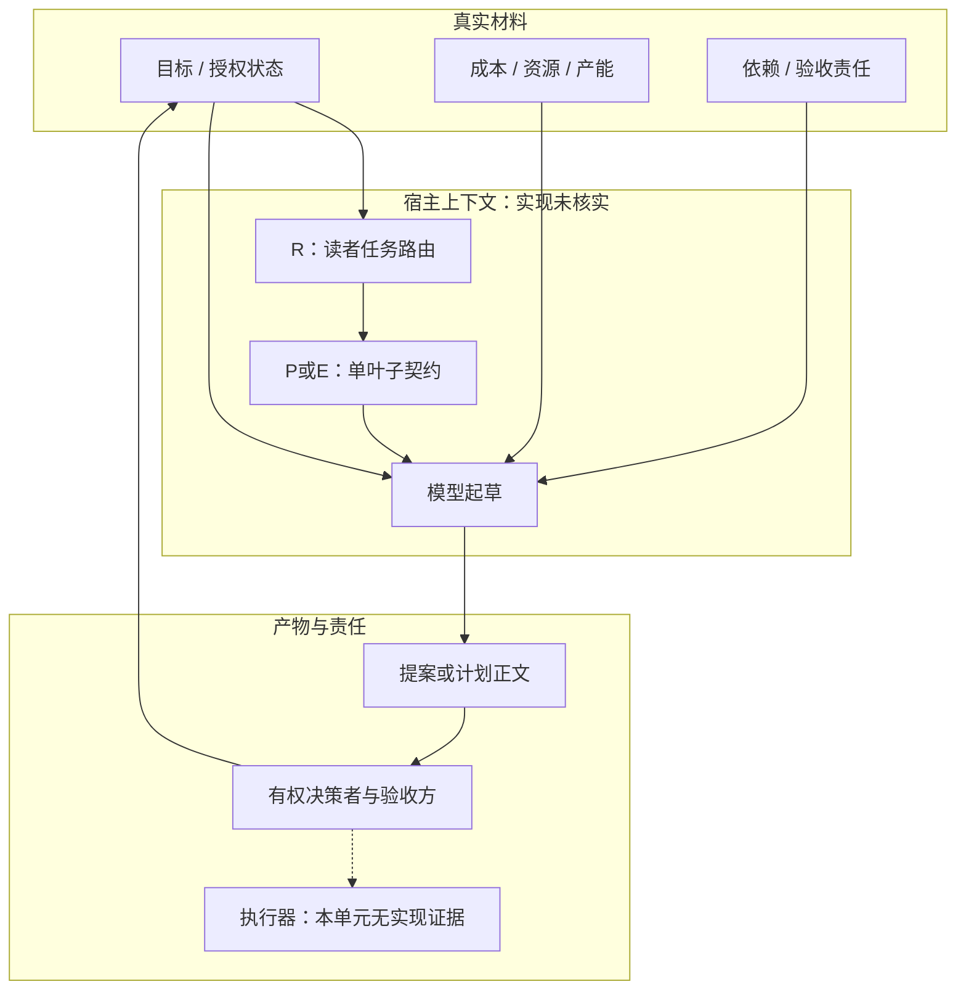

# 技术方案：从决策提案到可验收执行计划

日期2026-11-06；larksuite/cli固定017b19a793ad71794a02887ede04757f3d82e10d，MIT。完整静态读3份依赖，未运行模型、CLI或业务接口。此处Plan是文档契约，尚不是Harness计划执行器。

## 问题与适用条件

“给我一个上线方案”可能是在比较投入方向，也可能已经批准项目、只差排期。若仅靠“方案”关键词选择模板，模型可能把未批准资源写成承诺，或者把日期表当成可执行计划。适用于办公、迁移、发布及一次性跨团队变更；不自动覆盖重复运维SOP。

## 原文与证据

| ID | 固定快照 | 可见事实 |
| --- | --- | --- |
| R | [route-workplace](../../snapshots/larksuite/cli/017b19a793ad71794a02887ede04757f3d82e10d/files/skills/lark-doc/references/genres/route-workplace.md) | 先按读者任务和生命周期选且只读一个叶子，排除信号优先于关键词 |
| P | [proposal](../../snapshots/larksuite/cli/017b19a793ad71794a02887ede04757f3d82e10d/files/skills/lark-doc/references/genres/proposal.md) | 明确决策者、请求和时点；比较现状/最小变化基准及真实选项 |
| E | [execution-plan](../../snapshots/larksuite/cli/017b19a793ad71794a02887ede04757f3d82e10d/files/skills/lark-doc/references/genres/execution-plan.md) | 已定方向转为交付、依赖、关键路径、owner、资源、退出条件与验收 |

原文哈希与备份读回见[清单](../evidence/2026-11-06/source-manifest.json)。R中的“只读一个叶子”是宿主执行该写作任务时的提示要求；本轮研究为对照而读取多个文件，不将研究对象指令作为本次工作规则。

## 输入、输出与真实边界

输入不是正式API schema，而是用户目标、现有批准状态、可行选项、成本/资源依据、依赖和验收责任。输出包括可审议提案、执行计划、探索稿、范围收窄或blocked。模型负责路由与起草；批准状态必须来自已有真实材料，不能由生成的文字倒推。

R将具名批准请求送P，将方向已定的一次性交付送E；比较策略而不形成批准入口可送商业分析；重复稳定操作送SOP，产品行为定义送PRD。只有P/E三份文件已在本单元闭合，其他分支仍为未读依赖。

P要求真实选择；没有替代项时说明约束怎样收敛，不捏造陪衬选项。E要求每个关键工作包有输入/输出、owner、依赖、完成定义和验收方；每个日期应能回溯到产能与依赖。它没有定义任务队列API、工具执行函数或模型调用参数。

## 流程图

按R/P/E提示契约整理；不是已验证宿主状态机。

## 架构图

虚线为本仓提出的集成边界，不表示技能会自动启动执行器或发送审批。

## 状态、权限、副作用与恢复

提示要求区分事实、估算、假设、未知和已确认承诺。P缺决策权、关键成本或必要依据时先收窄探索稿；仍要求批准则blocked。E资源或前提不清时缩范围、分阶段或设决策门；不得凭空补精确日期。这里没有新增授权流程的强制规则：用户已授权的动作仍按已有授权推进，不能每一步重新索要确认。

风险条目须带预警信号、动作、决策owner和切换后的业务终态；“加强沟通”不是恢复策略。变更须更新基线和重新验收，但如何落库、解决并发修改、保存历史未给代码。超时、取消、分页、重试与幂等也不在这三份参考中。blocked是文档表述，未证明它能让宿主停机。

## 对照、反例与替代方案

与[商业分析契约](lark-quantitative-evidence-contract.md)对照同一“上线Agent”需求：

| 场景 | 适用路线 | 失败反例 |
| --- | --- | --- |
| 比较自建、采购、维持现状 | 商业分析 | 无统一成本口径就按成功率排名 |
| 请负责人批准试点资源 | P提案 | 将建议写成已批准预算 |
| 已批准试点，组织交付 | E执行计划 | 只有日期与部门，没有完成定义 |
| 反复执行同一种已定流程 | R转SOP，待读 | 每次重写一次性项目计划 |

跨实现证据对照：本轮复读Coze Studio固定node_chat_prompt.go，能看到Eino的Jinja2系统消息、历史占位符(true)、当前输入占位符(false)的装配顺序；这是程序构造模板的事实。飞书R是“如何选择内容”的提示文本。前者不能证明有审批门禁，后者不能证明有自动调度器；两种证据解决不同层的问题，不能因提示中写了Plan便声称实现了计划执行。Coze来源及快照见[核查](../ownership-review-2026-11-06.md)。

本仓替代建议：对工作包另建结构化记录，字段含deliverable、depends_on、owner、acceptance、resource_assumptions、approval_evidence；检查依赖闭环、缺字段和变更影响，再生成正文。它比纯模板多出维护成本，且字段存在仍不能证明真实授权或产能足够。尚未实现或测量收益。

## 验收与学习练习

教学任务（未运行）：目标为“将一个测试Agent从旧环境迁移到新环境”。先给“预算待定、无验收人”的输入，应输出探索提案或缺口，不能声称上线日期已确认；再补“方向批准、测试集冻结、可用人员已确认”，拆导出、兼容检查、试运行、回退验证四个工作包。每包列输入输出、依赖和验收方；将“周五上线”改为“兼容检查通过且回退验证完成后”的退出条件，再按真实产能估计日期。

验收者检查目标→交付物→里程碑→工作包能否回链；随机删除一项关键依赖，计划应暴露缺口；新增约束后应说明基线如何调整。可用假数据离线练习，不调用业务API、不安装上游代码。本轮没有执行练习。

## 接续

目录从18/44到21/44，剩23，整包与宿主未验收。下一批读SOP/PRD/周期状态等叶子，对照一次性交付与重复执行；SDK重试、跨技能调用和宿主状态继续保留。P1-01未通过，不将本卡记作P3阶段验收。
