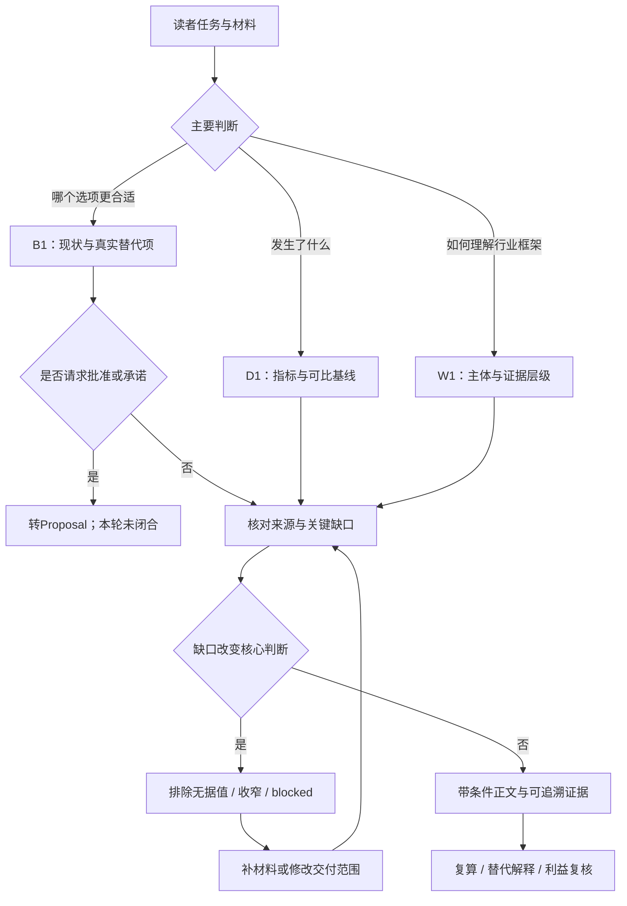
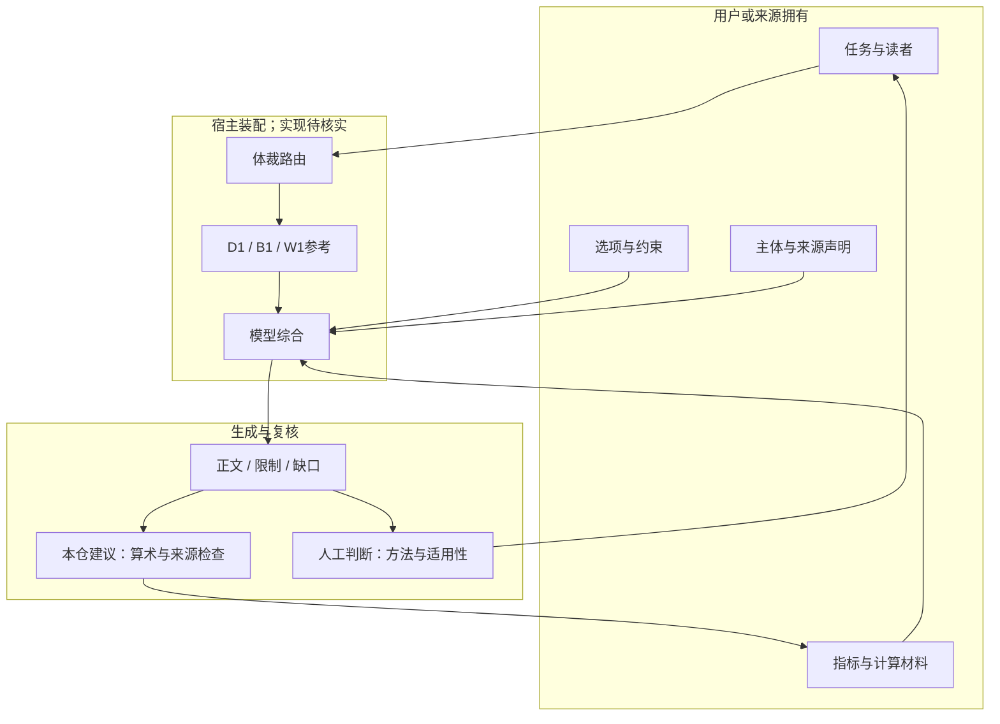

# 技术方案：数据报告、商业分析与白皮书的证据契约

研究日期2026-11-05；larksuite/cli固定017b19a793ad71794a02887ede04757f3d82e10d，MIT。沿上轮体裁消歧依赖继续完整阅读3份文件；属于同一lark-doc occurrence，未新增入口组。仅静态阅读，未运行模型或CLI。

## 问题与适用条件

用户给出几组Agent成功率，希望写“分析报告并推荐方案”。数字本身不决定体裁：解释指标、比较决策选项、建立面向行业的论证，分别需要不同输入与验收。若分母、成本边界或发布主体缺失，漂亮模板会掩盖本来应保留的未知。

## 原文与证据

| ID | 原文快照 | 已读规则与边界 |
| --- | --- | --- |
| D1 | [data-report.md](../../snapshots/larksuite/cli/017b19a793ad71794a02887ede04757f3d82e10d/files/skills/lark-doc/references/genres/data-report.md) | 指标定义、分子分母、时间窗、总体、来源版本、修订；缺定义等对应值不得进入结论 |
| B1 | [business-analysis.md](../../snapshots/larksuite/cli/017b19a793ad71794a02887ede04757f3d82e10d/files/skills/lark-doc/references/genres/business-analysis.md) | 现状/不行动与可行替代，同口径全周期比较、翻转条件；建议不等于批准 |
| W1 | [white-paper.md](../../snapshots/larksuite/cli/017b19a793ad71794a02887ede04757f3d82e10d/files/skills/lark-doc/references/genres/white-paper.md) | 发布主体、状态、利益关系、证据层级；名称和版式不能制造政策身份 |

三份是官方技能的提示文本，文件自称硬约束不等于宿主有机器门禁。哈希和读回见[来源清单](../evidence/2026-11-05/source-manifest.json)，与[上轮技术/研究路线](lark-genre-evidence-routing.md)互补。以下“要求”均指提示契约；本仓验收设计另标建议。

## 真实输入、输出与职责

这些参考没有API请求schema。输入概念来自正文：D1需要指标、基数、过滤/聚合、质量与不确定性；B1需要目标、成功标准、owner/时点、约束、真实替代项、全周期成本及关键假设；W1需要作者/发布主体、读者、使用场景、范围、文档状态、利益关系和支持主张的来源。

输出是对应结构的正文，以及受限观察、decision frame（决策框架）、concept note（概念说明）、缺口或blocked。B1尤其区分“分析支持判断”与“要求具名决策者批准/资源承诺”：后者应转Workplace Proposal，不能因为全文有推荐就认为已授权执行。该Proposal依赖尚未读完。

宿主应将适用契约和材料放入模型上下文，模型做消歧、综合和写作；自动加载入口与强制校验代码在本单元不可见。这三个文件既不执行计算工具，也不向飞书发布，更不调用财务审批；执行、状态回传和实际完成判据需外部宿主/工具补齐。

## 流程图

依据D1/B1/W1组织的提示工作流；不是已找到的程序状态机。

## 架构图

## 状态、权限、副作用与失败恢复

D1要求观测、解释假设、行动条件分开；缺分母不能用占位文字旁边的数字继续排名。不可比数据分开展示，限制紧邻对应发现，图同时有文字等价信息。显著性不等于效应大小，也不等于业务胜出；提示中包含敏感小群体汇总/抑制/访问限制，但未提供具体访问控制器。

B1把事实、估算、假设、未知、外部依赖分开；现状是真实选项，不是为预选结论陪衬。可能翻转推荐的假设需要范围、情景、敏感性或验证门；无法界定时blocked。价格不能推销量/份额，建议不能写成已批准。这里的owner用于明确判断责任，不意味着代码给该人发送审批消息。

W1要求区分政府政策、专业/技术/品牌资助白皮书，不能凭标题把自己变成标准发布者；主体未明用待确认标记，核心证据不足降为概念说明，关键发布状态/利益无法确认则blocked。它防止的是论证越界，不自动授予素材使用权。

错误恢复主要是补证、降低主张强度、拆开不可比项或改变文档类型。原文没有定义超时、取消、持久检查点、工具重试、分页或副作用回滚；不能将“blocked”当作宿主真的终止执行的返回码。本轮没有创建或发送业务文档。

## 同问题对照与反证

教学材料：A在100道固定任务中完成80道；B在另一套50道任务中完成45道；未记录模型版本、预算、重试与任务难度。以下为本仓示例，非实测结果。

| 路线 | 合格输出 | 应拒绝的越界结论 |
| --- | --- | --- |
| D1数据报告 | 分别说明80/100与45/50，列缺口，不做直接排名 | B比A更强，或B使成功率提高10个百分点 |
| B1商业分析 | 补同任务预算比较、现状、迁移与运维成本、可逆性；先建立决策框架 | 仅凭90%宣布采购B、已承诺预算 |
| W1白皮书 | 标明作者/范围，只论证评估维度；披露材料局限 | 把两样例包装成行业共识或官方标准 |
| 上轮研究报告 | 补研究问题、样本选择、方法和外推边界 | 用两个比例当可泛化研究结论 |

数字本身可以复算，但不能因此跨任务归因。这里与[工具结束判定](tool-outcome-and-termination.md)形成反证：Baidu success事件或mimoagent Idle若被直接计作“题目正确”，分子已失真；后续统计格式再合规也不能修复错误验收定义。

替代实现一是单一报告模板，维护成本低但不揭示输入缺失；二是本仓建议的结构化证据账本，给主张附来源、版本、分母、适用范围和推断类型，再由脚本检查必填与算术。后者便于复核，却不能自动判断抽样偏差、因果识别或利益冲突。没有运行对照实验，不保证提示可提高正确率。

## 验收与学习练习

验收分三层：结构是否齐备；数字与来源是否可复算/回链；主张强度是否与设计及证据相称。模型一句“验证通过”不能替代后两层；未核分母的值不得进入主要结论；不能仅提供图不提供必要精确值与文字解释。

未运行练习：先用上述两组异任务数据写三种报告各一段，再补“同一100题、同模型/预算且重试口径一致”的条件，逐项列哪些判断现在可比较、哪些因成本/时间/业务约束仍不能下结论。最后加入品牌资助关系，检查白皮书是否披露主体与样本选择。仅手工/本地假数据，不购买API或调用模型。

本轮目录累计18/44，剩26；完整依赖研究、完整组、实跑仍0。剩余genres/route-workplace、proposal、marketing路由及跨技能宿主依赖继续保留。入口相同未产生任何完整结论等价复用。
