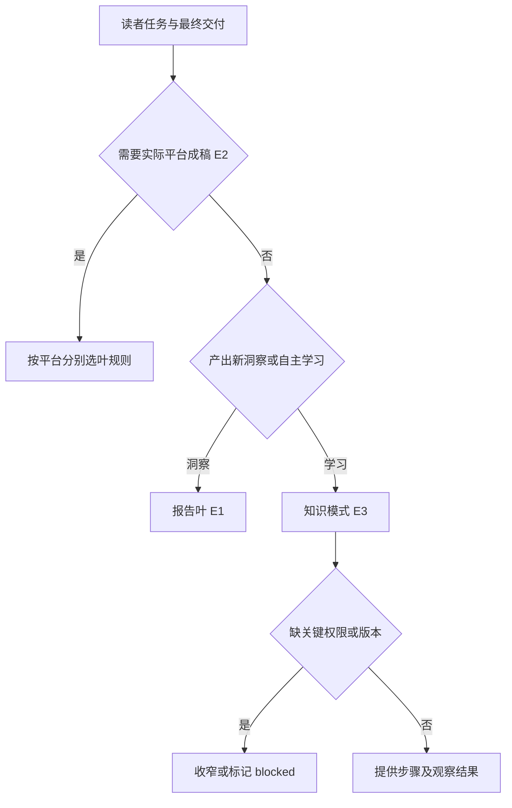
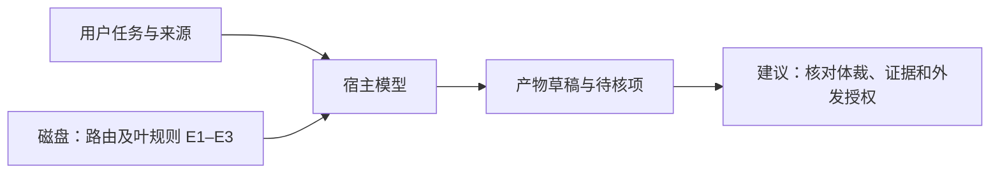

# 飞书体裁路由按最终读者任务分类

2026-11-08。固定 `017b19a793ad71794a02887ede04757f3d82e10d`，三份目录依赖全文新读，源码静态核对。

| 证据 | 原文 | 约束 |
| --- | --- | --- |
| E1 | [报告](https://github.com/larksuite/cli/blob/017b19a793ad71794a02887ede04757f3d82e10d/skills/lark-doc/references/genres/route-report.md) | 根据研究问题、已定义指标、专业解释或商业比较选一个叶子。 |
| E2 | [平台](https://github.com/larksuite/cli/blob/017b19a793ad71794a02887ede04757f3d82e10d/skills/lark-doc/references/genres/route-platform.md) | 只有最终交付为公众号、小红书或邮件成稿才触发；多平台分别生成。 |
| E3 | [知识](https://github.com/larksuite/cli/blob/017b19a793ad71794a02887ede04757f3d82e10d/skills/lark-doc/references/genres/route-knowledge.md) | 自助学习、一次已知操作与检索各有结构，未知排障转技术路径。 |

## 输入输出与流程

输入包括读者、最终交付目的、材料、版本和权限。关键词只提供候选。同一个“公众号”可以是研究对象、资料出处或实际成稿渠道。报告类的商业比较若进一步要求具名决策者拨资源或承诺执行，转办公提案。知识任务要求可观察结果，版本或权限不明时缩小范围，关键分叉或风险无法判断时标记 blocked。输出是选择后的正文和缺口标记。平台成稿分流本身不执行外发。

模型决定读取什么规则，规则正文留在文件层，草稿和发布状态分开。对照[OpenSandbox 重试](opensandbox-wake-retry.md)，那里可用网关拥有的机器标记触发代码分支，飞书的 blocked 在已读文件中只是指令。高风险场景可由宿主把已证实版本、权限和交付种类做成独立字段，再交给程序门禁；增加录入成本，不能自动解决任务语义歧义。尚未验证宿主是否只加载一个叶子、失败后重选，或如何管理并发及草稿写入。

## 验收与练习

给同一份公众号转化数据三个目标：比较趋势、教新人复算、写公众号成稿。预期分别选数据报告、知识教程、平台稿。去掉复算权限或指标口径，检查未知是否保留，平台成稿是否仍与实际发布分离。练习未运行。后续读其他体裁路由、叶规则及宿主加载。
