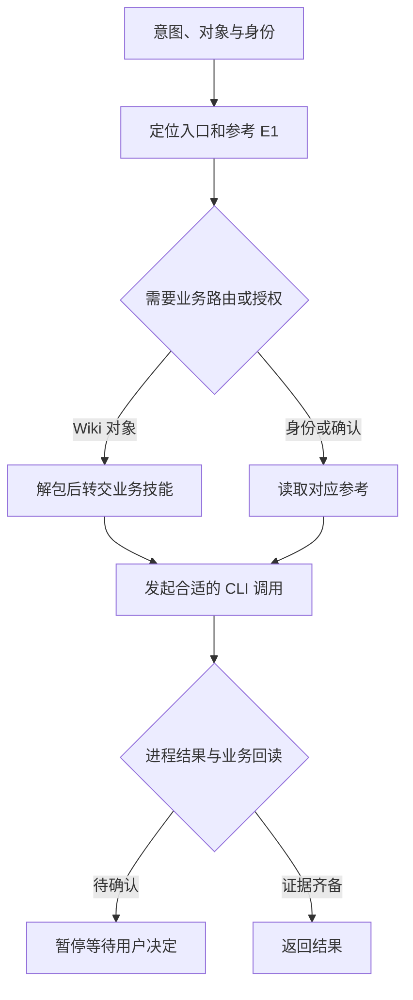
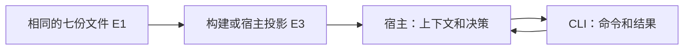

# 飞书共享技能的内容等价与宿主差异

2026-11-17，固定官方快照 017b19a 和两个 WorkBuddy 第三方快照 1c9239c、4e60dd8。源码、提示规则和归档对照，未运行宿主。问题是同一技能正文能否跨分发复用验收结论。

| 层 | 证据范围 |
| --- | --- |
| E1 文件 | 三处 SKILL.md 和六份参考文件逐项读回，Git blob 与 SHA256 一致。六份中五份是入口强触发索引直链，Wiki 路由文件是同目录附加参考。 |
| E2 依赖 | manifest 均列同样七个目录文件。入口要求有 lark-cli，Wiki 参考还会转向业务技能。 |
| E3 宿主 | 固定官方 CLI 的嵌入读取、输出分流已见代码；WorkBuddy 两份仅是第三方归档观察，宿主投影、版本和批准捕获未核。 |

[三处逐文件校验与待办](../evidence/2026-11-17/lark-shared-equivalence.json) · [官方 CLI 嵌入读取](lark-cli-embedded-skill-read.md)

## 输入和流程

宿主输入包含用户意图、目标对象与已观察的身份。共享技能的五个直接参考分别处理身份与授权、进程信封、确认、初次配置和版本通知。Wiki 链路先区分知识库节点与底层对象，再按对象类型转交业务技能。模型按当前意图决定读哪个参考，CLI 执行动作，宿主要同时吸收 stdout、stderr 与进程退出码。确认由宿主回到用户决策，提示文件本身只是规则。

## 反例和学习练习

同一正文下，官方 CLI 可以从嵌入树提供引用，实际宿主若只收 stdout，可能漏掉入口附加提示或错误信封；第三方快照缺乏宿主层证据。另一个反例是命令退出 0，但对象来自错误身份。迁移时可以共享七份文件的解释，仍须锁定宿主、可执行版本、有效身份和目标对象再验收。直接读磁盘适合外部更新，内嵌读取便于与 CLI 版本绑定；二者都需要证据证明引用真正进入上下文。

用假 Wiki 节点和两个本地输出信封，分别测试底层对象 token 与节点 token 的归属，并观察单取 stdout、合并捕获两种策略能否识别阻塞。只做静态阅读，练习未运行。三个出现路径独立保留传递依赖、宿主与执行状态。
