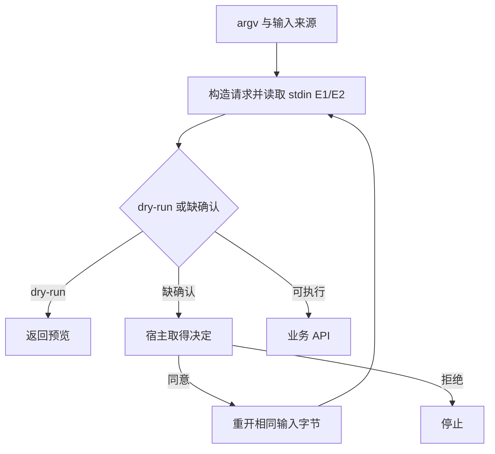
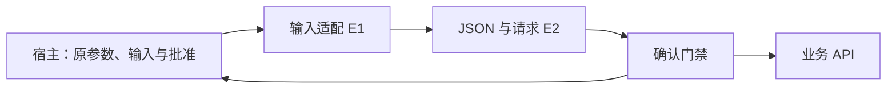

# 飞书确认后重试如何保留 stdin

2026-11-19，固定 `017b19a793ad71794a02887ede04757f3d82e10d`，lark-shared 的部分依赖阅读。适用于宿主通过 stdin 传 JSON，第一次遇到 exit 10 后需要用户批准再执行相同请求的场景。

| ID | 固定原文 | 所见范围 |
| --- | --- | --- |
| E1 | [输入读取](https://github.com/larksuite/cli/blob/017b19a793ad71794a02887ede04757f3d82e10d/internal/cmdutil/resolve.go) · [JSON 解析](https://github.com/larksuite/cli/blob/017b19a793ad71794a02887ede04757f3d82e10d/internal/cmdutil/json.go) | '-' 消耗读取器全部字节，空白输入报错 |
| E2 | [通用 service](https://github.com/larksuite/cli/blob/017b19a793ad71794a02887ede04757f3d82e10d/cmd/service/service.go) · [测试](https://github.com/larksuite/cli/blob/017b19a793ad71794a02887ede04757f3d82e10d/cmd/service/service_test.go) | 构造请求先于 dry-run 和确认；params 与 data 同读 stdin 会被拒绝 |
| E3 | [JSON 测试](https://github.com/larksuite/cli/blob/017b19a793ad71794a02887ede04757f3d82e10d/internal/cmdutil/json_test.go) | 空/错误 JSON、无正文方法等预期 |
| E4 | [前批确认链](lark-confirmation-argv-contract.md) | 错误只给 action 和 hint，宿主保留原调用 |

输入包括保存的 argv、stdin 字节来源、身份和用户决定。E2 在权限相关检查后构造请求，ParseJSONMap 或 ParseOptionalBody 因 '-' 调用 ResolveInput。确认缺失时请求构造可能已经消费 stdin。再次执行时若复用已耗尽读取器，会得到空输入错误。重新启动管道生产者也不保证内容相同，例如生产者读取实时状态。

输入字节不进入确认错误信封，避免完整自由文本和敏感值被复制进错误日志。宿主若需要暂存，应把保留范围、访问权限和清理放入任务约束。固定 CLI 没有在该确认分支提供可复用 stdin 的凭据对象；这是调用者需要实现的恢复部分。业务执行、超时后副作用与审批参数绑定也仍待验证。

对照 [UI-TARS 结束判定](ui-tars-sdk-terminal-status.md)，恢复证据既包括控制状态，也包括重新执行时的数据。可选方式是调用前保存授权输入字节并绑定摘要，或让用户批准明确的规范请求；后者需要请求重建接口。两种方案均是本仓迁移建议。

独立 Python 练习从 17 字节假 JSON 读取两次，第二次为 0 字节；重新用首次字节创建读取器后可完整恢复。未运行 CLI 或真实业务。Go 测试只静态阅读。三个 lark-shared 出现路径继续分别保留宿主未知和版本差异，下一步核宿主如何捕获 stderr、保存输入、恢复批准。
