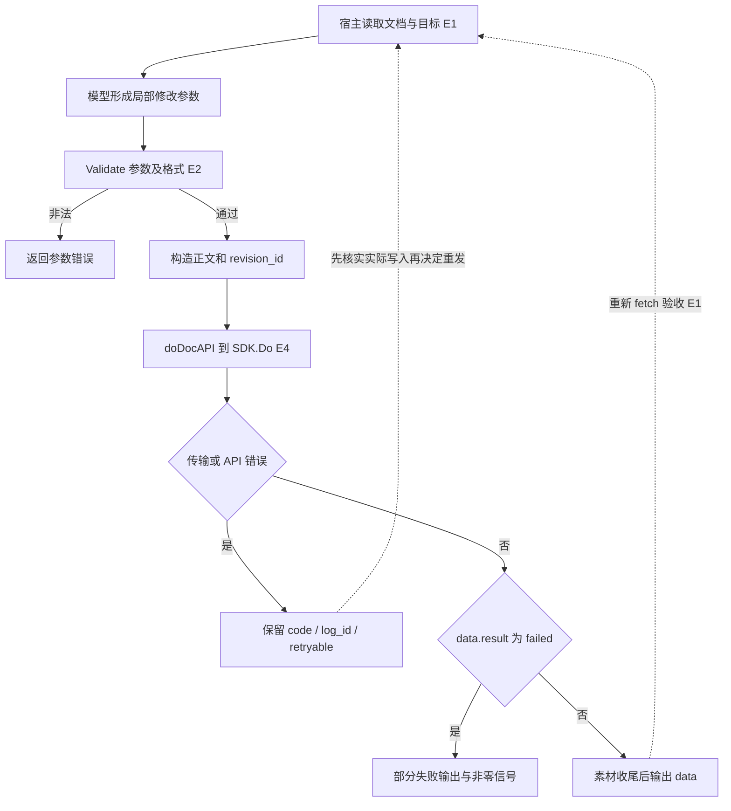
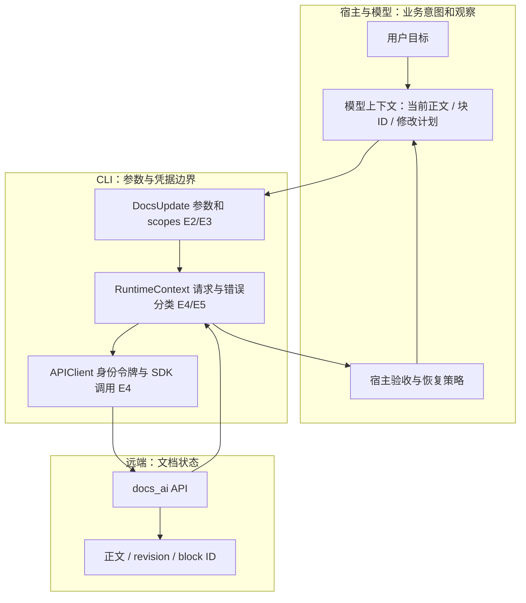

# 技术方案：文档更新的版本条件、错误提示与重试边界

研究 ID：LARK-UPDATE-20261103。日期：2026-11-03。状态：更新子链静态拆解；技能整包未验收。来源：官方源码、官方技能参考。固定版本：larksuite/cli @ 017b19a793ad71794a02887ede04757f3d82e10d，MIT。未运行 CLI、测试或业务 API。

## 问题与适用条件

同事正在编辑一份周报，Agent 根据先前读取的内容追加或替换一节。需要分清三件事：写请求是否基于旧观察、失败后能否安全重发、返回无异常是否代表目标全部完成。带版本字段、使用 HTTP PUT、错误中出现 retryable，都不足以独立回答这三问。

本卡限定 docs +update 的普通正文更新。素材上传、HTML5 资源准备与最终回填是额外步骤，不能把本卡当作那些步骤的事务证明。技能要求的“读取—诊断—局部计划—修改—再读取”是交给宿主 Agent 的工作契约，不是这条 CLI 命令内置的模型循环。

## 原文与证据

以下路径均以固定版本为准。[本轮来源清单](../evidence/2026-11-03/source-manifest.json)记录完整快照路径、SHA256、Git blob 与实际阅读范围。保存完整文件不等于全文已读。

| ID | 源码事实或文档要求 | 固定原文 | 边界 |
| --- | --- | --- | --- |
| E1 | 默认 XML；更新后重新 fetch，不沿用旧 block ID；Markdown 写入另读格式参考 | [更新参考](../../snapshots/larksuite/cli/017b19a793ad71794a02887ede04757f3d82e10d/files/skills/lark-doc/references/lark-doc-update.md) | 提示契约，不是强制调度代码 |
| E2 | revision-id 默认 -1；仅非 0 时序列化；append 转为 block_insert_after，block_id=-1 | [docs_update_v2.go](../../snapshots/larksuite/cli/017b19a793ad71794a02887ede04757f3d82e10d/files/shortcuts/doc/docs_update_v2.go) | 服务端如何处理旧 revision 尚未验证 |
| E3 | +update 为 write，支持 user/bot；普通 scopes 和素材条件 scopes 分开 | [docs_update.go](../../snapshots/larksuite/cli/017b19a793ad71794a02887ede04757f3d82e10d/files/shortcuts/doc/docs_update.go) | 不代表所有写操作都有交互确认 |
| E4 | doDocAPI → CallAPITyped → DoAPI → DoSDKRequest → SDK.Do；返回后分类错误 | [helpers.go](../../snapshots/larksuite/cli/017b19a793ad71794a02887ede04757f3d82e10d/files/shortcuts/doc/helpers.go)、[runner.go](../../snapshots/larksuite/cli/017b19a793ad71794a02887ede04757f3d82e10d/files/shortcuts/common/runner.go)、[client.go](../../snapshots/larksuite/cli/017b19a793ad71794a02887ede04757f3d82e10d/files/internal/client/client.go) | 所读外层没有重发循环；SDK 内部和认证传输仍待读 |
| E5 | 1061045、131009 映射为 conflict 且 retryable=true；99991400 为可重试限流，1063006 为限流但不置可重试 | [codemeta.go](../../snapshots/larksuite/cli/017b19a793ad71794a02887ede04757f3d82e10d/files/internal/errclass/codemeta.go)、[classify.go](../../snapshots/larksuite/cli/017b19a793ad71794a02887ede04757f3d82e10d/files/internal/errclass/classify.go) | 这是通用代码映射，不能断言某码就是 docs_ai 的修订冲突码 |
| E6 | Markdown 导出转义需保留，pattern 不支持 @file；Markdown 可混用 XML 标签 | [Markdown 参考](../../snapshots/larksuite/cli/017b19a793ad71794a02887ede04757f3d82e10d/files/skills/lark-doc/references/lark-doc-md.md) | 本轮新读的第 13 份目录文件；解析器/服务端渲染未实跑 |

## 输入、输出与组件职责

教学输入：`docs +update --doc doxExample --command block_replace --block-id blkExample --revision-id 42 --content @./patch.xml`。这些 token 是合成占位符，不是可调用资源。

参数解析后的请求为 PUT `/open-apis/docs_ai/v1/documents/{documentID}`，正文包含 format、command、revision_id、content 和 block_id。默认 revision_id=-1 会发送；显式 0 被省略。append 是命令式“向末尾插入”的别名，不能因 HTTP 方法为 PUT 就推定重复请求没有额外副作用。str_replace 允许空内容；源码只在 content 非空时加入 body，所以删除文本时服务端看到的是缺省 content，而不是必然含空字符串的字段。

区间替换/删除要求 start-block-id 与 end-block-id 成对，不能同时用 block-id。CLI 检查参数组合与哨兵值方向；没有读取整棵文档树来本地证明两个块同父、顺序正确。服务端仍承担资源有效性与业务约束判断。

输出 data 可含 result、updated_blocks_count、warnings、tips、document.revision_id 和 new_blocks。程序只把规范化后等于 failed 的 result 分支送入 OutPartialFailure；partial_success 在该判断中为 false，继续走后续资源处理及 OutRaw。没有素材失败等额外错误时，不能仅凭外层成功认定全量完成。

## 流程图

实线还原所读源码；虚线是技能要求或本仓建议，未实现为本命令内循环。

## 架构图

模型没有在已读更新函数内被调用；上下文装配来自宿主读取技能、格式参考和 fetch 结果。CLI 持有解析参数和执行上下文；服务端持有文档；错误分类器不保存恢复计划。不得把图中的宿主验收框解释为已找到的自动调度器。

## 状态、权限与恢复契约

CallAPITyped 先取得客户端，执行一次外层 DoAPI，再解析响应。非零业务 code 经过 BuildAPIError；未知 code 降为 api/unknown。服务端 error.message 优先于 msg，error.details 的提示优先于默认 APIHint；x-tt-logid 在正文未提供时补入，便于核查请求。

通用 conflict 提示是稍后重试并避免同资源并发重复请求。分类函数只构造错误，没有重发。httpStatusError 把 5xx 置为可重试；这个标记也没有判断当前业务写入是否已经生效。因此“可重试”是恢复输入，不能直接变成盲目重复 append 的决策。

[api_errors.go](../../snapshots/larksuite/cli/017b19a793ad71794a02887ede04757f3d82e10d/files/internal/client/api_errors.go)进一步显示两个不同契约：WrapReplaySafeTransportError 在调用者声明可安全重放且上下文仍有效时可标记瞬时错误；WrapDoAPIError 主要保留类型/归类错误，不能把前者自动套到更新路径。DoStream 的 replaySafe 行为也不是 docs +update 所调用的 SDK 路径。

[go.mod](../../snapshots/larksuite/cli/017b19a793ad71794a02887ede04757f3d82e10d/files/go.mod)固定 SDK v3.7.2；本轮没有读取该外部 SDK 或全部认证 transport，故不能宣布“网络层绝不重试”或“默认重试 N 次”。具体旧 revision 的拒绝、协同变换或错误码也不能由字段名猜测。取消、超时和最终写入结果之间的竞态保留待验证。

Markdown 参考中“@file 只接受 cwd 相对路径”的文字，与此前读到的默认本地后端允许受约束绝对路径不一致，继续保留[输入来源卡](lark-input-provenance.md)的后端限定结论，不回退成一刀切说法。文件传参绕开 shell 转义，并不代替 Markdown 自身转义；pattern 仍要使用导出的转义形式。

## 验收和反例

建议宿主验收四层：命令结果、data.result、warnings/实际修改数量、重新 fetch 的目标正文与资源。业务验收者是宿主/用户目标，不是 CLI 的返回码。

| 反例 | 为什么足以否定过强结论 | 验证级别 |
| --- | --- | --- |
| 用旧 fetch 生成补丁，却使用默认 -1 | CLI 不会把观察时 revision 自动绑定为写入条件 | 源码静态可见；实际并发结果待服务端实验 |
| 服务端已追加，响应丢失，宿主直接重发 append | 可能重复追加；当前所读 body 无幂等键 | 风险推断，未复现 |
| result=partial_success 而无额外资源错误 | 不能靠 failed 分支捕获所有未完成项目 | 条件性源码推导 |
| 把读取出来的反斜杠删掉再匹配 | 文档契约要求保留转义，否则匹配/展示可能变化 | 官方文档要求，未验证渲染 |
| 测试名含 conflict | 已读范围测试主要检查 block-id 与区间参数互斥，不是多人修订冲突 | 上游测试静态阅读 |

## 横向比较与选择

同一工程问题是“如何避免基于过期状态重复执行”。[AgentScope Runtime 中断方案](agentscope-runtime-interruption.md)在入口对任务状态做 CAS（比较并交换），这是可见程序原语；Lark 更新把 revision 交给服务端，CLI 片段不提供本地 CAS。二者保护对象不同，不能互相替代。

| 方案 | 比较对象与所有者 | 能支持的结论 | 成本和局限 |
| --- | --- | --- | --- |
| Lark revision 字段 | 远端文档基准；服务端负责解释 | 参数可以传递明确版本 | 服务器一致性契约待证；默认 -1 不绑定先前观察 |
| Runtime 本地锁 / Redis Lua CAS | user_id:session_id 的任务运行标记 | 同一后端、有效状态期间拒绝第二次启动 | 本地仅单进程；TTL、代次和外部副作用另有边界 |
| 本仓建议：记录写意图、结果核对后再重试 | 宿主保存目标、操作、观察版本、请求诊断及验收结果 | 提供可恢复决策依据 | 需要持久记录和额外读取；不保证服务端幂等 |

不要在缺少 revision 服务端文档或可控实验时把“传 42”宣传成已经验证的乐观锁。也不要把 CAS 的任务互斥当作文档版本保护。暂无性能或收益对比实验。

## 学习练习

未运行。用假文档和桩服务定义四种响应：成功、partial_success、failed、写入后断线。让宿主恢复策略分别输出“复读验收”“处理部分项”“停止并检查”“先查实际结果，禁止直接 append 重发”。保留同一目标的原观察版本与新观察版本。

另在受控真实环境验证 revision 42 过期时的服务端行为；记录原始请求、响应 code、修改前后文档与请求日志 ID，不含凭据。此实验需测试文档和可用业务权限，本轮不创建或修改真实文档。

## 接续事项

继续追 SDK v3.7.2 及 CLI 客户端构造/认证传输的重试路径；查 docs_ai 的版本冲突正式契约。补剩余 31 份 lark-doc 目录依赖与 shared/whiteboard/OKR 跨技能宿主。入口新增 0、整包完成 0、实跑 0；本卡是进行中技能的子链成果。
