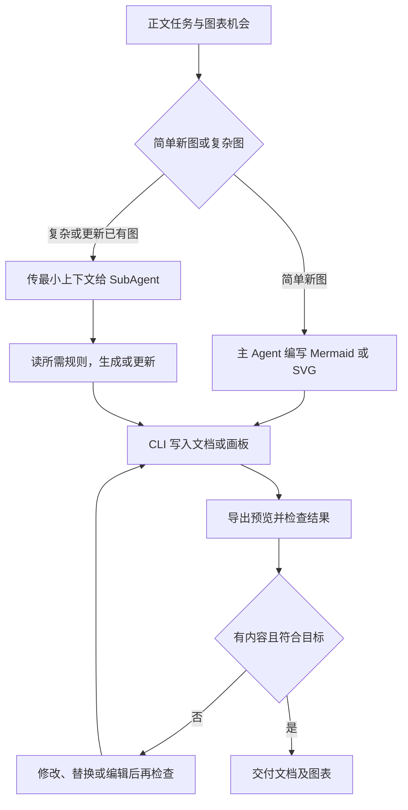
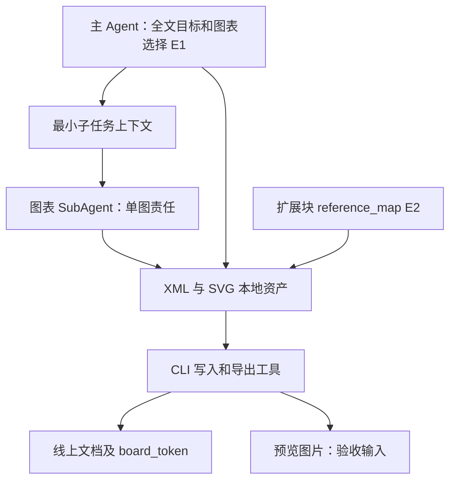

# 飞书文档：白板子任务与扩展块的双向契约
日期：2026-10-28。固定 larksuite/cli @ 017b19a793ad71794a02887ede04757f3d82e10d。阅读官方技能依赖全文，未实跑、未审计对应白板服务实现。原文、Git blob、SHA256 见[清单](../evidence/2026-10-28/lark-code/manifest.json)。

## 问题与证据
文档任务包含图表、HTML 与 OKR 时，模型如何分工，读回数据能否直接当成写入参数？E1 为 lark-doc-whiteboard.md，E2 为 lark-doc-xml-extended-blocks.md；以下均是官方技能操作契约，不能冒充 CLI 已强制执行的调度机制。

## 输入输出和上下文
E1 区分简单图与复杂图：简单 Mermaid/SVG 可由主 Agent 写 XML；复杂图与已有画板更新要求独立 SubAgent。SVG 插入子任务携带 doc token、插入位置、图表目标、受众、源段落/数据及 XML 规则；已有画板更新子任务携带 board_token、目标、类型、受众与相关数据，并读 lark-whiteboard。前者不要求读整份白板技能，后者要求。

图表插入输入如 whiteboard type=svg 与完整自包含 SVG，或 path=@./diagram.svg；输出侧需要定位画板并导出 preview。文档指南要求不留下空白占位。模型负责选图、内容与分工；CLI/服务执行插入和导出；视觉判定仍需执行者读结果。本轮未验证宿主真的提供 SubAgent 工具或严格隔离上下文。

## 流程图
这是 E1 的规定流程，不是已审计的调度器代码。

## 架构图

多图互不依赖时 E1 允许并行，但未给出跨子任务事务、锁或冲突合并的执行代码；不能推断 Team 协调已实现。

## 状态、副作用和完成判定
写入会产生外部文档或画板副作用。失败后修改再写可能涉及删除旧画板或编辑已有内容，不能把重试默认视为幂等。SVG 要求自包含，不引用外部资源；可编辑元素与降级图片不同，视觉正确不等于全部可编辑。滤镜、裁剪、遮罩等有特定限制，浏览器里可显示也不证明画板转换无误。

E2 的 HTML5 块读回 XML 可能只有 data-ref 占位，真实 HTML 在 document.reference_map["html5-block"][id].data 或对应资源 path；只读 XML 就可能遗漏主体。写入使用本地 HTML 与 path，或配 reference-map。指南明示 CLI 原样写入 HTML、不验证高度模式字段；必须由作者提供 auto 或 viewport。500KB 是文档声明的内容上限，本轮未核验执行器限额代码。

OKR 读取可返回 Objective/KR/Progress 完整树，创建却只允许 root-only 挂载已有 cycle-id；更新保留只读业务 ID，可改状态/百分比/分数与进展，不可随意改目标描述。这是“读模型”与“写模型”不对称的直接案例。

## 对照、反例与练习
|设计|优势与适用条件|不能省掉的部分|
|---|---|---|
|主 Agent 完成简单图|上下文转交少|XML规则、预览检查|
|单图 SubAgent|限制任务范围与视觉依赖加载|宿主调度能力、结果回收、冲突处理|
|读回 XML 原样写回|表面省事|不适合含占位资源、只读字段或创建限制的块|

反例：空白画板 token 已返回，但图没写入，不能标记任务完成；HTML占位 XML 读到了，却没取 reference_map，不能声称完整读过文档；把 GET 的完整 OKR 树送进创建请求，也不能从结构相似推断合法。

教学练习（未运行）：制作三个假任务——简单时序图、复杂已有白板更新、含 HTML/OKR 的读后修改。分别列最小上下文、只读字段、依赖文件和验收证据；给一个缺 reference_map 的输入，要求明确报告不完整而不是补写想象内容。此练习不需真实服务权限。其收益只是假设，未做模型效果实验。

## 接续
目录阅读由6/44增至8/44，未新增入口组、未验收整包。lark-whiteboard、lark-okr 是跨技能依赖，尚未读完；@file 展开、服务转换/渲染实现和宿主实际调度仍待追踪。不得将本卡的技能契约替代源码强制保证。
