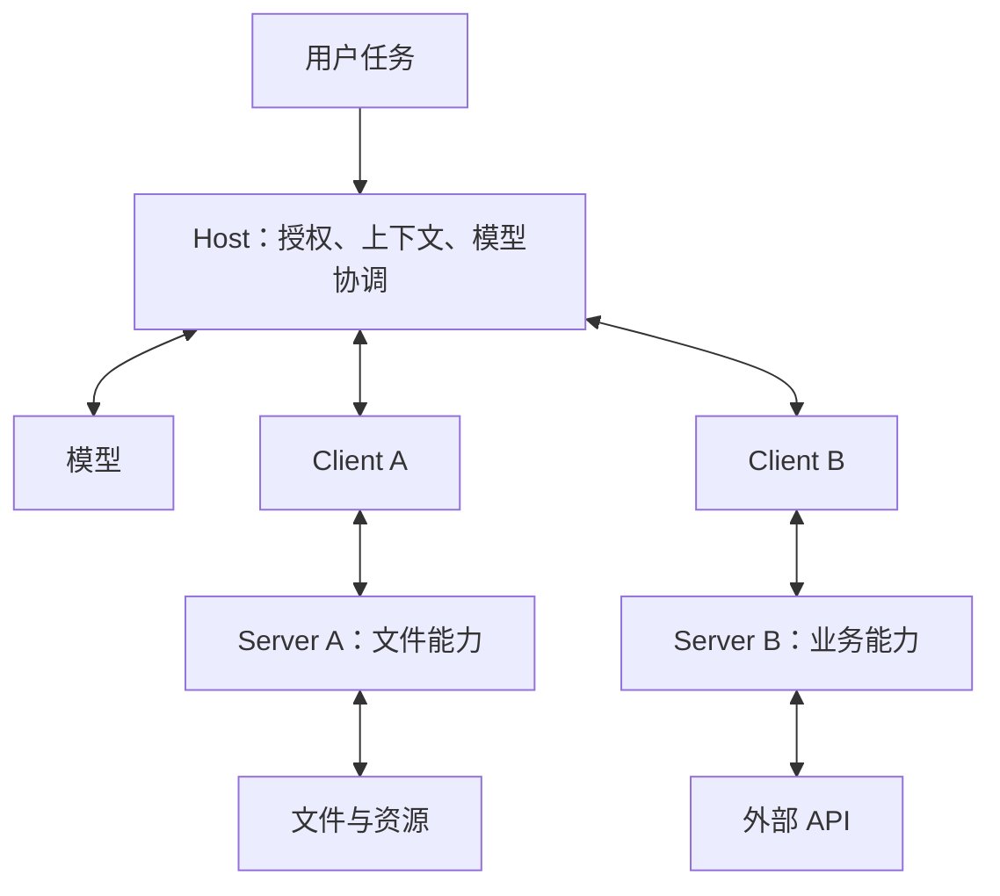
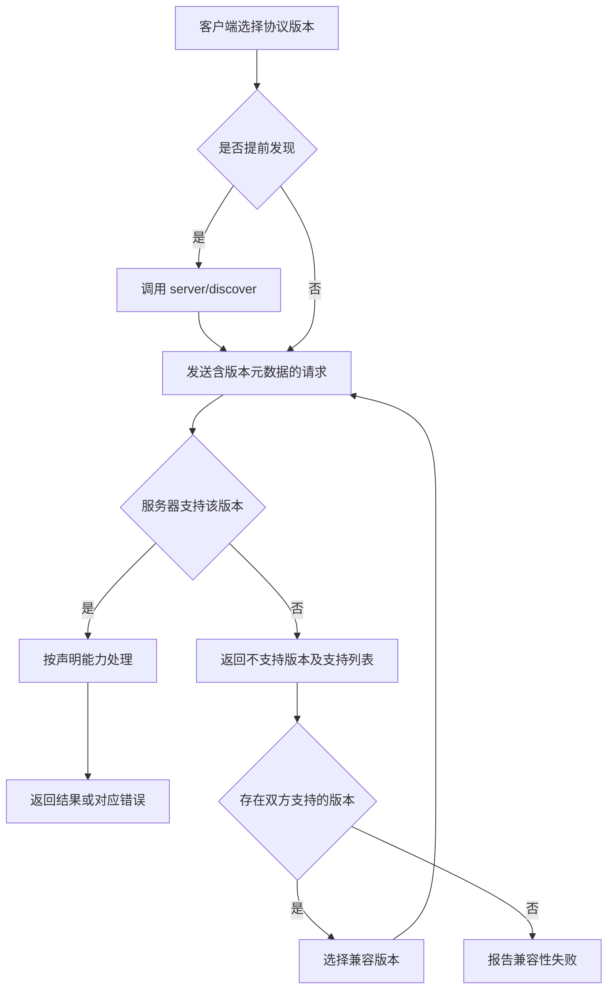

# MCP：先固定协议版本，再谈服务与运行架构

日期：2026-10-25。状态：2026-07-28 的架构、版本兼容正文已静态阅读；未实跑客户端或服务端。固定仓库 modelcontextprotocol/modelcontextprotocol，提交 `dae694f61a31f7a3ec2af3aff709e11f70f61e48`。本次保存[指定原文与许可证](../originals/modelcontextprotocol/modelcontextprotocol/dae694f61a31f7a3ec2af3aff709e11f70f61e48/)，不表示完整仓库备份。

许可按所存 LICENSE 保留：项目处于 MIT 向 Apache-2.0 过渡，已取得同意的贡献与未取得同意的贡献分开；非规范文档另列 CC-BY-4.0。不能用一个简化标签抹去这些差异。

## 关键问题

MCP 为 Agent 应用提供共同的能力交换接口。研究它首先要问：Host、Client、Server 分别持有什么状态和权限？采用哪个协议版本？何时发现能力、如何返回结果、版本不兼容怎样处理？

| ID | 原文 | 能证明什么 |
| --- | --- | --- |
| M1 | [architecture/index.mdx](../originals/modelcontextprotocol/modelcontextprotocol/dae694f61a31f7a3ec2af3aff709e11f70f61e48/docs/specification/2026-07-28/architecture/index.mdx) | Host/Client/Server 关系，逐请求能力信息与发现 |
| M2 | [basic/versioning.mdx](../originals/modelcontextprotocol/modelcontextprotocol/dae694f61a31f7a3ec2af3aff709e11f70f61e48/docs/specification/2026-07-28/basic/versioning.mdx) | 当前版本和旧初始化握手版本的区分与兼容矩阵 |

M1 将 Host 定义为创建客户端、控制连接与授权、聚合上下文和协调模型的应用进程；每个 Client 对应一个 Server。Server 暴露工具、资源、提示等能力，可以是本地进程或远端服务。不要从“支持 MCP”推导服务器自动获得整段对话。

## 架构图：来自 M1 的简化还原

A/B 是教学名称。具体服务的认证、事务、幂等与业务验收还需读取实现；图不假定所有服务都使用同一种传输方式。

## 版本差异

M2 把 2026-07-28 及以后称为 modern：请求携带版本等元数据，服务器逐请求接受或拒绝；2025-11-25 及以前归为 legacy：通过 initialize 建立相应会话语义。当前规范规定服务器实现 server/discover，客户端可以先发现，也可以发请求后处理不支持版本错误。

因此，常见“先 initialize 再工作”的旧流程不能不加版本标注地套到当前规范。反过来，最新规范也不能证明现有 SDK 或部署实例已经迁移。

## 流程图：M2 中当前协议的版本处理

这是版本兼容流程，不是网络故障或业务写入的一般重试策略。不能从图推导“任何失败都可以重试”。

M2 还描述 dual-era 实现怎样兼容旧客户端或服务端，stdio 与 HTTP 的检测方式不同。该细节本轮只读版本章节，尚未逐段核对传输绑定全文、SDK 实现和实际网络轨迹，后续单列任务。

## MCP、CLI 和 Skill 怎样比较

这是本仓设计分析：MCP 适合把能力按协议暴露给应用；CLI 把动作暴露成进程参数、输出和退出码；Skill 写明何时及怎样使用这些能力。可以让 CLI 调同一业务库，也可以由 MCP Server 调该业务库；是否共享实现要看代码，不能从名字推断。

我们建议用同一个只读业务操作比较两种入口，例如读取一个本地任务列表。对照参数校验、结果结构、分页、错误、权限、进程/连接管理和可观察性。成功标准用返回的业务数据，不仅看协议请求成功。

## 写 MCP 的学习清单

先决定协议与 SDK 版本，再定义工具输入输出、错误语义、身份传递、权限、取消、分页、长任务和副作用；明确哪些由协议规定、哪些是 SDK 行为、哪些由业务负责。以不兼容版本、空结果、权限不足、超时、重复请求、部分成功作为待验证分支。

本篇形成版本与职责框架。认证、工具调用与 schema、异步任务扩展、传输恢复、真实服务实现仍在待办；不宣称已经会通所有 MCP SDK 或完成端到端复现。

