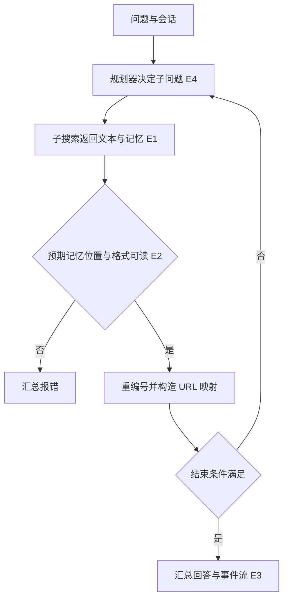
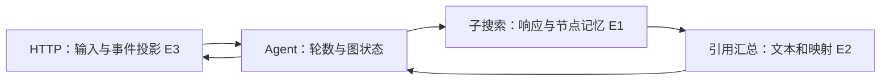

# MindSearch 搜索图的引用完整性

2026-11-12，固定 `7952c5f8a956fe6a44228a6a7d528a35340e7c87`。适用多个搜索节点各自从本地编号引用，汇总器需要给最终答案输出统一的证据映射。源码静态核对，另有合成数据模拟。

| 证据 | 固定原文 | 范围 |
| --- | --- | --- |
| E1 | [图执行](https://github.com/InternLM/MindSearch/blob/7952c5f8a956fe6a44228a6a7d528a35340e7c87/mindsearch/agent/graph.py) | 子搜索节点、状态与图流 |
| E2 | [主 Agent](https://github.com/InternLM/MindSearch/blob/7952c5f8a956fe6a44228a6a7d528a35340e7c87/mindsearch/agent/mindsearch_agent.py) | 引用提取、重编号、图状态、收尾 |
| E3 | [API](https://github.com/InternLM/MindSearch/blob/7952c5f8a956fe6a44228a6a7d528a35340e7c87/mindsearch/app.py) | `/solve`、事件流消息投影及错误分支 |
| E4 | [作者论文方法](https://arxiv.org/html/2407.20183#S2) | WebPlanner 分解，WebSearcher 分层检索；作者描述 |

## 输入与调用链

HTTP 入口接收 `inputs`、`session_id`。规划器根据用户问题和已有结果决定是否继续搜索。图执行层分派子问题，节点保存响应及记忆。汇总器跳过 root、response，约定从 `agent.memory[2]` 的 ActionExecutor 消息取搜索结果 JSON，再将文本内 `[[数字]]` 重编号，输出汇总文本与 `ref2url`。这依赖节点记忆位置、发送者和 JSON 格式，字段缺失或不匹配会中断该汇总步骤。

## 失败、权限与完成

`_update_ref` 遇到缺失本地来源编号时记录日志，文本仍重编号，映射只保留存在的来源。因而“文本引用被重排”不能推出“每个引用可点击”。此外，最终回答由模型生成，此子链未见逐条校验回答声明是否得到来源支持。同步和异步入口均读取节点状态，事件投影在单节点更新时去掉全局引用映射并裁剪其他节点。流结束、图结束与事实校验属于不同条件。网络搜索授权、取消语义及页面真实性未在本轮运行验证。

## 对照、验收与练习

对照 [Lagent 执行契约](lagent-action-status-and-hooks.md)，两者都在工具结果与模型上下文之间转换结构，但搜索汇总需要保留来源键。另一方案是在节点写入类型化证据对象，再按稳定节点顺序分配编号，发布前检查所有标记均可解析。代价是额外结构维护，并仍需核验语义支持。

已运行纯 Python 合成模拟，输入本地编号 2 和 7、来源表只含 2。模型化的重编号得到展示编号 1、2，映射只有 1，缺失 2。这个实验未导入或运行 MindSearch，只检验缺失映射的可能性。学习练习再加一条损坏的节点记忆和一条“有 URL 但内容不支持声明”的案例，分别验证结构错误与事实错误。未运行上游、检索服务或模型。
