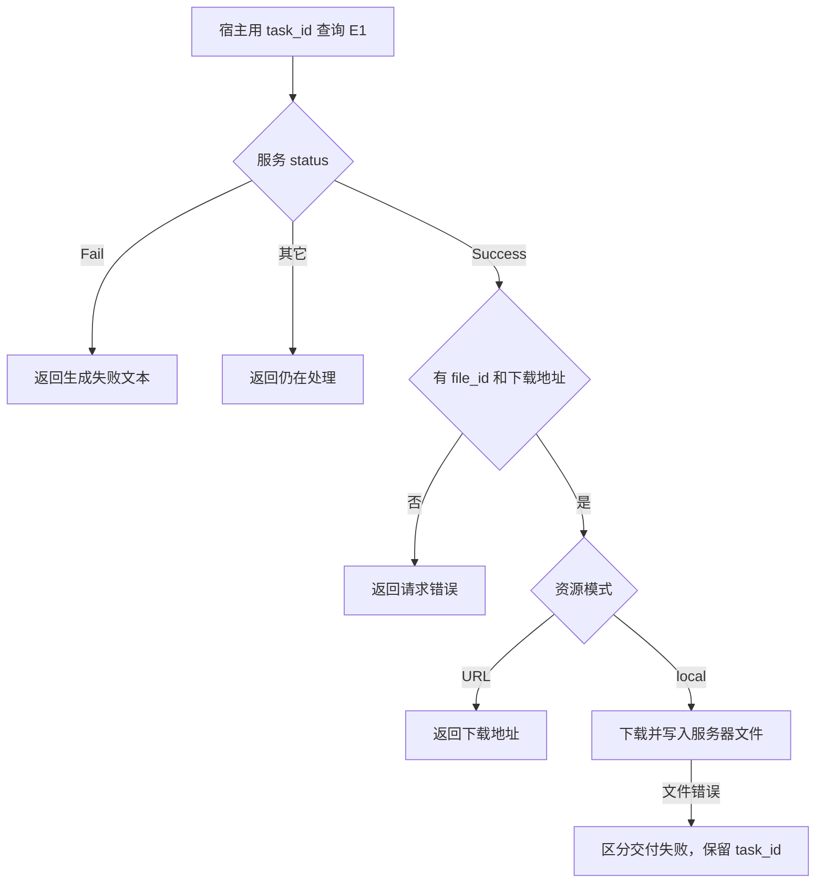
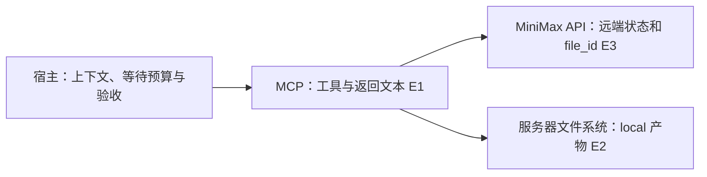

# MiniMax MCP 视频查询与交付边界

2026-11-09，P1-01，固定 `0856b9aef8a9d676bb63bdd6b6426d7b640a3b7a`，源码与测试静态核对。场景是视频已经提交，客户端需要恢复查询或交付文件。

| 证据 | 原文 | 支持范围 |
| --- | --- | --- |
| E1 | [视频工具](https://github.com/MiniMax-AI/MiniMax-MCP/blob/0856b9aef8a9d676bb63bdd6b6426d7b640a3b7a/minimax_mcp/server.py#L321) | 生成、查询、下载与异常分支 |
| E2 | [路径与命名](https://github.com/MiniMax-AI/MiniMax-MCP/blob/0856b9aef8a9d676bb63bdd6b6426d7b640a3b7a/minimax_mcp/utils.py) · [异常类型](https://github.com/MiniMax-AI/MiniMax-MCP/blob/0856b9aef8a9d676bb63bdd6b6426d7b640a3b7a/minimax_mcp/exceptions.py) | 文件路径解析、可写检查、异常类型 |
| E3 | [请求封装](https://github.com/MiniMax-AI/MiniMax-MCP/blob/0856b9aef8a9d676bb63bdd6b6426d7b640a3b7a/minimax_mcp/client.py) · [路径测试](https://github.com/MiniMax-AI/MiniMax-MCP/blob/0856b9aef8a9d676bb63bdd6b6426d7b640a3b7a/tests/test_utils.py) · [服务测试](https://github.com/MiniMax-AI/MiniMax-MCP/blob/0856b9aef8a9d676bb63bdd6b6426d7b640a3b7a/tests/test_server.py) | API 错误路径、绝对路径忽略基准目录的断言；未实跑 |

## 输入、状态与流程

宿主将工具声明和历史交给模型，模型选择工具；这套 MCP 适配层只接收工具调用。异步提交接收 `prompt`、可选首帧和参数，返回含 `task_id` 的文本。查询接收 `task_id` 与可选 `output_directory`，检查远端 `status`。只有 `Success` 并取得 `file_id` 才继续取 `download_url`。其它非 `Fail`、非 `Success` 值都走“处理中”，所以宿主应自有等待上限。

## 权限、副作用和恢复

在 local 模式，名字含 query 的工具会发起下载并写文件。路径函数把绝对输出目录直接采用，或拼接相对目录与基准目录。它检查可写并创建目录，没有规范化后验证目录归属。上游测试明确断言绝对目录可忽略基准目录，因此不能把 `MINIMAX_MCP_BASE_PATH` 解释为安全边界。文件名含完整任务 ID 与秒级时间，写入用 `wb`。由代码推断，同任务同秒落在同一目标路径时可能覆盖；并发未实测。查询只捕获 `MinimaxAPIError`，而同步生成另捕获文件和下载错误。查询的下载 HTTP 失败可能越过本函数的捕获，框架如何封装需另核。

## 验收、替代和练习

分别验收远端生成状态、下载地址可用、本地文件完整以及宿主能访问产物。下载失败时已有 `task_id` 可作为恢复入口，直接重提生成会触发另一次提交。对照[飞书素材预览](lark-media-side-effects.md)，两者的读式入口在本地都有副作用。另一实现可拆纯状态查询与显式下载，返回结构化状态和恢复字段，下载前校验受控目录并使用排他创建。调用次数及状态维护会增加，未比较性能。

用离线假服务返回 Success 和 file_id，再令下载返回 403；观察远端成功与本地失败能否分别表达。另在临时目录比较 URL 模式与 local 模式的写入计数、绝对路径行为和同秒重复命名。只设计练习，未执行。待核 MCP 框架异常封装及 JS 对照。
