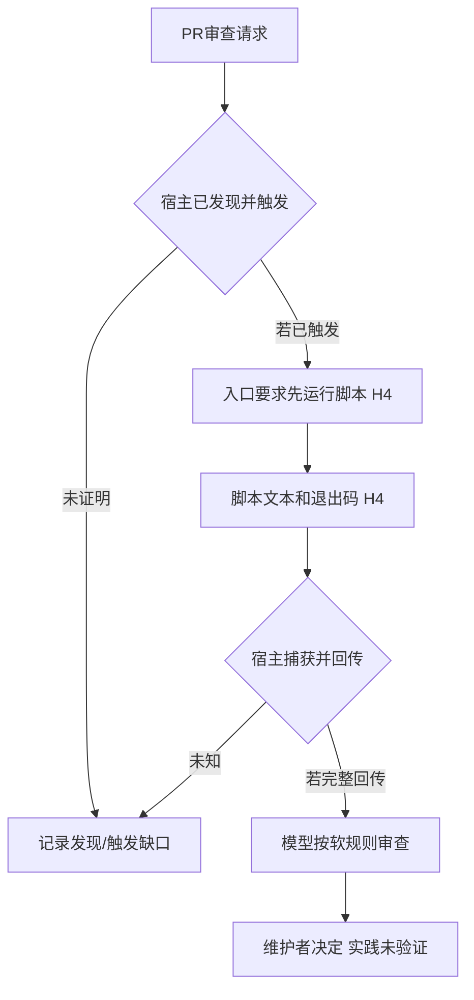
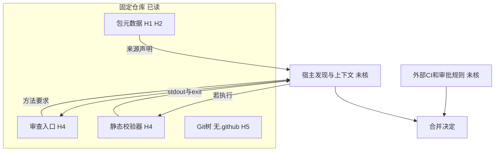

# MiniMax PR Review：提示要求与宿主接线证据

2026-11-23，冻结版本 `60aaae52bb2af8162732751a4332f62a5fef518b`。接续[校验器边界](minimax-skill-review-validator-boundaries.md)，研究“发布了审查技能，是否等于PR已自动强制执行”。静态核对，未安装插件、调用宿主、执行脚本或触发CI。

## 原文与输入输出

| ID | 固定原文 | 已读范围和含义 |
| --- | --- | --- |
| H1 | [plugin.json](https://github.com/MiniMax-AI/skills/blob/60aaae52bb2af8162732751a4332f62a5fef518b/.claude-plugin/plugin.json) | 全文，名称/版本/作者等包元数据，无校验器执行命令 |
| H2 | [marketplace.json](https://github.com/MiniMax-AI/skills/blob/60aaae52bb2af8162732751a4332f62a5fef518b/.claude-plugin/marketplace.json) | 全文，source=./，说明插件来源，不证明审查触发 |
| H3 | [README](https://github.com/MiniMax-AI/skills/blob/60aaae52bb2af8162732751a4332f62a5fef518b/README.md) | 贡献与安装段；本地可手动运行脚本及PR Review入口 |
| H4 | [PR Review入口](https://github.com/MiniMax-AI/skills/blob/60aaae52bb2af8162732751a4332f62a5fef518b/.claude/skills/pr-review/SKILL.md)、[脚本](https://github.com/MiniMax-AI/skills/blob/60aaae52bb2af8162732751a4332f62a5fef518b/.claude/skills/pr-review/scripts/validate_skills.py) | 全文复核，模型应先硬检查再软审查；脚本只输出文本/退出码 |
| H5 | [固定完整Git树](https://api.github.com/repos/MiniMax-AI/skills/git/trees/60aaae52bb2af8162732751a4332f62a5fef518b?recursive=1) | API truncated=false、472条记录，没有.github目录条目 |

[本批证据](../evidence/2026-11-23/source-review.json)保留树范围与文件哈希。H5仅证明该commit树没有.github工作流，不证明组织外部CI、服务端合并规则或维护者实践不存在。

输入是PR及固定技能目录，期望输出是硬检查结果、软审查意见和维护者决定。模型看到哪些文件、脚本stdout/stderr如何入上下文、PR事件是否启动模型，都属于宿主实现；本仓公开包里已读的元数据不能填补这些缺口。

## 流程图

实线节点为已读文本/字段；未知节点明确保留，不把文档要求画成强制门禁。

## 架构图

## 状态、权限和错误恢复

入口description指向PR review/check skill等触发语义，这是提供给模型/宿主的描述，并不是事件监听器。两份元数据没有声明校验器执行命令；marketplace的source指向仓库根，也不证明.claude内审查技能在某个宿主的默认扫描范围中。须核具体宿主和版本，不能据目录位置臆断加载或完全不可用。

脚本默认扫描skills，找不到技能返回exit0；宿主必须同时保存路径、发现数、诊断、退出码和候选版本，才能区别“没检查”和“通过”。此处是本仓建议的证据契约，不是现有实现已提供。脚本WARN不阻止退出成功，模型仍有软审查责任，格式通过不能替代生成产物的业务验收。

只读研究不需要安装或调用账户；实际执行时，宿主的文件读取/命令权限、依赖与输出捕获另核。冻结包脚本不访问网络，但任何自动审查宿主是否允许写PR或发评论不能从此推断。本批没有发送消息、触发CI、设置保护规则或改变权限。

## 验收与跨实现对照

反例：只有入口文本与plugin元数据、没有调用轨迹，无法证明任何PR运行过脚本；完整树无.github也无法否定外部CI。即使拿到exit0，也可能扫描零目录。应按“发现→触发→执行→回传→决定”各环节独立取证。

对照 [Open-AutoGLM循环](open-autoglm-finish-and-observation.md)，后者能在源码追到模型请求、动作执行和上下文回传，可明确指出哪里丢了错误；MiniMax提供知识包，宿主链不能靠相似名词补出。另一替代是独立CI显式调用校验器并保留覆盖清单，再让模型作软审查；这是本仓建议，未建立或验证真实CI，也没有质量收益数据。

## 学习练习与断点

未运行：为假宿主制作三份回执：仅“加载技能”、仅exit0、完整路径/版本/发现数/诊断；逐项判断能支持哪个验收结论，再模拟零输入和脚本非零退出。无需调用真实PR或模型。

冻结目录4/4阅读证据保留，新增包元数据和树清点只推进部分宿主核查。仍待具体宿主发现规则、CI/审批实际接线、输出装配及业务运行；不把未暴露证据当成不存在，更不将整组改为完成。
