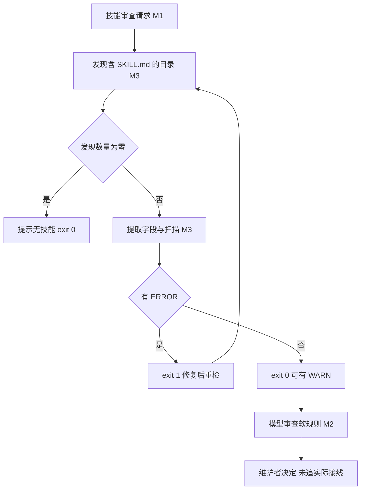
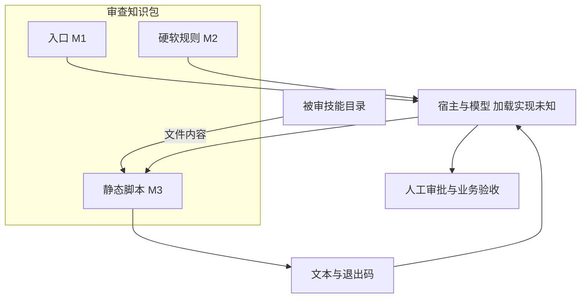

# MiniMax：技能审查脚本通过能证明什么

2026-11-22；冻结版 `60aaae52bb2af8162732751a4332f62a5fef518b`，当前版本 `02853d885acb1abc157477ce00c4d98a8ed14a71`。完整读取冻结 PR Review 入口、两份引用和校验脚本；当前入口、脚本、根许可与冻结字节相同。未运行上游脚本、未调用模型；完整宿主和新版依赖等价未验收。

## 问题与适用条件

仓库收新技能时，需要把确定的格式错误交给程序，把范围、触发、依赖与真实效果留给进一步审查。本方案研究“审查材料如何变成验收结果”，不把结构检查器当成业务质量或安全证明。

## 原文与证据

| ID | 固定原文与已读范围 | 种类 |
| --- | --- | --- |
| M1 | [冻结审查入口](https://github.com/MiniMax-AI/skills/blob/60aaae52bb2af8162732751a4332f62a5fef518b/.claude/skills/pr-review/SKILL.md)全文 | 官方提示契约，两阶段审查 |
| M2 | [硬规则](https://github.com/MiniMax-AI/skills/blob/60aaae52bb2af8162732751a4332f62a5fef518b/.claude/skills/pr-review/references/structure-rules.md)、[软规则](https://github.com/MiniMax-AI/skills/blob/60aaae52bb2af8162732751a4332f62a5fef518b/.claude/skills/pr-review/references/quality-guidelines.md)全文 | 文档要求，不自动等于代码实现 |
| M3 | [冻结脚本](https://github.com/MiniMax-AI/skills/blob/60aaae52bb2af8162732751a4332f62a5fef518b/.claude/skills/pr-review/scripts/validate_skills.py)全文；[新版脚本](https://github.com/MiniMax-AI/skills/blob/02853d885acb1abc157477ce00c4d98a8ed14a71/.claude/skills/pr-review/scripts/validate_skills.py)全文 | 源码事实，已比字节 |
| M4 | [当前贡献规范](https://github.com/MiniMax-AI/skills/blob/02853d885acb1abc157477ce00c4d98a8ed14a71/CONTRIBUTING.md)、README、CREDITS、根许可 | 当前项目承诺与归属，未覆盖所有技能 |

原文、哈希和occurrence见[证据](../evidence/2026-11-22/source-review.json)。冻结目录4/4已读，不包含宿主加载、CI和维护者审批。

## 输入、输出与职责

输入是 PR/技能目录与 --path（默认 skills），输出为各技能 PASS/WARN/FAIL 文本和退出码。模型按 M1 先做硬检查，再阅读软规则、PR目的、触发条件和README同步；程序执行目录发现、字段读取和凭据模式匹配，维护者决定合并。仓库没提供本链完整模型请求装配；不能假定正文或 stderr 已实际进入宿主上下文。

## 流程图

## 架构图

这是提示流程与脚本关系，不声称宿主已强制顺序或CI已接入。

## 状态、上下文与失败恢复

find_skill_dirs 只收集已包含 SKILL.md 的目录，跳过点目录；随后 validate_skill 虽有“缺入口”分支，默认发现路径却不会把没有入口的目录交给它。默认 skills 范围也不包含 .claude 下这个审查技能自身。扫描路径不存在或没有匹配目录都会到“无技能 exit 0”，没有证明预期清单覆盖完整。

extract_frontmatter 去掉开头 BOM，检查以 --- 开始后找下一个 --- 子串；没有严格要求分隔符独占一行。parse_frontmatter_fields 用正则与缩进收集字段，不是 YAML 解析库。必需的 name、description 只检查非空及名称等于目录；metadata/license 缺失是警告。所以 M1“YAML可解析”的表述强于脚本覆盖。静态反例：description 值为未闭合的左方括号，在简化解析中仍是非空字符串；这不是实际运行报告。

凭据检查只覆盖有限后缀、非点目录和三类模式：特定 sk 前缀、AWS access key、长 Bearer。读文件失败返回空发现，errors=ignore 也会忽略坏编码；不能推成“没有凭据”。错误输出含匹配文本的截断片段，故日志也应作为可能含敏感信息的产物管理，本批没有扫描用户凭据。

脚本无网络或业务写操作；主要读文件并输出诊断，但读取权限、文件变更竞态、符号链接与不可读目录的覆盖未另行验证。修复后重检仍要对齐预期技能数；仅捕获 exit 0 的宿主会混淆“无输入”和“检查通过”。需要失败恢复的是来源清单、缺权限和模型审查接续，不是无限重复同一命令。

## 验收与反例

| 信号 | 能证明 | 不能证明 |
| --- | --- | --- |
| exit 0，零目录 | 没进入逐技能检查 | 技能集合合格 |
| exit 0，有警告 | 已发现文件没触发当前ERROR规则 | 完整YAML合法、无凭据 |
| name匹配 | 字符串等于目录名 | 符合所有命名、触发和业务要求 |
| 三模式无发现 | 当前规则没报告 | 所有格式、编码和路径均已安全审计 |
| 内容审查通过 | 审查者作出判断 | 目标系统已运行或应用满足需求 |

## 横向比较与选择

与 [RTC停止门禁](trtc-stop-gate-boundaries.md)比较，MiniMax 是提交前文件静态检查，RTC是在宿主停止时读本地工作状态。两者都有“允许继续”但无法升级为业务成功的分支；静态校验更轻，代价是覆盖和语义有限。与 [AWorld控制异常](aworld-controller-error-boundary.md)比较，后者区分普通工作和最终提交边界，处理的是执行协议异常，不审查技能内容。

本仓建议另列 expected/discovered/validated 数量，用正式YAML解析器并把不可读项单列失败，模型再审语义与依赖；这是替代设计，未测性能收益，也不据此声称所有PR已漏检。

## 学习练习与接续

未运行练习：造空目录、缺入口目录、description为左方括号、合法最小入口四组假数据；记录预期发现数、结构合法性和脚本可能返回的信号。再设计能区分“没检查”与“通过”的报告字段，不使用真实凭据。

下一步读CI/宿主的脚本调用与结果装配、维护者审批和真实业务验收；新版入口及脚本相同只允许复用这部分解读，引用和宿主全等价尚未证明。冻结组完整验收、实跑仍未完成。
