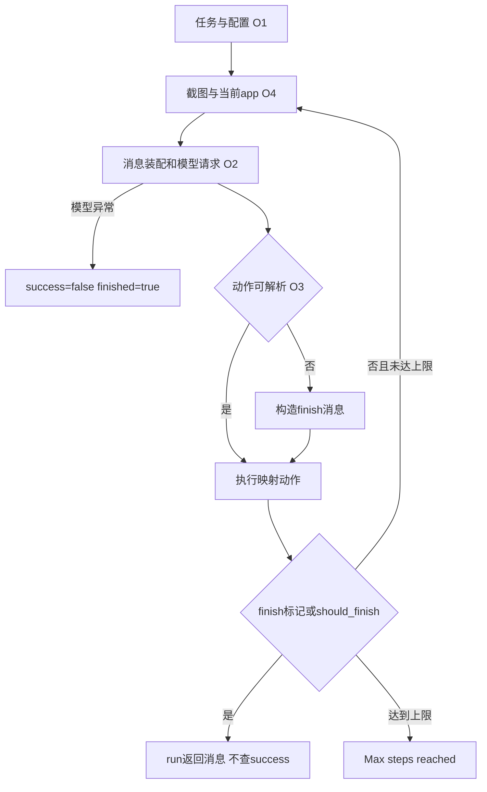
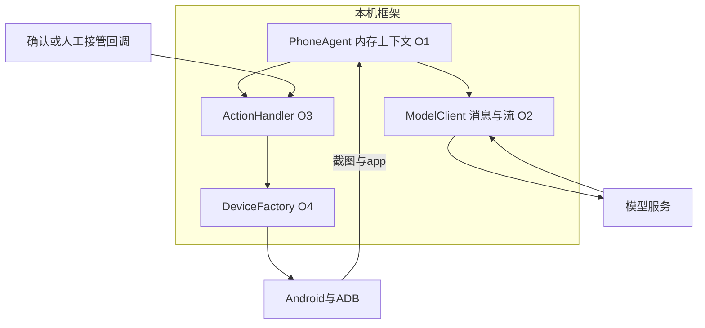

# Open-AutoGLM：结束标记与真实设备观察

2026-11-23；固定 `86f55382982fb054e8fc98ca80609dff8a2cdc3c`。源码静态核对，未连接手机、运行模型或上游脚本。研究对象是 PhoneAgent 的 Android/ADB 路线，具体提示路径取 AgentConfig(lang="en")；默认中文正文未读，不扩展为iOS、HDC或商业产品的完整实现。

## 问题与原文

屏幕Agent必须区分：模型说结束、动作执行返回成功、用户目标真的完成。解析错误和截图故障如果只被折成结束/普通图像，调用者容易丢失失败归因。适合设计GUI Harness的反馈和验收边界。

| ID | 固定原文 | 已读范围 |
| --- | --- | --- |
| O1 | [agent.py](https://github.com/zai-org/Open-AutoGLM/blob/86f55382982fb054e8fc98ca80609dff8a2cdc3c/phone_agent/agent.py) | 全文：run/step/上下文/异常/结束 |
| O2 | [model/client.py](https://github.com/zai-org/Open-AutoGLM/blob/86f55382982fb054e8fc98ca80609dff8a2cdc3c/phone_agent/model/client.py) | 全文：请求、标记解析与MessageBuilder |
| O3 | [handler.py](https://github.com/zai-org/Open-AutoGLM/blob/86f55382982fb054e8fc98ca80609dff8a2cdc3c/phone_agent/actions/handler.py) | ActionResult、execute、Tap、parse_action与默认回调；其余动作未逐行审计 |
| O4 | [device_factory](https://github.com/zai-org/Open-AutoGLM/blob/86f55382982fb054e8fc98ca80609dff8a2cdc3c/phone_agent/device_factory.py)、[ADB导出](https://github.com/zai-org/Open-AutoGLM/blob/86f55382982fb054e8fc98ca80609dff8a2cdc3c/phone_agent/adb/__init__.py)、[设备函数](https://github.com/zai-org/Open-AutoGLM/blob/86f55382982fb054e8fc98ca80609dff8a2cdc3c/phone_agent/adb/device.py)、[截图](https://github.com/zai-org/Open-AutoGLM/blob/86f55382982fb054e8fc98ca80609dff8a2cdc3c/phone_agent/adb/screenshot.py) | 工厂/导出/截图全文，设备读app、tap、launch分支 |
| O5 | [提示选择](https://github.com/zai-org/Open-AutoGLM/blob/86f55382982fb054e8fc98ca80609dff8a2cdc3c/phone_agent/config/__init__.py)、[英文提示](https://github.com/zai-org/Open-AutoGLM/blob/86f55382982fb054e8fc98ca80609dff8a2cdc3c/phone_agent/config/prompts_en.py) | 全文；不冒充默认中文已学完 |

[快照清单](../../snapshots/zai-org/Open-AutoGLM/86f55382982fb054e8fc98ca80609dff8a2cdc3c/manifest.json)和[证据](../evidence/2026-11-23/source-review.json)记录许可、哈希与依赖缺口。README及privacy_policy的开发者确认要求属于官方文档要求，不能自动当作运行时强制能力。

## 输入、输出和上下文

输入为自然语言task、AgentConfig、ModelConfig、确认/接管回调与设备。run返回最终字符串；step保留success、finished、action、thinking、message。首次模型输入为系统提示、用户任务、当前app JSON和截图data URL；后续只有新屏幕信息加截图，历史动作文本留在_context。O2发OpenAI兼容流式请求，模型文本拆为thinking/action。读到模型输出后移除该轮用户消息图片，历史文字继续积累，不能称为无限记忆或跨进程恢复。

模型文本按finish标记优先，再do，再旧answer标签解析；action解析不是远程代码执行，do分支用AST和literal_eval抽关键词，但并非完整动作schema验证。普通Type路径另有字符串截取。具体动作由ActionHandler的有限映射选择设备函数，而非模型直接执行任意Python。

## 流程图

## 架构图

模型服务可能是远端，截图和任务随请求发送；设备权限与业务写副作用发生在执行端。

## 状态、错误与恢复

解析ValueError被O1转为finish(message=原action文本)，O3的finish返回success=true、should_finish=true，故解析故障可表现为success=true/finished=true。模型请求异常则success=false/finished=true；run只检查finished，不把success作为返回门槛。外层execute若抛错，O1再执行finish(异常消息)，也可到结束路径；大多数具体动作异常已被handler内部捕成false/false，不能泛称每次设备错误都会结束。

动作结果的失败message未被追加到_context；追加的是原模型响应，下轮靠新截图/app观察，调用step者才可另外处理message。未知动作false/false也有这个边界。没有发现本链自动重规划证明、持久检查点或业务幂等键，reset/run会清空内存上下文；预算默认100步，不等于完成验收。

ADB tap忽略subprocess返回码，只要Python层没有抛错，handler便返回true/false；launch识别应用名后同样未以返回码判启动成功。下一轮观察才可能看出没生效。敏感Tap确认只在action含message键时触发；这不能证明覆盖privacy_policy要求的所有风险类别。确认拒绝会false/true，随后仍走结束打印路径，不能把庆祝日志当成功。

截图失败会生成1080×2400黑图，is_sensitive按失败类型不同；O1只读取base64/宽高，不读取该标记。图像格式正常不能证明真实屏幕可观察。get_current_app发生在模型try之前，空dumpsys输出会抛错；不是所有故障都变为StepResult。截图临时文件、设备/sdcard/tmp.png及远端请求均有副作用，应按部署边界另行验证。

## 验收、反例与对照

| 观察 | 能支持 | 不能支持 |
| --- | --- | --- |
| 模型输出不能解析后finish | 进入结束分支 | 用户目标完成 |
| ADB子进程非零但不抛异常 | 函数可能正常返回 | 点击成功 |
| 新截图为可解码黑图 | fallback图构造成功 | 当前页面已可靠观察 |
| run返回消息 | 循环结束或预算停止 | step.success与业务成功均为真 |
| Tap有确认回调 | 该分支可以征求确认 | 所有高风险动作都被判别并确认 |

对照 [UI-TARS实验SDK](ui-tars-sdk-terminal-status.md)：它可能用终止状态覆盖执行错误，Open-AutoGLM则可将解析失败转为成功finish；两者都不能只凭终态标签判断任务。UI-TARS保留error字段，Open-AutoGLM的step有success但run收窄为字符串，调用者需要保留失败类型和最终目标观察。图像窗口与移除历史图像是不同上下文策略，本批没有同预算效果实验。

本仓替代建议：解析失败返回可恢复错误，保留独立execution/observation/acceptance三类结果；不可观察屏幕先处理截图故障，终态要有业务谓词。代价是反馈字段、验证器和设备适配维护，未验证收益。

## 学习练习与接续

未运行练习：用假模型返回无效动作、假ADB返回非零码、假截图返回黑图，分别记录step字段、run字符串和进入下一轮的消息；验证是否仍能识别目标未达成。只用假数据，不连接真实设备或执行上游脚本。

下一步补中文提示、ADB输入/连接、真实设备命令返回处理、iOS/HDC、业务验收与取消路径；不能将本子链扩为完整手机Agent复现。
