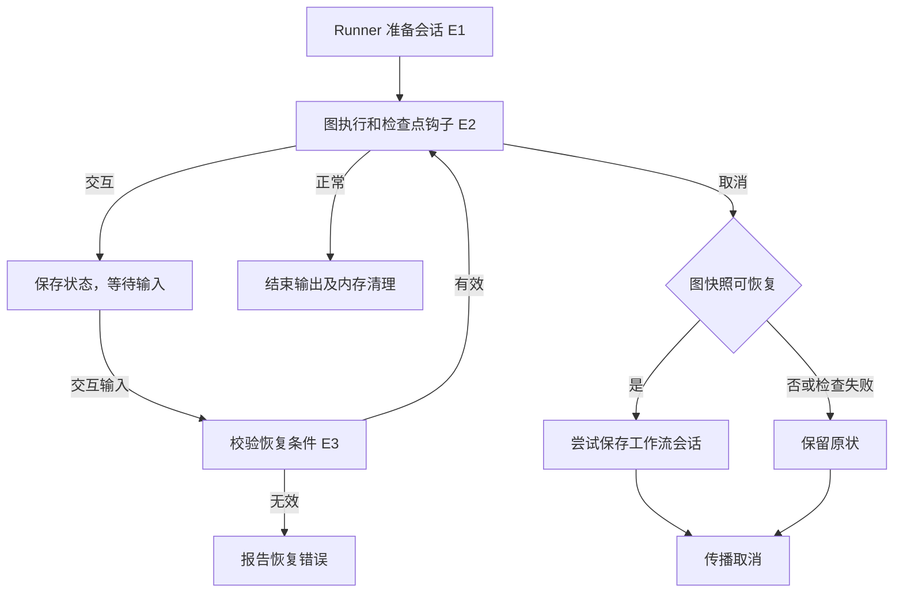
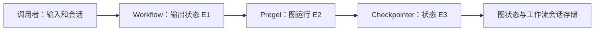

# openJiuwen 工作流取消后的恢复现场

2026-11-17，固定 `5c7c2662b7bcf3998cef975e59f75a07d3b27b22`。源码静态阅读。适用于长工作流等待人工输入或外部步骤，调用者可能取消当前执行，又希望保留已有可恢复状态的场景。

| 证据 | 固定文件 | 观察 |
| --- | --- | --- |
| E1 | [Runner](https://github.com/openJiuwen-ai/agent-core/blob/5c7c2662b7bcf3998cef975e59f75a07d3b27b22/openjiuwen/core/runner/runner.py) · [Workflow](https://github.com/openJiuwen-ai/agent-core/blob/5c7c2662b7bcf3998cef975e59f75a07d3b27b22/openjiuwen/core/workflow/workflow.py) | 输入、会话、模型上下文传给工作流，交互事件映射为 INPUT_REQUIRED |
| E2 | [CompiledGraph](https://github.com/openJiuwen-ai/agent-core/blob/5c7c2662b7bcf3998cef975e59f75a07d3b27b22/openjiuwen/core/graph/graph.py) | 串入前后检查点钩子，取消时查询图状态 |
| E3 | [内存检查点](https://github.com/openJiuwen-ai/agent-core/blob/5c7c2662b7bcf3998cef975e59f75a07d3b27b22/openjiuwen/core/session/checkpointer/inmemory.py) · [工厂](https://github.com/openJiuwen-ai/agent-core/blob/5c7c2662b7bcf3998cef975e59f75a07d3b27b22/openjiuwen/core/session/checkpointer/checkpointer.py) · [Noop](https://github.com/openJiuwen-ai/agent-core/blob/5c7c2662b7bcf3998cef975e59f75a07d3b27b22/openjiuwen/core/session/checkpointer/noop.py) | 检查点生命周期、默认内存回退及不保存实现 |

## 输入和流程

Runner 接受已注册工作流名或对象、输入、会话 ID 或会话对象和 ModelContext。工作流在图中执行组件，模型和工具的具体权限取决于所选组件，本文只核编排子链。普通输入写入会话状态，交互输入走恢复核验。同步调用遇到交互事件返回 INPUT_REQUIRED，其余正常返回 COMPLETED 及结束节点输出或流片段。

## 失败恢复与验收

捕获取消后，只有主图且图快照存在并报告可恢复时，才用异常路径触发检查点保存。读取或保存失败不会取代原始取消。内存后端收到交互输入先验证现场；已有状态但普通输入且未允许清理会报错。正常完成时清除该工作流状态，交互中断时保存状态。Noop 的会话钩子不作存取，内置图存储只活在该实例里。默认内存状态不能证明跨进程接续，更不能证明业务动作恰好一次。

对照 [Coze Loop 当前请求观测](coze-loop-current-request-observation.md)，Coze 逐次核对运行代次和发布依据；openJiuwen 这里判断是否保留执行现场。若图节点调用外部写入，业务侧仍需设计幂等键或先回读再恢复。固定版本未核完整 Pregel 和 Redis 或持久化后端，未运行模型、工具、上游项目。

练习用假图存储造三例：取消时有可恢复图快照、无快照、查询失败。预期保存尝试次数分别是 1、0、0，均传播取消。再让一个假写入在取消前完成，观察只恢复图现场能否防重复。练习未运行。
