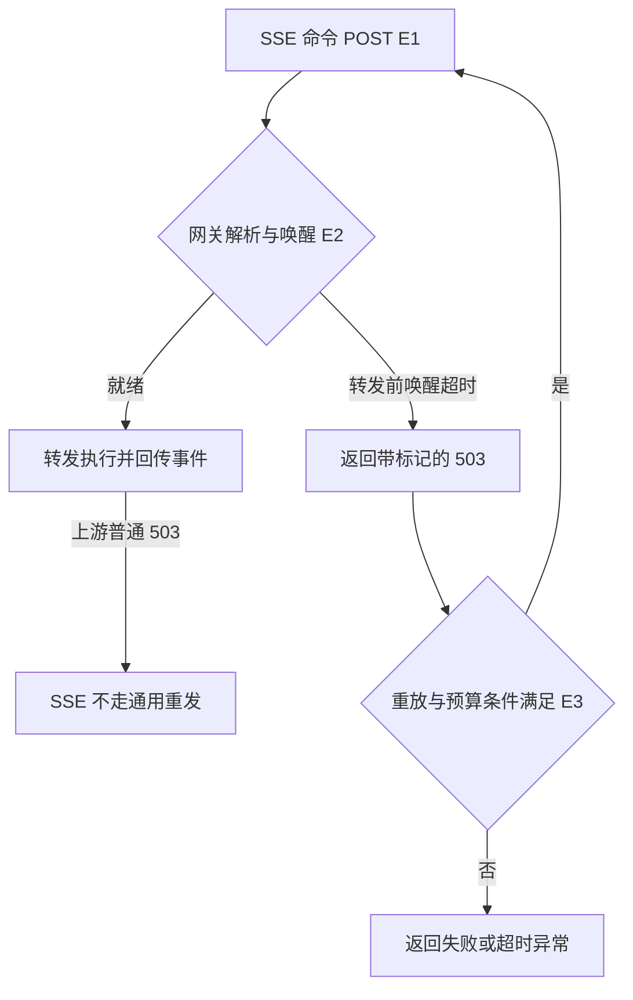

# OpenSandbox 唤醒超时与命令重发

2026-11-08，P1-01。固定版本 `1f3ec4f27432ea2386cb8b357d70d2036c11f81c`，源码及测试静态阅读。

| 证据 | 原文 | 核对范围 |
| --- | --- | --- |
| E1 | [命令适配器](https://github.com/opensandbox-group/OpenSandbox/blob/1f3ec4f27432ea2386cb8b357d70d2036c11f81c/sdks/sandbox/python/src/opensandbox/adapters/command_adapter.py) · [SSE transport](https://github.com/opensandbox-group/OpenSandbox/blob/1f3ec4f27432ea2386cb8b357d70d2036c11f81c/sdks/sandbox/python/src/opensandbox/transport/__init__.py) | SSE POST、wake-only transport |
| E2 | [网关入口](https://github.com/opensandbox-group/OpenSandbox/blob/1f3ec4f27432ea2386cb8b357d70d2036c11f81c/components/ingress/pkg/proxy/proxy.go#L133) · [标记处理](https://github.com/opensandbox-group/OpenSandbox/blob/1f3ec4f27432ea2386cb8b357d70d2036c11f81c/components/ingress/pkg/proxy/wake_marker.go) | 转发前错误分支、自有标记、剥离上游标记 |
| E3 | [分类器](https://github.com/opensandbox-group/OpenSandbox/blob/1f3ec4f27432ea2386cb8b357d70d2036c11f81c/sdks/sandbox/python/src/opensandbox/transport/_classify.py) · [异步重试](https://github.com/opensandbox-group/OpenSandbox/blob/1f3ec4f27432ea2386cb8b357d70d2036c11f81c/sdks/sandbox/python/src/opensandbox/transport/_async_retry.py) | 状态码、响应头、请求体与预算 |
| E4 | [网关测试](https://github.com/opensandbox-group/OpenSandbox/blob/1f3ec4f27432ea2386cb8b357d70d2036c11f81c/components/ingress/pkg/proxy/wake_test.go) · [SDK 测试](https://github.com/opensandbox-group/OpenSandbox/blob/1f3ec4f27432ea2386cb8b357d70d2036c11f81c/sdks/sandbox/python/tests/test_wake_retry_transport.py) | 转发前、陈旧路由、标记剥离、重试预算的断言，未执行 |

## 输入、输出和流程

宿主决定是否调用工具。SDK 用命令及参数构造 JSON，通过 SSE POST 请求 `/command`；网关做目标解析和唤醒，执行器产生事件或状态。转发前唤醒超时返回 503、`OpenSandbox-Wake: expired` 和 `Retry-After`。SDK 判定使用状态码与响应头，JSON `code` 只作诊断。流式命令只保留专门唤醒重试，且需请求体可重放、策略已开启、预算允许。预算耗尽的该分支可抛出 `SandboxWakeTimeoutException`。

## 架构、状态与信任

网关在正常 HTTP 代理响应路径去掉上游同名标记，避免执行器返回的普通失败被 SDK 误当成未转发。网关测试专门区分转发前标记与转发后陈旧路由超时。此证据依赖实际调用走受信的入口链路，代理配置、请求重放权限和不同部署组合未实测。重试不授予新的执行权限。该子链也不提供跨客户端全局去重，客户端失联后不能凭普通错误断言没有副作用。工具启动、进程结束和产物验收应分别观察。

## 对照、反例和练习

[旧版](https://github.com/opensandbox-group/OpenSandbox/blob/dc96a4698cefc59d0c7e8b393a44f1c795457f26/sdks/sandbox/python/src/opensandbox/adapters/command_adapter.py)对命令 SSE 去掉重试包装，简单保守，但没有自动利用网关的未转发证据。新版适合明确受控入口，增加网关和 SDK 对标记语义的一致性要求。另一方案是在业务执行器存幂等键和结果，支持部分发送后查询，代价是持久状态和键过期规则。本轮未测成本、延迟或收益。

练习使用假网关与副作用计数器，依次模拟普通 503、带正确头的转发前 503、只有诊断 JSON 的 503，以及不能重放的流式体。记录是否重发和执行计数。再检查普通连接断开后是否先核对执行状态和工件。仅设计，未运行。待核运行环境中的鉴权、端到端实际版本与网关代理链。
