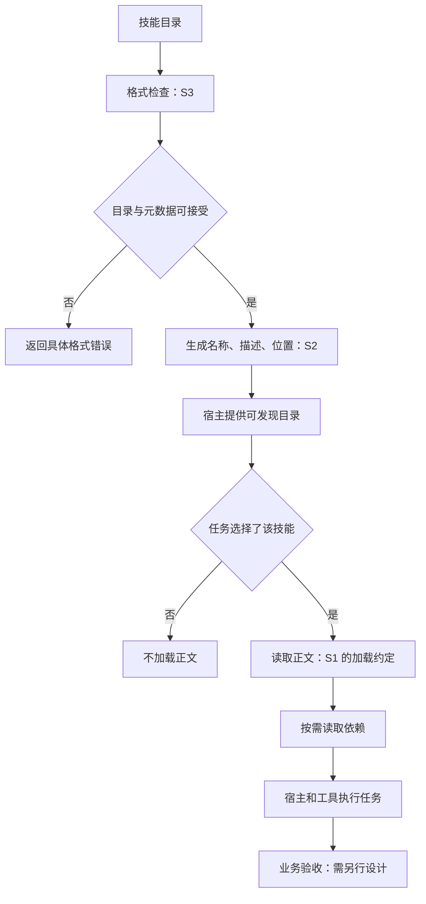
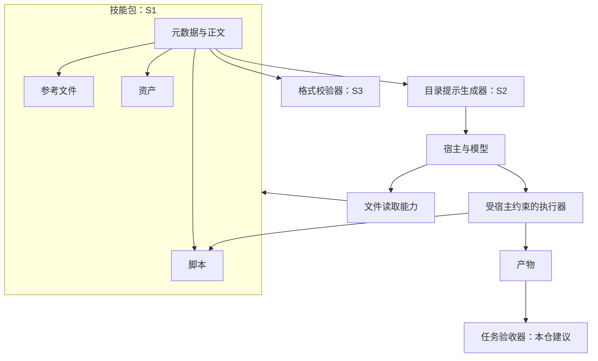

# Skill：目录格式、渐进加载和校验器到底保证什么

日期：2026-10-25。研究状态：指定规范与两份参考实现已静态阅读；未安装、未运行上游。固定仓库为 agentskills/agentskills，提交 `69ef37e9424c0a7ea9dd2293b559e43ec8176379`。三份正文和根许可证均保存于[原文快照](../originals/agentskills/agentskills/69ef37e9424c0a7ea9dd2293b559e43ec8176379/)，Apache-2.0。本次为指定文件快照，未完成该仓库整包备份。

## 解决的问题

把可复用工作方法组织成模型能发现、按需读取并配合工具执行的包。研究一个 Skill 不能只看正文是否写得长，还要看它如何被选中、依赖如何取得、输入是否满足前提、结果如何验收。

规范要求一个包含 SKILL.md 的目录；入口由 YAML 元数据和 Markdown 正文组成。name 与 description 是必填项；scripts、references、assets 是约定的可选目录。规范建议先暴露元数据，启用后读正文，再按需加载资源。这是组织与加载约定；实际宿主是否按这个顺序工作仍要读加载器。

## 证据链

| ID | 原文 | 实际核对 |
| --- | --- | --- |
| S1 | [specification.mdx](../originals/agentskills/agentskills/69ef37e9424c0a7ea9dd2293b559e43ec8176379/docs/specification.mdx) | 完整规范文件：字段、目录、加载和文件引用 |
| S2 | [prompt.py](../originals/agentskills/agentskills/69ef37e9424c0a7ea9dd2293b559e43ec8176379/skills-ref/src/skills_ref/prompt.py) | to_prompt 的元数据装配 |
| S3 | [validator.py](../originals/agentskills/agentskills/69ef37e9424c0a7ea9dd2293b559e43ec8176379/skills-ref/src/skills_ref/validator.py) | validate 与 validate_metadata 的检查范围 |

S2 的 to_prompt 接受技能目录列表，读取属性并产生包含 name、description、location 的 XML。代码对 name/description 做 HTML 转义，并不在这个函数中加入整个 SKILL.md 正文。parser 的内部实现本轮未读；不能据此证明任意宿主的完整发现与激活机制。

S3 检查目录存在、入口文件、元数据解析，以及 name、description、compatibility 的部分格式约束；它还拒绝未列入允许集合的顶层字段。阅读可见，validate_metadata 并不验证正文任务质量、引用文件是否完整、脚本是否安全或业务产物是否正确，也未在这个函数中逐值检查 metadata 和 allowed-tools。

一个值得追踪的细节：规范表格的名称描述使用小写字母、数字、连字符，正文又出现 Unicode 表述；参考实现先做 NFKC 归一化，再用 isalnum() 判断，接受范围不能简单等同 ASCII 正则。这应作为跨宿主兼容测试项，而非据此断言规范错误。

## 流程：把规范与实现边界画清楚

图中 S2/S3 是源码事实；H 之后描述规范约定与待核查宿主行为，业务验收属于我们要求补充的设计。

## 架构：包、索引、执行环境各管什么

## 与飞书业务 Skill 对照

现有[飞书原文学习笔记](../../cases/original-reading-workbook.md)把身份、对象解析、分页、异步状态等业务条件写入方法与参考资料；本规范解决包怎样描述和组织的问题。学习时需要两层都读：格式通用，但正确完成某类业务依赖领域契约。

allowed-tools 在规范中仍标为实验性，支持情况取决于实现。技能文件里出现这个字段，不足以证明运行环境真的授予或限制了工具权限。

## 怎样写自己的 Skill：本仓建议

从一个可观察任务开始，写清触发条件、输入必需项、成功产物与检查方式；把分支和易错处留在正文，把长参数表和领域知识放在 references，把重复计算放进可审查脚本。为脚本写明输入、输出、依赖、错误和副作用。

分别设计四类检查：能否正确选中；选中后是否读齐必要资料；执行结果是否满足业务约束；版本/宿主变化是否破坏方法。格式验证只是其中一个入口检查。

最小练习：准备“汇总 CSV 中指定列”的只读技能，以一份正常输入、一份缺列输入、一份空文件测试方法是否描述清楚；将 description 改得含糊，观察选择变化；移走参考文件，检查宿主能否报告真实缺失。以上是待做实验，没有运行结果。

后续：读 parser、宿主发现与激活代码；比较两种宿主的名称、allowed-tools 和依赖行为；用故障样例验证，不能把本篇静态完成状态升级为技能实跑完成。

