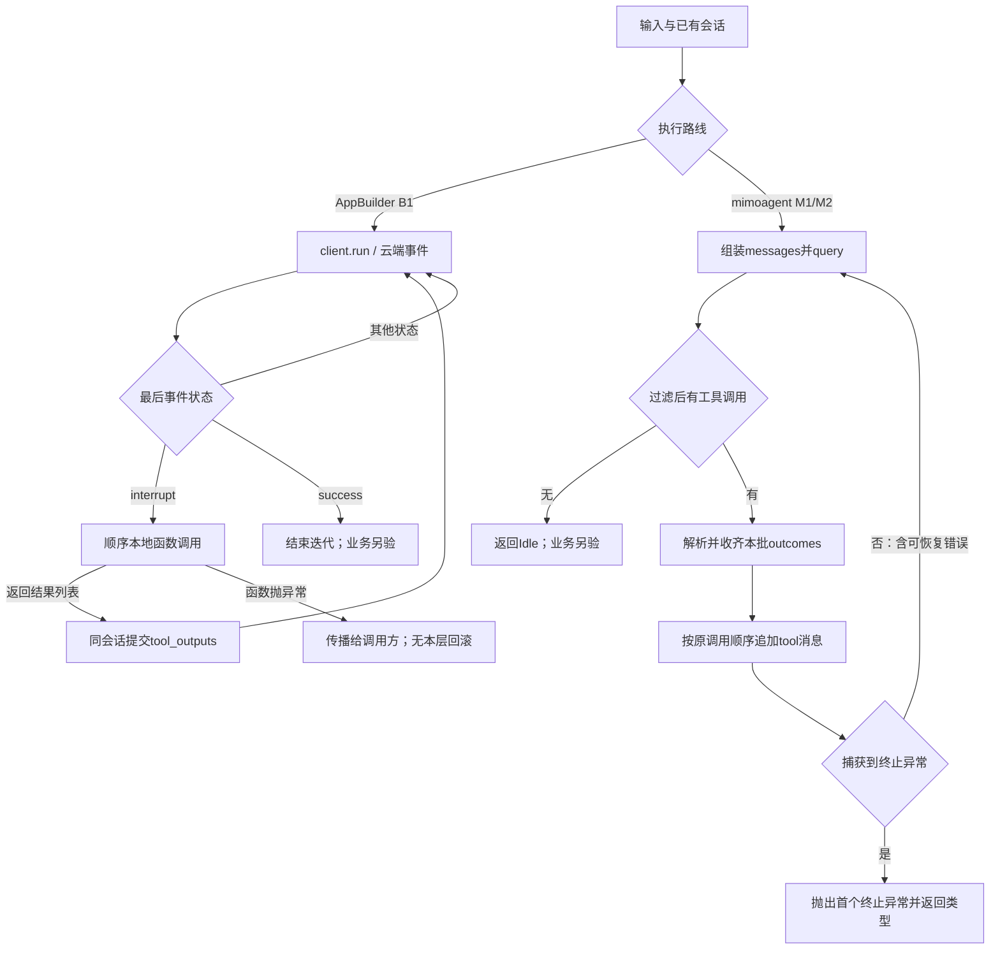
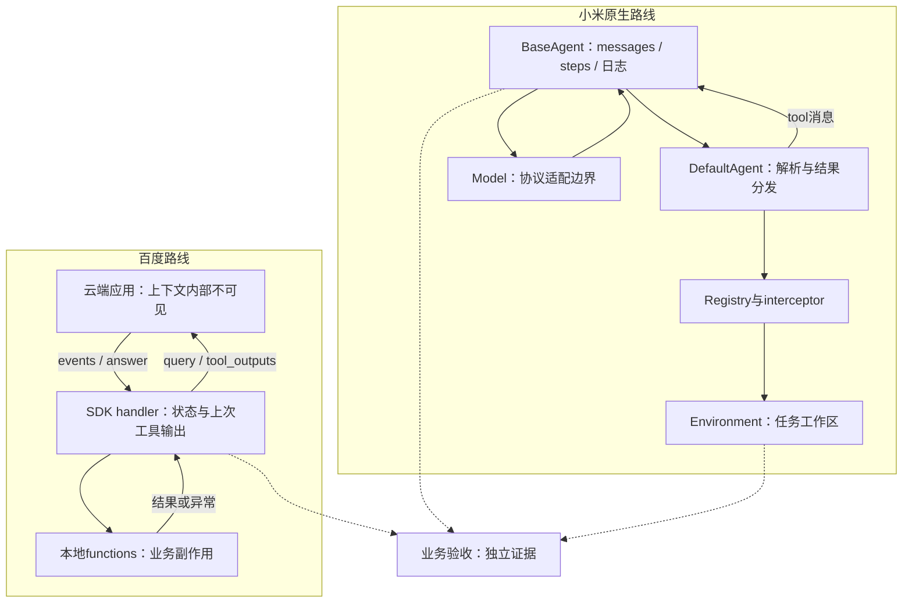

# 技术方案：工具结果配对、异常传播与结束判定

研究日期：2026-11-05；P1-01公开实现边界子单元，供P3提前参考，不代表P3已启动验收。源码静态核对，未运行模型、SDK、工具或上游测试。

## 问题与适用条件

同一轮模型提出两个工具调用，第一个已写文件，第二个失败：宿主应该把什么反馈给模型，什么时候停止，怎样避免把“循环结束”当成“任务做对”？对照百度AppBuilder同步事件处理器与小米mimoagent原生DefaultAgent。前者跨云端应用与本地函数边界，后者由本地主循环管理模型消息及工具分发；不比较未读的异步处理器或黑盒CLI。

## 固定原文与证据

下列文件均完整静态阅读，并与既有规范快照逐字读回、SHA256和Git blob核对；详细清单见[manifest](../evidence/2026-11-05/source-manifest.json)。

| ID | 固定文件 | 本轮可证明的范围 |
| --- | --- | --- |
| B1 | [AppBuilder事件处理器](../../snapshots/baidubce/app-builder/76a7316c0671900b698f9e955afb432ec9a93183/files/python/core/console/appbuilder_client/event_handler.py) | run/submit分支、回调、状态、工具结果 |
| B2 | [错误回调测试](../../snapshots/baidubce/app-builder/76a7316c0671900b698f9e955afb432ec9a93183/files/python/tests/test_appbuilder_client_toolcall_event_handler_error.py) | 上游测试输入与断言；未运行 |
| M1 | [DefaultAgent](../../snapshots/XiaomiMiMo/mimoagent/c3df8469f250b15e7906487a6d52be4c1827a509/files/src/mimoagent/agents/default.py) | 工具解析、并行、结果消息、错误分层 |
| M2 | [BaseAgent](../../snapshots/XiaomiMiMo/mimoagent/c3df8469f250b15e7906487a6d52be4c1827a509/files/src/mimoagent/agents/base.py) | 上下文首轮装配、查询、循环退出、内存与日志 |
| M3 | [README](../../snapshots/XiaomiMiMo/mimoagent/c3df8469f250b15e7906487a6d52be4c1827a509/files/README.md) | 作者描述的轨迹/评分分层；不是本轮验证器源码证据 |

Baidu固定76a7316c0671900b698f9e955afb432ec9a93183，Apache-2.0；mimoagent固定c3df8469f250b15e7906487a6d52be4c1827a509，MIT并保留mini-swe-agent版权及NOTICE第三方边界。许可和归属见[核查记录](../ownership-review-2026-11-05.md)。

## 输入、上下文、模型与输出

**B1实际字段。** 初始化接收conversation_id、query、file_ids、tools、stream、action，第一次调用client.run传入这些字段。云端返回事件后使用events最后一项的status、tool_calls更新运行上下文。interrupt回调取得每个tool_call.function.name、arguments和id，以函数名查本地functions，再以关键字参数调用。输出列表元素为tool_call_id与output；下一轮同conversation_id提交tool_outputs。云端如何把历史、工具声明和结果组装成模型请求不在这份SDK回调中，不能据此还原服务端系统提示。

**M1/M2实际字段。** 首次run(task)把配置、环境模板变量、任务变量、模型模板变量合并，再渲染system_template和instance_template；dict消息输入绕过instance模板。同实例后续run追加用户消息，保留messages和环境。query发送messages及工具定义、tool_choice=auto，保存assistant响应。工具请求使用function.name、function.arguments、id，解析为tool、params、tool_call_id。执行上下文明确含env、model和agent；结果以role=tool及调用id回到messages，供下一轮query。协议SDK如何转换这些消息尚未读。

## 流程图：已读代码分支

B1的其他事件会执行对应回调；默认回调为空。图中“业务另验”是本仓要求，不是SDK自动调用验证器。query自身失败或步数超限通过M2异常分支直接退出，未画入工具批次。

## 架构图：状态与副作用归属

虚线仅表示应交付给验收的材料；没有把未读的评分器画成已确认调用链。

## 状态、权限、副作用与恢复

B1的状态在handler实例中：_is_complete、_need_tool_call、_last_tool_output。仅success置完成，done和error是回调名称，不自动终止。interrupt置_need_tool_call后，后续走提交分支；本层没有逐工具检查点、去重账本、事务回滚或明确重试上限。本地函数抛异常时，已执行的前序副作用不会被这段代码撤销。工具未知时仅logger.error，仍附带该id及空字符串output；不能把空字符串理解成成功或“没有数据”。

B1对interrupt返回值要求list且非空，只对第一项检查是否为ToolOutput或能否构造ToolOutput，随后保留原列表。**仅证明此回调层不是全列表校验**；下游client.run、序列化和服务端可能继续验证，不能据此宣布服务器接受非法第二项。

M1在合法结构的调用列表上顺序解析单项并捕获已定义错误；多项经ThreadPoolExecutor执行，executor.map收集后按输入顺序发回结果。ToolException和普通工具异常转换为NonTerminatingException，模型可据错误继续决策；TransportError转换为InfraError。M2捕获TerminatingException并用实际类型名返回，所以文件开头列出的“三种状态”不能当封闭枚举，源码还有InfraError。

M1注释称基础设施错误立即终止，但本批执行先collect，再emit所有outcome，最后raise首个终止异常。因此**没有从这条代码链证明即时取消同批工具**；其余工具可能已产生副作用。不是已复现的并发故障，也不是所有环境都会继续运行的无条件断言。

M2的messages为内存状态；可选msg_path初始化时会截断文件，逐消息追加可读日志，对内联媒体作缩短显示。它不是本轮已证实的跨进程检查点。恢复同实例的run会延续_steps_taken，不能把新一轮调用自动算成新预算。当前step_limit=0不启用步数限额；旧cost_limit参数注释为过滤掉，不能靠类名LimitsExceeded推断有成本控制器。

权限由本地functions/工具/环境承载。M1提供执行前interceptor，但是否注册、如何授权未核实；不能把有hook等同沙箱。并发写冲突、超时取消、重放幂等、云端分页和网络重试均需各自组件的证据。没有执行任何外部业务操作。

## 验收、反例和注释反证

| 输入或情形 | 源码事实 / 静态推导 | 不能声称什么 |
| --- | --- | --- |
| Baidu已知函数抛错 | ToolCallEventHandler.interrupt无局部try；异常传播，未收齐工具结果 | 不能说所有工具均有错误回执或自动恢复 |
| Baidu未知函数 | 日志错误但仍回传空output及原id | 空输出不等于执行成功 |
| 回调返回合法首项、非法次项 | handler只检首项；下游待核查 | 不证明端到端校验绕过 |
| mimoagent一项InfraError，另一项写文件 | 先收齐本批、发结果，再抛首个终止异常 | 不保证立即停止兄弟工具或撤销写入 |
| mimoagent非空tool_calls仅含非dict元素 | query真值检查可通过，_collect_tool_calls过滤后为空，step可返回Idle | Idle不证明模型输出格式有效或任务成功 |
| 调用缺失id | _emit_outcome仅在id真值存在时附带tool_call_id | 注释“一一配对”依赖上游id完整；不是无条件协议保证 |
| B2错误测试 | 回调返回[{}]；CPU_SERIAL条件下建真实client，并只assertRaises(Exception) | 既未实跑，也不能从宽泛异常证明指定校验分支命中 |

前两类恢复应先确认副作用是否发生，再决定重试；“可恢复异常”只表示继续给模型机会，不证明业务可安全重做。业务验收至少需要调用id与结果对应、外部状态符合预期、失败被显式记录、重试不重复副作用。mimoagent README描述独立grader与reward输出，但本轮未读grader实现和数据，不评价其抗作弊或正确率。

## 横向比较与选择

| 维度 | AppBuilder handler | mimoagent DefaultAgent |
| --- | --- | --- |
| 主要控制边界 | 云端事件驱动，本地函数回传 | 本地消息循环与工具结果装配 |
| 工具调度 | 回调内顺序函数调用 | 多调用默认并行并保持输出顺序 |
| 局部失败 | 函数异常传播；未知名空结果 | 常见解析/工具错误变为模型可见反馈 |
| 正常结束 | 最后事件success | 本轮没有保留的工具调用而Idle |
| 自己仍要做 | 服务端契约核对、幂等与业务验收 | 并发策略、真实预算、持久恢复与评分核对 |

这两条路线解决不同控制权问题，不能用少量分支宣布哪家可靠性更高。替代实现是本仓建议的显式工具账本：记录call_id、参数哈希、尝试次数、执行中/已提交/失败和外部幂等键；只对允许并发的独立操作分组。它增加状态与协调成本，仍需处理业务提交成功但回执丢失的窗口，暂无实验收益。

## 学习练习与接续

未运行的受控练习：用假函数A追加本地计数、B抛指定异常，分别构造两条调用；记录调用顺序、已有副作用、模型收到的结果数量和退出类型。再输入未知工具、缺id、[非dict调用]和第二项非法的输出列表。验收应逐条比较本卡预测，禁止联网、真实凭据和业务写入；用自己的最小桩先隔离协议，再在获准环境中验证真实组件。

后续需要读取Baidu client.run/data_class/SSE与异步版本、mimoagent模型适配/工具/数据集验证器，并为批次终止、消息配对和重试窗口补受控实验。此卡完成的是公开控制边界比较，不把P1-01、两个项目或P3阶段标成完成。
