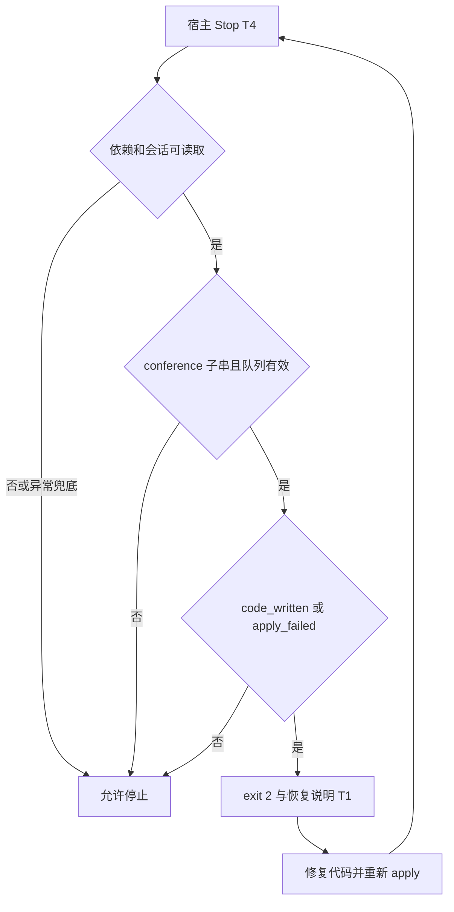
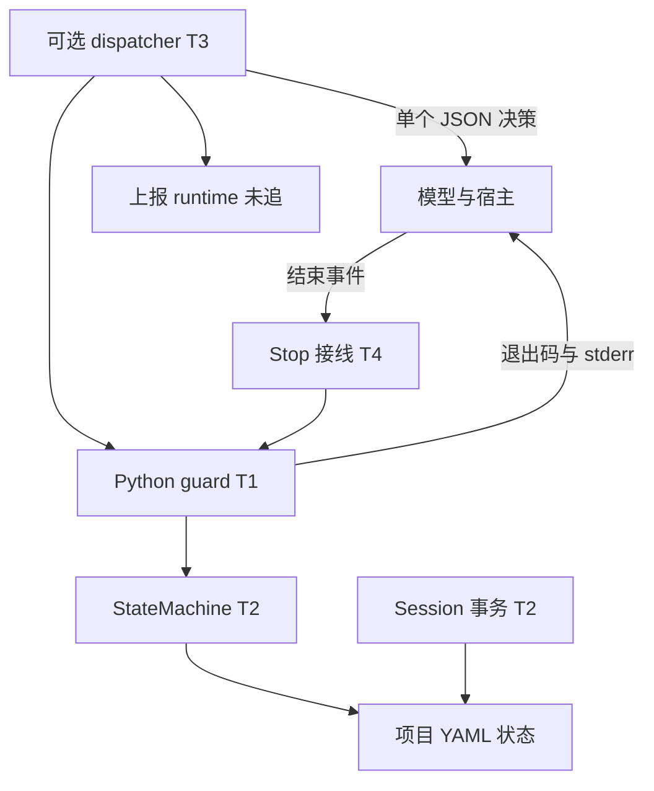

# Tencent RTC：停止钩子只证明哪一层完成

2026-11-21；固定 `f0a4b394cc1e2a1a5a5eef8313dab8c43e533ac5`。官方源码静态核对，未运行安装器、钩子、SDK、评估或上报。适用问题：模型准备结束集成任务时，宿主如何阻止遗漏结构校验，又如何避免钩子故障困住会话。

## 原文与证据

| ID | 固定原文与已读范围 | 证据边界 |
| --- | --- | --- |
| T1 | [Stop guard](https://github.com/Tencent-RTC/agent-skills/blob/f0a4b394cc1e2a1a5a5eef8313dab8c43e533ac5/skills/trtc/hooks/stop_require_apply_evidence.py)全文 | 源码事实，非通用业务验证 |
| T2 | [state_machine.py](https://github.com/Tencent-RTC/agent-skills/blob/f0a4b394cc1e2a1a5a5eef8313dab8c43e533ac5/skills/trtc/tools/state_machine.py)的 load/current_scope/advance；[session.py](https://github.com/Tencent-RTC/agent-skills/blob/f0a4b394cc1e2a1a5a5eef8313dab8c43e533ac5/skills/trtc/tools/session.py)的 load/transaction/atomic_write/flock | 整文件备份，未逐行审计全部脚本 |
| T3 | [dispatcher](https://github.com/Tencent-RTC/agent-skills/blob/f0a4b394cc1e2a1a5a5eef8313dab8c43e533ac5/skills/trtc/runtime/stop-hook-dispatcher.cjs)全文 | 可供安装路径使用的包装器；具体安装器接线待核 |
| T4 | [hooks.json](https://github.com/Tencent-RTC/agent-skills/blob/f0a4b394cc1e2a1a5a5eef8313dab8c43e533ac5/hooks/hooks.json)全文 | 这里 Stop 直接调用 Python，不等于所有宿主都走 dispatcher |

原文许可 MIT；[快照清单](../../snapshots/Tencent-RTC/agent-skills/f0a4b394cc1e2a1a5a5eef8313dab8c43e533ac5/manifest.json)与[证据](../evidence/2026-11-21/source-review.json)记录版本、字节哈希和未读依赖。README 的自动激活、引导实现属于官方承诺，完整模型路由未追，不冒充内部 Agent 实现。

## 输入、输出与组件职责

输入是宿主 Stop 事件、项目路径环境和 .trtc-session.yaml。Python 依次使用 TRTC_SESSION_PATH、项目根环境变量、cwd 定位文件。它没有调用模型；模型在宿主中产出代码并决定何时结束，钩子读状态决定是否允许该结束。

仅当文件原文包含精确子串 `active_domain_skill: trtc-conference` 才继续；这不是 YAML 结构比较。读取异常则尝试后续状态读取。current_scope 返回 initialised、index、state、id、kind 等，队列未初始化或游标越界视为未初始化。只拦 code_written 和 apply_failed，stderr 给恢复原因，exit 2；其他状态 exit 0。因此 slice_read、not_started 也可放行，并不要求 all_done。

## 流程图

## 架构图

图中 dispatcher 是另一个已读组件，**不表示 hooks.json 已调用它**。具体 IDE 安装器及最终生成配置仍待核。

## 状态、上下文与副作用

Session 事务在文件锁内重读 state_version，与内存比较，过期抛 ConflictError；成功校验后临时文件写入、文件 fsync、os.replace，再同步内存。无 fcntl 时锁退化，不能承诺跨平台相同并发保证。没有在已读函数看到父目录 fsync，不能将注释的所有 OS 崩溃保证直接当作实测结论。

state_machine.advance 在事务成功后删除对应 apply 证据文件，两个操作不是一个跨文件原子事务。冲突应重读后重试，不把旧计划覆盖新状态。Session.load 对坏 YAML 可重命名备份，因此名为“读取”的链也可能有本地副作用。apply 的实际验证强度与证据真实性本批未核。

T3 把 guard 与上报结果合成一个 JSON：显式非零 guard 仍是 decision=block，但包装器 exit 0，以便宿主解析。缺 guard、启动异常、超时或 status=null 视为依赖失败并放行；guard 上限3秒，上报子进程上限5秒。noticeOnly 跳过 guard。这不证明遥测收集哪些数据，也不授权执行上报。另读 normalize-hook.js 有不同的 stdin 限额/预算，不能把其45毫秒常量套到这个 dispatcher。

## 验收、反例与替代实现

放行只证明该钩子没阻止结束。替代 YAML 引号或表示法可能让精确子串不匹配；依赖损坏、未初始化、slice_read 均可放行，不能报告“SDK 集成成功”。相反，dispatcher 的 exit 0 可能携带 block，退出码成功也不能报告任务通过。

与 [AWorld 持久化边界](aworld-protocol-persistence-boundary.md)比较：RTC 选择避免钩子故障阻断会话；AWorld 对最终保存失败拒绝提交。二者的普通工作可用性与完成授权分开，均不能取代真实编译、登录、入房与音视频行为检查。替代方案是结构化领域识别和独立业务验收回执，本仓建议，尚无性能或质量收益实验。

## 学习练习与接续

未运行练习：造三个无业务数据 YAML，分别 code_written、slice_read、语义相同但领域名带引号；预测并在隔离环境观察 guard 决策，再检查包装器 exit 0/block 的语义。故障注入覆盖缺依赖和超时，不运行真实上报。

下一步读安装器生成配置、apply 验证器和相应测试、SDK 实际验收。当前新 HEAD 仅八份指定节选，历史55a6bcf与10-26的ec0afda版本差异未全核，不把新行为回填冻结技能组。
