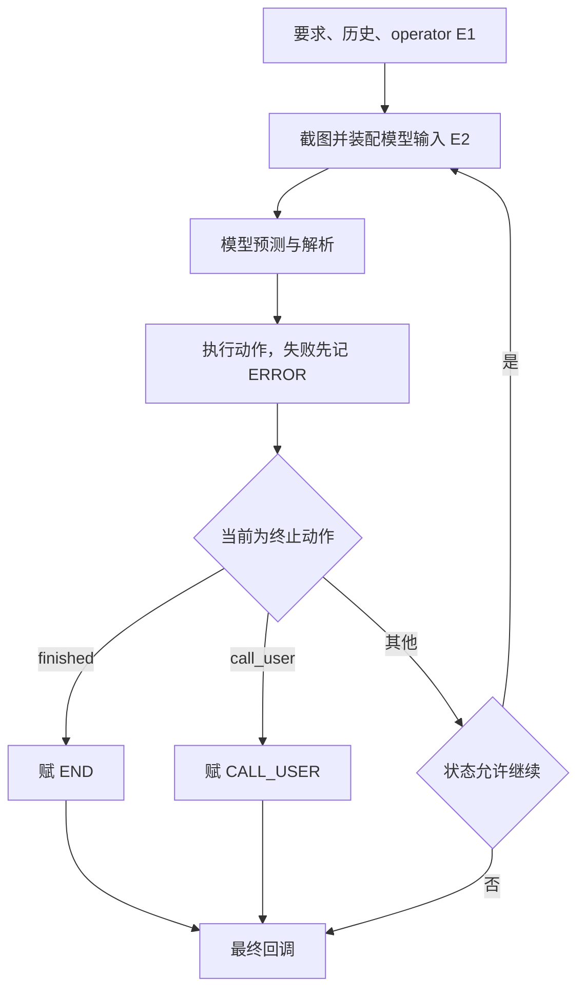
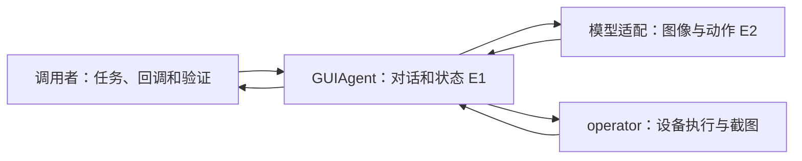

# UI-TARS 实验 SDK 的结束状态与执行证据

2026-11-19，固定 `3ac2cb8d946d78d5ff92ad17b318eaafa18c178c`，只针对 packages/ui-tars/sdk 1.2.3 的 GUIAgent。源码静态核对与独立合成演算，未运行上游。适用于调用者需要从 GUI 动作循环判断业务结果，或排查“执行器出错但任务显示结束”的场景。

| ID | 固定原文 | 可见行为 |
| --- | --- | --- |
| E1 | [GUIAgent](https://github.com/bytedance/UI-TARS-desktop/blob/3ac2cb8d946d78d5ff92ad17b318eaafa18c178c/packages/ui-tars/sdk/src/GUIAgent.ts) · [类型](https://github.com/bytedance/UI-TARS-desktop/blob/3ac2cb8d946d78d5ff92ad17b318eaafa18c178c/packages/ui-tars/sdk/src/types.ts) | 输入、截图、模型调用、执行器重试和回调 |
| E2 | [上下文转换](https://github.com/bytedance/UI-TARS-desktop/blob/3ac2cb8d946d78d5ff92ad17b318eaafa18c178c/packages/ui-tars/sdk/src/utils.ts) · [模型](https://github.com/bytedance/UI-TARS-desktop/blob/3ac2cb8d946d78d5ff92ad17b318eaafa18c178c/packages/ui-tars/sdk/src/Model.ts) | 历史与任务拼接、图像窗口、响应解析 |
| E3 | [共享状态](https://github.com/bytedance/UI-TARS-desktop/blob/3ac2cb8d946d78d5ff92ad17b318eaafa18c178c/packages/ui-tars/shared/src/types/agent.ts) · [默认常量](https://github.com/bytedance/UI-TARS-desktop/blob/3ac2cb8d946d78d5ff92ad17b318eaafa18c178c/packages/ui-tars/shared/src/constants/vlm.ts) · [包指南](https://github.com/bytedance/UI-TARS-desktop/blob/3ac2cb8d946d78d5ff92ad17b318eaafa18c178c/packages/ui-tars/sdk/README.md) | 状态枚举，默认 100 轮与指南 25 轮的差异 |
| E4 | [同提交另一 GUIAgent](https://github.com/bytedance/UI-TARS-desktop/blob/3ac2cb8d946d78d5ff92ad17b318eaafa18c178c/multimodal/gui-agent/agent-sdk/src/GUIAgent.ts) | operator 工具结果与 environment_input 事件式观察 |

输入是 instruction（用户要求）、可选历史消息、模型配置和注入 operator。默认系统提示列动作空间，也可用 operator.MANUAL 拼接。每轮截图带宽高、缩放比例，任务和历史文本加入首个用户消息。processVlmParams 将图像和对应占位消息裁到最新 5 张，旧动作文本仍保留。Model 对截图缩放后发请求，用解析器产出动作及参数，执行器承担真实点击、输入等副作用。下一轮截图作为环境反馈。

执行器错误 catch 写 ERROR 和 error 字段，之后 terminal 动作分支可以覆盖状态。若 finished 的执行器失败，最终可能保留 error 字段但 status=END；CALL_USER 也有类似分支。最终 onError 只在 status=ERROR 时调用，因而调用端应同时检查状态、错误字段和目标界面。这里是固定分支的静态推导，实际 operator 是否对终止动作抛错另测。普通动作错误后同一预测列表的其余动作是否还会执行，也需观察具体解析结果。

SDK 的异常主路径记录错误和回调，普通 await run 返回不直接代表任务成功；最终回调和清理代码自身仍可能抛错。达到上限赋 ERROR。说明写默认 25，而实际导入常量为 100。模型、截图、执行重试分别配置，默认 0；非幂等 GUI 写入若开启执行重试应先核副作用。暂停恢复只保存内存 Promise 和标志，没有证明跨进程接续。

对照同仓 E4，另一套 SDK 把执行错误包装成工具结果，截图与 URL 由 environment_input 事件回传。二者调用框架不同，尚未完成另一套框架的终止语义核查。若目标是创建文档，调用者可增加文档存在、正文正确和身份归属的外部验收。代价是业务验证器与权限维护，本次没有测收益。

合成 Node 例用总是失败的假执行器，分别处理 click、finished、call_user，得到 ERROR、END、CALL_USER，三例均残留执行错误。未导入 SDK、调用模型或操作设备。接续应在隔离假 operator 中实跑这三例，再核默认 Desktop 接线和模型解析器，保留独立的业务验收。
