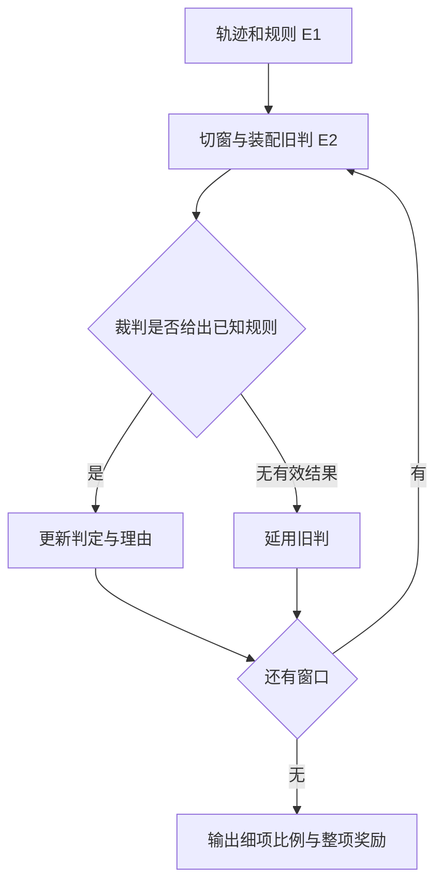
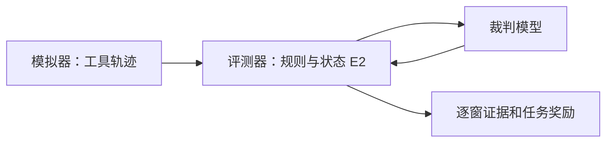

# VitaBench 1.0 的滑窗规则改判

2026-11-17，固定 `742e240855bf8686a0842360749d5ea970ea3987`，静态复核。适用于跨窗口验收，尤其是后续动作能撤销先前成功的轨迹。

| 证据 | 对应材料 |
| --- | --- |
| E1 | [入口](https://github.com/meituan-longcat/vitabench/blob/742e240855bf8686a0842360749d5ea970ea3987/src/vita/evaluator/evaluator.py) 分流指定提前结束与无规则分支 |
| E2 | [轨迹评分器](https://github.com/meituan-longcat/vitabench/blob/742e240855bf8686a0842360749d5ea970ea3987/src/vita/evaluator/evaluator_traj.py) 持有规则状态，处理已知规则的更新 |
| E3 | [arXiv v2 §3.3](https://arxiv.org/html/2509.26490v2#S3.SS3) 说明已达成项永久保存；会议正式文本待核 |

评测器的输入是任务要求、当前消息窗与旧判，工具在轨迹产生阶段已执行。这条分支直接覆盖已知规则的新真假与理由，因此不同于论文 v2 的单调状态。空解析保留原判，抛错未在此窗捕获。整项奖励要求全部细则达成，细项比例允许部分成功。这条链根据轨迹判断，环境终态参数未参与该评分函数的判断。信息留存应限制在被授权的轨迹证据范围。

对照 [Coze Loop 观测](coze-loop-current-request-observation.md)，执行记录与正确结果发布各自需要证据。对于已确认的写入可另接终态断言，澄清或建议则保留轨迹评估；两者有不同的维护开销。练习令 A、B 均通过，再用后窗撤回 A，对比两种状态策略的预期结果。未运行裁判、模拟器或复现论文，指定评分文件的归档展开仍待补。
